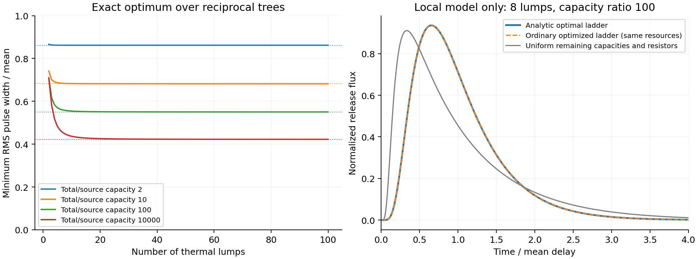

# Q17 stage 1: sharp resource law and construction for passive thermal-pulse shaping

Stage 1 completed on 2026-10-26 after approximately 27 minutes of useful work, beginning 08:26 UTC. The starting packet was read, but none of its inherited mathematical families or Astra archive was needed. Original assignment/public evidence were preserved.

**Actual outcome:** a self-contained governing theorem, an explicit attaining reciprocal thermal network, a compatible continuum limit, and executed independent numerical comparisons. A new practical thermal timing capability, verified priority, and civilisation-changing impact are **not established**. This is a complete scoped mathematical construction with an honest failure of the proposed route to economical sharply timed release.

## Question and demonstrated operations

Can ordinary passive thermal conduction and storage deliver the energy from an initially heated lump as a sharply timed heat pulse, without a powered switch or a directed heat-transfer primitive? Temporal width is defined here as the RMS width of the full normalized bath-flux waveform divided by its mean delay. It is not cycle-to-cycle timing jitter, a temperature-threshold crossing, or a guarantee about the fraction inside a narrow window.

Positive heat capacities, reciprocal conductances, thermal RC characterization, and Cauer networks are established operations. Stout and Billings' [onsemi AND8218/D, April 2006](https://www.onsemi.com/pub/Collateral/AND8218-D.PDF) describes experimental transient characterization and ordinary RC models, and warns about extrapolating unresolved short times. Our calculations are newly executed idealized models; none of their measurements is presented as our device data.

The strong same-resource incumbent is ordinary RC synthesis with free optimization of all positive capacities and resistances. We implemented multistart numerical optimization using direct matrix moment equations, giving it the same source capacity, total capacity, number of lumps, mean delay, equations, and allowed components. Uniform components are only a secondary illustration. Broader incumbent hardware already includes [mechanical thermal-pulse switching, McKay and Wang 2013](https://dspace.mit.edu/entities/publication/2026f9b5-7084-4c2f-b398-b3e42febd8f3), [passive thermal regulators, Park, Li and Weisensee 2024](https://www.nature.com/articles/s41598-024-67758-4), and [actively switched counter-flow heat release, Ye et al. 2026 preprint](https://arxiv.org/html/2608.19500v1). We do not claim to have invented storage-and-release or to outperform these architectures. Their switches, moving fluids and operating cycles are additional operations outside the fixed linear-tree comparison.

## Constructed claim

Let N positive isothermal storage lumps and a fixed bath form any tree of positive, constant, reciprocal conductances. Initially deposit all energy E at one source lump of capacity C_s; the other lumps start at bath temperature. There is no further input, changing conductance, advection, latent heat or feedback. Let C_total be the total finite capacity and R=C_total/C_s>1. The normalized output heat flux integrates to one. Its mean tau and variance sigma squared obey the sharp bound

    sigma^2/tau^2 >= 1/[1+(N-1)tanh(log R/[2(N-1)])].

This is the exact optimum over the whole tree class at prescribed N, R and tau, attained by a ladder with geometrically spaced cumulative heat capacities. Branching cannot improve it. The complete proof and all hypotheses are in [PROOF.md](PROOF.md).

The construction is explicit. For q=R^(1/(N-1)), rho=1/q, set cumulative capacity S_k=C_s*q^(k-1), C_1=C_s and C_k=S_k-S_{k-1}. Let endpoint weights w_1=w_N=1/(1+rho) and interior weights w_k=(1-rho)/(1+rho). With Z=sum w_k, the positive resistances

    r_k=tau*w_k/(Z*S_k)

give exactly the prescribed mean and attain the bound. No selective actuator is hidden in this construction. [explore.py](explore.py) compiles these components and evaluates them by independent matrix equations.

The proof is substantive beyond one fixture: the ladder variance is an exponential-kernel quadratic form in the edge delay contributions; its inverse and concavity give the global resource optimum. Collapsing every off-path tree branch preserves the mean and subtracts a proven nonnegative variance term, extending the optimum to arbitrary trees.

At fixed R, allowing arbitrarily many lumps still gives

    sigma/tau >= 1/sqrt(1+log R/2).

Consequently 20% relative RMS width requires R>=exp(48), approximately 7.02e20, and 10% requires R>=exp(198), approximately 9.78e85. Finite node counts require even more capacity; at N<=100 the 10% target is unattainable for any finite R. This is a decisive blocker for the proposed fixed linear-tree route, rather than a small unfavorable benchmark.

[CONTINUUM.md](CONTINUUM.md) supplies an ordinary exponentially flaring conductor, a finite source reservoir, and two fixed contact resistances approaching the sharp limit within one-dimensional Fourier conduction. It also gives the exact Laplace transfer function. Exponential tapering itself is established; no novelty is assigned to that shape.

## Executed matched comparison and checks

All numbers below are local computation, with full component arrays and optimizer outcomes in [numerical_results.json](numerical_results.json).

| Lumps N | Capacity ratio R | Proven optimum CV squared | Ordinary numerical synthesis CV squared |
|---:|---:|---:|---:|
| 3 | 10 | 0.490439445400826 | 0.490439445400827 |
| 4 | 100 | 0.340544961140645 | 0.340544961140679 |
| 8 | 100 | 0.310271805516982 | 0.310271805517644 |

All eight independent ordinary starts in each case reported convergence. Thus the analytic construction supplies no observed design-performance advantage over competent ordinary optimization. That comparison does not refute the general theorem; it removes a numerical-capability claim and makes the possible contribution the sharp governing law.

Direct backward moment solves agree with the analytic optimum over 24 designs spanning N=2..32 and R=2..10000 to maximum absolute error 1.60e-13 in CV squared. An additional 200 arbitrary ladders agree with the derived variance identity to relative error 6.42e-13. Across 2400 sampled trees, no bound violation occurred; the smallest sampled slack was 0.008339. An explicit branching example has unchanged mean 1.7 and a variance reduction 0.320000000000002 upon collapsing its side branch, matching the proof's 0.32 term. These computations check implementations and examples; the theorem's quantifier comes from the proof.

[graph_explore.py](graph_explore.py) additionally optimized full reciprocal graphs with 3, 4, 5 and 8 nodes from ten starts, including an embedded near-optimal ladder. The best CV squared values were respectively 0.4904394591, 0.3405455118, 0.3248897584 and 0.3102740138, just above the corresponding tree optima. [The complete exploration](looped_network_exploration.json) establishes neither global optimization nor a graph-wide capacity theorem. Looped networks are an explicit unresolved boundary.

[verify_continuum.py](verify_continuum.py) solves finite tridiagonal systems at six real/complex Laplace frequencies for each of four capacity ratios and four discretizations. Finite transforms converge to the independent continuum formula; at 512 lumps the maximum sampled absolute difference is 9.60e-6 across ratios up to 10000. Data are in [continuum_verification.json](continuum_verification.json).

## Prior art and novelty boundary

The unrestricted phase-type optimum CV squared=1/N is already proved by [Aldous and Shepp (1987), DOI 10.1080/15326348708807067](https://escholarship.org/uc/item/7w51x4rb), with [primary manuscript](https://escholarship.org/content/qt7w51x4rb/qt7w51x4rb.pdf). A directed equal-rate cascade attains it. Our initial attempt to use that cascade was rejected: reciprocal thermal links cannot be silently replaced by directed transitions. The current law adds a finite heat-capacity resource constraint and tree optimality; it must not be relabeled as invention of the Erlang principle.

[Chiclana (2026), arXiv:2605.17513v1, Appendix A](https://arxiv.org/html/2605.17513v1#A1) proves a closely adjacent reversible-chain bound in terms of effective resistance and terminal conductance. Uniformization gives its continuous-time version CV squared >=1/[1+log(R_eff*g_b)/2]. This depends on different resources. At our 8-node R=100 optimum it gives 0.2847976742, versus our sharp capacity-constrained 0.3102718055. Both are valid there; the difference is not a claim to beat a physical incumbent.

[Kandic, Reljin and Reljin (2013), DOI 10.1155/2013/691740](https://onlinelibrary.wiley.com/doi/10.1155/2013/691740) studies established RC/RLC delay and rise-time synthesis. [El-Moursy and Friedman (2007), DOI 10.1016/j.vlsi.2006.06.002](https://doi.org/10.1016/j.vlsi.2006.06.002) studies exponential interconnect shaping. These sources prevent claiming that moment-based delay analysis, reciprocal ladders, or exponential tapering are new. Their inspected statements do not establish the exact fixed-capacity-ratio theorem above. The search is not exhaustive; **priority remains unresolved**. No separate adversarial scientific audit has yet occurred in this stage.

## Missing operation and actual consequence

The original missing directed-transfer primitive has been replaced by compatible reciprocal components, and the replacement has been solved exactly. Its resource penalty prevents it from supplying the desired economical low-RMS-width capability. The continuum geometry does not evade that penalty.

A new practical heat-timing advance would have to demonstrate a whole compatible operation outside this restricted class—such as gated or phase-changing release—while measuring preparation, actuator response, off-state leakage, delivered energy, timing sensitivity, and reset costs against ordinary thermal-switch storage. Passive nonlinear regulators and active release already exist, so declaring an ideal instantaneous programmable gate would both assume the operation and miss the incumbent. This trial does not supply such a new integrated operation.

The retained scientific consequence is the exact finite-node precision/capacity frontier and its attaining construction for every linear reciprocal tree. No physical validation, universal passive-device impossibility, narrow-window energy-concentration theorem, or civilisation-changing capability is claimed.

## Reproduction

Run with the existing /usr/local/bin/python3; NumPy/SciPy perform the calculations and Matplotlib creates the figure:

    /usr/local/bin/python3 explore.py
    /usr/local/bin/python3 graph_explore.py
    /usr/local/bin/python3 verify_continuum.py
    /usr/local/bin/python3 plot_results.py

Run from this stage1 directory or use each script's absolute path. Scripts write only next to themselves. [RESEARCH_NOTES.md](RESEARCH_NOTES.md) preserves the rejected directed cascade, the reciprocal pivot, source boundaries and implementation issue. No stage2 files were changed.
