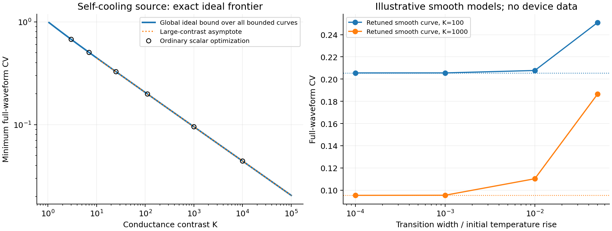

# Q17 stage 2: adversarial audit, attribution correction, and nonlinear completion

Stage2 began 2026-10-26 at 08:54 UTC. Stage1 is preserved unchanged. New tests were frozen in STRESS_SPEC.md before execution; all scripts write only in stage2.

**Actual result:** the precise finite-tree theorem survives the stress, but its ladder optimization is an application of established Ornstein--Uhlenbeck optimal-design mathematics. The continuum physical realization needs an additional geometry condition. A stronger autonomous nonlinear-switch representation was then constructed and solved globally, including leakage, giving an exact conductance-contrast/RMS-width frontier. Its ideal curve is not an experimentally calibrated device. **A new practical timing capability, verified novelty, and the mission-level advance remain NOT_ACHIEVED.**

## Strongest competing explanation and conventional incumbent

The stage1 kernel K_ij=exp(-|log S_i-log S_j|) is exactly an Ornstein--Uhlenbeck covariance matrix. Choosing normalized edge-delay contributions a_i/tau is the same quadratic problem as choosing unbiased weights for estimation of a constant mean. Ordinary generalized least squares gives K^(-1)1/(1^T K^(-1)1); ordinary optimal observation placement gives the equally spaced log-capacity positions.

The primary prior result is [Kiselak and Stehlik (2008), DOI 10.1016/j.spl.2007.12.012](https://www.sciencedirect.com/science/article/abs/pii/S0167715207004208), whose abstract establishes n-point equidistant optimality for the trend parameter. The exact mapping and its scope are in [AUDIT.md](AUDIT.md). This is an actual pre-existing mathematical method with the same information, not a universal program copying the new thermal algorithm after disclosure. The thermal capacity interpretation and tree consequence retain unresolved application-level priority, but the optimization principle is not new.

## Stress of the full claimed tree domain

[exact_stress.py](exact_stress.py) independently implements general moment equations and Gaussian elimination using rational Fractions. It imports no stage1 code. With new seed 17102602 it tests one positive rational fixture on every labelled tree with two through five storage nodes plus a bath: **1440 topologies**, including interior sources and irrelevant branches attached through the bath.

Every mean-preservation and branch-variance identity holds exactly. Every fixed-capacity covariance inequality holds. There are 1121 strictly positive branch penalties and 740 cases with irrelevant bath branches. Another **22 positive geometric-capacity designs**, N=2..12 and q=2 or 3, attain the bound exactly; ordinary GLS returns exactly the same edge-delay weights. Full retained data are in [exact_stress_results.json](exact_stress_results.json).

These fixtures were genuinely withheld from stage1 and expose cases its optimizer did not fit. They do not prove all real parameters. The all-positive-real quantifier comes from the audited shared-path Green function, the nonnegative branch penalty, positive inverse-kernel weights, tanh concavity and monotonicity; each step is detailed in AUDIT.md. No counterexample was found to the theorem at that stated scope. Looped graphs remain outside it.

## A physical qualification found in the continuum construction

For the proposed circular tapered conductor, let ell=sqrt(alpha*tau/(log R+2)) and c_v be volumetric heat capacity. Its largest radius obeys

    chi=a_max/ell=sqrt[C_total/(pi*c_v*ell^3)].

Transverse diffusion time relative to the proposed axial scale is chi squared, and the largest taper slope is chi/2. A slender one-dimensional approximation therefore requires an appropriate small chi. At fixed material, total capacity and delay, that condition cannot be obtained merely by declaring a geometrically similar conductor slender. AUDIT.md derives the corresponding time/capacity/aspect-ratio condition.

This corrects the physical reach of the preserved continuum statement. It does not damage the exact finite-tree mathematical theorem, whose ideal positive components impose fewer constraints than a specified material geometry.

## Stronger positive representation actually constructed

Instead of trying to approximate a directed cascade with ever more reciprocal storage, use an ordinary **cold-closing passive thermal contact** controlled by the source's own temperature. The reservoir cools slowly through its OFF conductance, then discharges quickly after crossing the threshold. All pre-release leakage remains part of the waveform. There is no external ideal clock.

Cold-closing zero-power switches are demonstrated operations. The inspected [Dietrich, Euler and Thummes primary manuscript, arXiv:1307.6367v2](https://arxiv.org/html/1307.6367v2) also makes clear that endpoint conductance and closure measurements occur in distinct regimes. It does not supply the ideal single-temperature response used below. No incompatible measurements have been composed into a claimed device.

The completed mathematical model has one constant-capacity reservoir and an autonomous memoryless conductance satisfying g_min<=G(T)<=g_max over the entire cooling trajectory. Let K=g_max/g_min>1. [SWITCH_PROOF.md](SWITCH_PROOF.md) proves that the exact minimum squared waveform CV, **over every measurable conductance curve in this range**, is the unique v in (0,1) satisfying

    2[atanh(v)-v] = -log(1-1/K)-1/K.

The attaining curve is a single source-temperature threshold, changing from g_min to g_max at the retained-energy fraction

    eta=(1-v)/[(1+v)(1-1/K)].

The proof does not infer global optimality from examples. Energy conservation converts the problem to an Exp(1) input under a monotone time map with bounded derivative. A signed linear functional selects one threshold over the full admissible function box; Cauchy--Schwarz supplies a global certificate. Continuous curves approach the step optimum only if sufficient transition sharpness is available.

For large K,

    minimum CV approximately (3/4)^(1/6) K^(-1/3).

Exact ideal contrast requirements for CV targets 20%, 10% and 5% are respectively **108.5353, 866.3329 and 6928.5236**. This is a different resource frontier for a different allowed operation. It is not a cost-matched physical advantage over ordinary storage and thermal switches.

The mean delay is an output of this contrast-only optimum. A desired mean tau requires C/g_min=tau/(1-eta+eta/K). The theorem does not simultaneously fix C, both absolute conductances and tau, and no free physical timescale rescaling is claimed.

## Executed conventional comparisons and consequential failure tests

[switch_stress.py](switch_stress.py) compares the formula against ordinary scalar threshold optimization on six new contrast values and independently integrates the full release density. All ordinary scalar runs converge. Their CV squared agrees with the analytic frontier to 1.3e-14; direct density quadrature agrees to 3.6e-15.

| Illustrative K | Exact ideal CV | Ordinary optimal threshold CV |
|---:|---:|---:|
| 7 | 0.50344615 | 0.50344615 |
| 111 | 0.19850500 | 0.19850500 |
| 1000 | 0.09532824 | 0.09532824 |
| 10000 | 0.04424337 | 0.04424337 |

A stronger conventional comparator, [ordinary_curve_qp.py](ordinary_curve_qp.py), optimizes arbitrary nonmonotone resistance curves on a log-temperature grid using a convex quadratic program and its own mesh refinement. It receives no analytic threshold. The best retained feasible CV squared values at K=7,111,1000 are 0.2534582379, 0.0394072631 and 0.0090875962, respectively within 2.1e-7, 3.1e-6 and 1.3e-7 of the proven full-function lower bounds. This demonstrates the same behavior through ordinary optimization over the broad curve class.

The initial K=1000 refined QP hit its iteration limit despite a feasible near-optimal objective; that flag and run are preserved in [ordinary_curve_qp_initial.json](ordinary_curve_qp_initial.json). A warm-start rerun converged but its adaptive grid gave a slightly worse discretized value; it is retained separately in [ordinary_curve_qp_results.json](ordinary_curve_qp_results.json). Neither run is advertised as a certified exact numerical optimizer. The analytic full-function proof provides the bound, and the feasible values provide ordinary incumbent constructions. Initial BLAS status warnings were removed with explicit elementwise contractions; no nonfinite result was accepted.

Finite switch transition width is a consequential failure mode. We let the conventional designer retune smooth logistic G(T) curves rather than hold the ideal threshold fixed. At K=1000, the ideal CV is 0.09533. A transition width of 1% of the initial temperature rise gives a best tested CV of **0.11028**, missing the 10% target; a width of 5% gives **0.18647**. These are illustrative model parameters, not a fit or device measurement. Complete ODE outcomes, retuned thresholds and all six contrast tests are in [switch_stress_results.json](switch_stress_results.json).

## What remains unsupplied

The ideal nonlinear route is a constructive mathematical improvement in the allowed model class, not a completed physical bridge. A real reservoir--switch--bath assembly must demonstrate the required **local** contrast and transition sharpness during self-cooling, while accounting for actuator heat capacity, hysteresis and lag, threshold repeatability, parasitic paths and reset. The global ideal theorem is useful as a necessary performance bound even when a component cannot attain it.

Threshold timing is sensitive: for small threshold error, relative delay error is approximately |delta theta|/[theta*log(1/eta)]. Deterministic waveform width and timing jitter remain distinct. Initial loading also has a cost: in the ideal cold-closing arrangement, a constant-power heater must exceed g_max*theta to cross the opening threshold. A different charging protocol could change that requirement, but loading/reset cannot simply be assumed free. These consequences are derived in SWITCH_PROOF.md.

Ordinary thermal-switch storage may already realize the same whole operation. No verified novelty for the nonlinear frontier was established in this bounded stage, and no new integrated device was measured or built. The outcome is therefore two precisely scoped governing results, stronger attribution and physical qualifications, and a concrete unresolved device operation—not an accepted consequential invention.

## Reproduction and preserved state

Use /usr/local/bin/python3 on exact_stress.py, switch_stress.py, ordinary_curve_qp.py and plot_stage2.py. All input and output paths are local to stage2. The source paper links are embedded above and in the proof/audit. A before/after content digest checks preservation only; it is not scientific validation. Stage1 remains unchanged.
