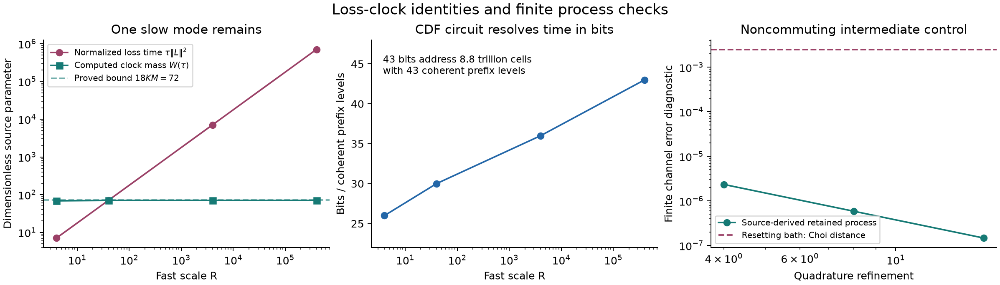

# A forward loss-clock compiler for coupled passive Gaussian memory

The second stage yields a constructive compilation principle, authored by this same sole Sol worker: process a classically described passive bosonic network through its **forward no-jump contraction and an explicitly acquired loss clock**, while the system interaction remains arbitrary and noncommuting. The resulting proposed complete-channel upper bound has only logarithmic dependence on the passive rate/frequency magnitude. It allows a coupled, nonnormal drift and rank-deficient loss, including dark modes. This is an author-derived theorem and executable finite discrimination, not an independently reviewed result or an executed fault-tolerant circuit.

The frozen first return is preserved. Ten principal authored first-stage files were checked byte-for-byte against the separate frozen copies; the result is recorded in `results/first_stage_preservation.json`. All new scientific work is in this stage directory.

## The actual operation

The input is a finite classical Hermitian one-particle matrix `H`, a finite loss factor `E`, and actual controlled block encodings for bounded system operators. Define

    A=-iH-EE^dagger/2,
    L_mu=e_mu^dagger b,
    D=H_S+sum_j Q_j(c_j b+b^dagger c_j^dagger).

The `M` modes start in vacuum and are carried through the complete process. System input may be entangled with a reference; system instruments occur at prescribed times. Put `a=sum_j q_j||c_j||`, using the actual system circuit normalizations, and let `R>=1` bound the known passive matrix norms. First compile the finite total occupation `N<=K`, then pay the first-stage infinite-Fock cutoff.

The output is the system channel, including prescribed instrument records. The retained bath and actual Markov output field are private. No weak-coupling, rotating-wave, positive damping per coordinate, simultaneous diagonalization or mixing-gap assumption is made. The result does not promise coherent public access to the old output field, arbitrary unpriced time-dependent controls, or unknown measured spectral data.

The mathematical construction is in [COMPILER_PROOF.md](COMPILER_PROOF.md). The reversible arithmetic, binary Fock gates, robust amplification and counted-moment details are in [FINITE_BIT_DETAILS.md](FINITE_BIT_DETAILS.md).

## The load-bearing identity

Set

    F(t)=exp(At),             B(t)=Gamma(F(t)),
    f(t)^2=||E^dagger F(t)||_F^2,
    J(t)=integral_0^t f(s)^2 ds=tr[I-F(t)^dagger F(t)]<=M.

`Gamma` is bosonic second quantization. The trace is over the `M` **one-particle** coordinates. With `Jcal=column_mu L_mu`, the intertwining identity gives

    a(v)Gamma(F)=Gamma(F)a(vF),
    ||Jcal B(t)||<=sqrt(K) f(t).

This supplies the jump block itself: compute the rows `e_mu^dagger F`, prepare their finite color amplitudes, rotate a normalized row to one mode, apply its binary annihilation block, rotate back, and apply `Gamma(F)` to the surviving particles. There is no loss normalization `||E||` in this acquired block.

The contraction `Gamma(F)` is acquired by second-quantizing the explicit `2M`-dimensional Julia unitary of `F` with fresh vacuum modes and using the common output-vacuum block. Small-matrix scaling/squaring, regularized positive square roots, Givens rotations and binary sparse beam-splitter simulation are all paid. No permanents, Fock-state table, supplied Gaussian oracle or inverse of dissipative evolution are used in the scalable construction.

## Noncommuting evolution and the complete source

Let `K0(t)=exp[(dGamma(A)-iD)t]`, `v=1+h+2a sqrt(K+1)`, and choose windows `tau<=1/v`. Its forward Dyson words use only contractions `B`, blocks `D/v`, and the exact phases `(-i)^k`; their total coefficient sum is at most `e<4`. Thus an explicit short source gives `K0(t)/4`, with order `q=polylog(1/error)` and time precision logarithmic in `R`.

The first physical jump is obtained by forward Duhamel:

    Jcal K0(t)=Jcal B(t)-i integral_0^t Jcal B(s)D K0(t-s)ds.

For the convolution, use a **row** time state of density `f(s)^2/J(t)` and a **column** state uniform on `[0,t]`, on the same time-index basis. Their overlap with the explicit normalized blocks gives denominator `4v sqrt(K t J(t))`; attenuation by `sqrt(J/M)` converts it to `4v sqrt(KMt)`. This earns the coefficient through an actual source circuit rather than assuming favorable normalization.

With

    w(t)^2=2K f(t)^2+32K v^2 M t,
    W(t)=2KJ(t)+16K v^2 M t^2,

the acquired stacked jump block is `Jcal K0(t)/w(t)` and

    W(tau)<=18KM,

independent of `R`. A `B`-bit clock is prepared by `B` coherent dyadic-prefix rotations. Each interval mass is a difference of the explicit `J` or `W` cumulative function, evaluated from the finite one-particle matrix. Tiny prefix masses and tiny loss directions are omitted at an absolute allocated error; the required division precision is charged. The circuit never enumerates its `2^B` cells.

The combined no-event and first-jump map is

    V_tau psi = |none>K0(tau)psi
       +sum_mu integral_0^tau |jump,t,mu>L_mu K0(t)psi sqrt(dt),
    V_tau^dagger V_tau=I.

Choose known `A0=O(sqrt(1+KM))` above `sqrt(16+18KM)`. Outer no-event mass `16/A0^2`, event density `w^2/A0^2`, and zero padding give signal block `V_tau/A0`. Complete-isometry oblivious amplification then has uniform success; no rare input-dependent event is normalized. The physical time/color stays coherent through amplification and can subsequently be measured as a private jump record. The Fock state and its system/reference entanglement remain.

This resolves the emitted-field issue in the formulation: all **inner** no-jump histories have the same physical vacuum in the discarded field, while **actual** jumps carry a common time/color record. Fresh block-failure modes are retained through their word and amplification. An arbitrary reduced free-channel dilation would not have this property. [DILATION_FAILURE.md](DILATION_FAILURE.md) preserves an exact one-photon counterexample: the correct loss-wavepacket overlap is `.5`, while separately compressing each duration gives `.6123724357`, changing an interference amplitude although every isolated interval channel is exact.

## The whole-process cap and resource consequence

Let `C` count actual emitted photons. Free passive evolution and a counted lowering jump conserve `N+C`; only the bounded linear system interaction changes it. The weighted factorial inequality gives

    E[(N+C)_k]<=(aT)^(2k),
    E exp[s(N+C)]<=exp[(aT)^2(exp(s)-1)].

This bounds the **actual** quantum process, with arbitrary reference and unconditional instrument records. It is not a state-independent waiting-time assumption. Put `lambda=(aT)^2` and take

    Jmax=O(lambda+log(1/epsilon)),
    S=O(vT+p+Jmax).

An unconditional fallback at this count cap and a backward contractive hybrid charge the exact count tail and at most `S` local source/clock/isometry errors. No approximate-process moment bound or rare-outcome normalization is assumed. Timestamp rounding and skipped tiny residual windows are charged by the finite generator norm; they increase the number of time bits, not the number of rate-resolving time slices.

A deliberately nonoptimized complete gate upper bound is

    O(S A0 {q[O~(M^2 K)+C_D]+poly(M,r,B,input bits)}),

where `C_D` is the actual cost of the supplied system/linear-interaction blocks, `q` is a logarithmic Dyson order and `B=polylog(M,K,R,v,T,1/epsilon)`. Workspace is polynomial in `M,r,log K,q,B` and actual system input size. The only direct dependence on passive stiffness is in bit precision and input length. If the supplied system circuits have a more expensive precision cost, that actual cost stays in `C_D`.

For the **already acquired first-stage bath**, `M=O(log^2(T/epsilon))`, `a` stays bounded, `R=poly(T/epsilon)` and parameter synthesis uses polynomial logarithmic guard bits. The proved vacuum cutoff has `K=O((aT)^2+log[(1+aT)/epsilon])`. Consequently this proposed consumer gives a **complete polylogarithmic inverse-accuracy upper bound at fixed horizon**, under polynomial logarithmic precision cost for the actual supplied system circuits. This includes spectrum, Fock truncation, coefficient synthesis, actual emitted-count cap, source preparation, clocks and digital gates. It is a whole-operation statement beyond mode count.

Its horizon dependence is coarse: the displayed leading Gaussian term can scale approximately as `T^5` before logarithms when the vacuum cutoff is quadratic in `T`. No near-linear-time or useful practical crossover is established.

## The comparison that survives

[PRIOR_COMPARISON.md](PRIOR_COMPARISON.md) compares the same output, horizon, inputs and accuracy against current complete pipelines. The September 2026 query-optimal consumers already achieve additive normalized-time/precision queries and near-linear gate overhead. Their time normalization contains the stacked-loss norm; after the best ordinary Gaussian Hamiltonian interaction picture it still contains `T K||EE^dagger||`. The new structural operation is the acquired trace clock and complete source, not trajectory simulation, LCU, amplification or additive query scaling. [Chen–Gao–Wang–Zhou](https://arxiv.org/html/2609.18757v1), [Wang–Ye](https://arxiv.org/html/2609.17490v2).

Direct ancilla-train simulation and positive temporal-kernel compression are legitimate nonperturbative competitors. Their published complete bounds, acquisition costs, and possible stronger Hamiltonian consumers are included. They can avoid Lindblad rate normalization by using different representations. No general separation from all such representations or certified bath reductions is claimed. [Ancilla train](https://arxiv.org/html/2509.12717v2), [kernel compression and dilution](https://arxiv.org/abs/2610.29372).

The illustrative two-mode family has a slow-mode reduction that becomes accurate at large `R`. I tested it as an ordinary comparator: at `R=400000`, its finite two-window Choi-derived diamond upper is about `2.26e-5`. Thus the stiffness plot cannot establish a practical advantage at modest accuracy. The proposed general compilation principle is the result being returned; its finite-rate arbitrary-accuracy upper bound is distinct from demonstrating a winning workload.

N1510's already accepted independent-mode result, its source interface and actual whole review are preserved. The established coupled realization is received from Huang–Park–Chan–Lin. Neither is relabeled as a discovery of this stage. Exact primary source bytes, inspected scope and the pinned Astra route are in [source_receipts.json](source_receipts.json).

## Executed finite checks

Every result below is a CPU mathematical discriminator, with its actual numerical error retained. It is not a gate-level execution or an independent proof audit.

* `loss_clock.py`: genuinely coupled rank-one-loss `A_R=[[0,sqrt(R)],[-sqrt(R),-R]]`, `R=4,40,4000,400000`, `M=2,K=2`; system `H_S=.7 sigma_z+.31 sigma_y`, interaction `sigma_x` with `c=(.12,.08i)`. One eigenvalue approaches `-1` as `R` grows. Intertwining residual is at most `2.28e-13`. Computed envelope mass stays below `72=18KM`, with `A0=16` and 16 amplification iterations throughout. Dyson order 8 has actual error below `2.11e-10` versus its `3.57e-10` tail bound. Julia vacuum blocks agree exactly at the finite matrix precision used. The 43-bit prefix source addresses 8.8 trillion leaves without enumeration. The finite source Gram errors are about `1e-5`, and their refinement is saved rather than described as exact normalization.
* `generic_gaussian_checks.py`: twelve separate complex passive networks with `M=2..4`, one to four loss ports and an exact dark-mode case. Second-quantization error is below `1.94e-14`; CDF versus positive integration residual below `1.71e-14`. Actual tilted-master-equation `N+C` MGFs at `R=4,40,4000` obey the proved bound in the tested noncommuting model.
* `retained_process_check.py`: zero/one/two-jump source-weighted quadrature per window, initial retained vacuum, two windows of length `.35`, with `exp(-.47i sigma_y)` applied to the system between them and the bath carried through. Comparison to the exact finite-cutoff Lindbladian uses the full qubit Choi matrix, including arbitrary input/reference. The numerical diamond upper from that Choi difference decreases `2.3393e-6 -> 5.8617e-7 -> 1.4661e-7` under refinement. Resetting the bath instead gives Choi trace distance `.00250734`. Finite quadrature need not be exactly TP; the constructive theorem separately provides an unconditional CPTP circuit.
* `reduction_comparator.py`: a one-mode ordinary slow-limit comparator at the same finite horizon, cutoff, system Hamiltonian and intermediate control. Its observed approach to the two-mode channel is saved and prevents an unsupported benchmark claim.

Commands and the complete result files are linked in [README.md](README.md). The exported figure is a plot of source parameters and finite channel diagnostics, **not an end-to-end runtime comparison**.

## Remaining obstacle

The source isometry, loss normalization, field bookkeeping, finite precision and actual jump cap have constructive arguments in this return. The next scientific gate is independent review of their full conjunction, especially coherent finite arithmetic and the accumulated source/clock error. Historical priority remains unknown. Establishing practical value additionally requires tightening the large cutoff/horizon overhead and comparing actual complete resources against the best certified reduction or alternate bath representation for a workload. Neither acceptance, a universally superior algorithm nor experimental capability is claimed. The first-stage two-quantum heating obstruction and lack of exact global KMS remain unchanged.
