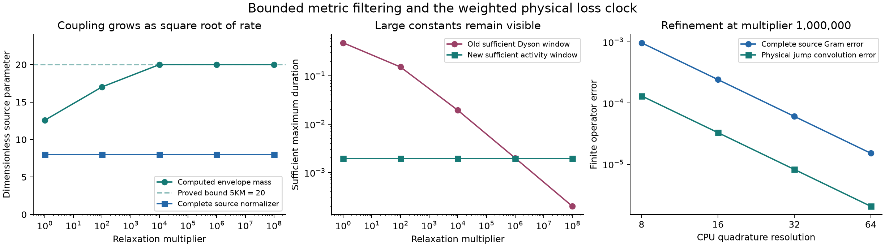

# Coupled Gaussian memory at near-linear activity

The selective sources change the baseline and lead to a stronger construction. **N1511 already earns the interacting common-loss first-event receiver, and N1512 already earns its near-linear activity schedule with actual controlled-duration accounting.** Their accepted internal reviews are preserved at their actual scope. My second-stage comparison omitted these results; the frozen report is unchanged and this return corrects that omission.

The new result is a constructive extension to a checked class of **coupled, nonnormal Gaussian memories with unequal or rank-deficient loss**. It earns a time-uniform occupation bound, an actual linear-activity emitted-count cap, a bounded-filter no-jump source using the acquired Dots scalar bridge, and an exponentially weighted physical loss clock. The complete resource envelope is near-linear in extensive activity and ordinary system action after explicit metric, mode, cutoff and precision factors. This is author-derived and still awaits independent review of the whole new conjunction.

## The additional physical interface is explicit

The model remains

    A=-iH-EE^dagger/2,  L_mu=e_mu^dagger b,
    V=sum_j Q_j(c_j b+b^dagger c_j^dagger),

with initial retained vacuum, arbitrary bounded noncommuting system operators supplied by actual circuits, arbitrary system/reference inputs, and prescribed system-only instruments with retained records. The bath and Markov output field remain private. No reset of the retained bath is introduced.

Acquire a finite one-particle certificate

    P>=I,       A^dagger P+PA<=-gamma P,       gamma>0.

It is checked from the actual classical matrices, with its precision, slack and conditioning paid. Define

    a=sum_j q_j||c_j||,
    a_P=sum_j q_j||c_j P^(1/2)||,
    a_inv=sum_j q_j||c_j P^(-1/2)||,
    mu=4a_P^2/gamma^2,
    Lambda=4a_P a_inv/gamma,
    pmax>=||P||.

The constants are not presumed favorable. Rank deficiency of EE^dagger is allowed because Hamiltonian mixing can supply decay in this metric. An exact undamped dark mode cannot satisfy the certificate and can have occupation proportional to T^2. The unrestricted second-stage construction remains available in that case.

## Occupation and actual emissions are earned

The analysis uses the positive observable `Gamma[I+(z-1)P]`, not a simulated or prepared state. Its free counted evolution is determined by the finite one-particle identity

    Phi_(0,eta,t)^dagger Gamma(R)
       =Gamma[eta I+F(t)^dagger(R-eta I)F(t)],
    F(t)=exp(At).

Together with the bounded forcing, this gives a scalar transport inequality and

    E z^N(t)<=exp[mu(z-1)]                    for all t,
    E exp(theta C_T)<=exp[Lambda T(exp(theta)-1)].

The second inequality uses the explicit tilted positive weight `R=exp(theta)I+sP`, with `s=(exp(theta)-1)a_inv/a_P`. It does not apply normalized-state log-convexity to an unnormalized tilted state. Both results are first proved on finite global cutoffs and are uniform over the admitted system controls and references.

Thus the complete-channel boundary estimate is

    error_K<=2aT sqrt(K+1)exp(mu/2)2^(-K/2),

so `K=O(1+mu+log[(1+aT)/epsilon])` suffices. Actual emissions have cap `Jmax=O(Lambda T+log(1/epsilon))`. The proof is in [METRIC_OCCUPATION_AND_ACTIVITY.md](METRIC_OCCUPATION_AND_ACTIVITY.md). Exponential quantum Lyapunov storage and characteristic-PDE methods are established priors; no priority claim is made for that general method. [Vladimirov–Petersen](https://arxiv.org/html/1205.3566v1).

## The missing activity-sized source is also constructed

Uniform occupation alone would leave the old window restriction `tau=O(1/(a sqrt(K)))`. That loses the rapid-limit benefit when coupling grows as sqrt(relaxation). The source needed a further construction.

Use the bounded metric filter

    Z=I+P/(K pmax),       S=Gamma(Z^(1/2)),
    kappa=gamma/(2K pmax),
    C=Z^(1/2)A Z^(-1/2)+(kappa/2)I.

Then `C+C^dagger<=0`, `||S||<sqrt(e)`, and `||S^(-1)||<=1`. The filters are explicit binary-occupation amplitude circuits and small-matrix basis rotations. Filtering directly by P would cost an exponential factor in K; using Z close to I avoids that failure.

The transformed free no-jump word factors into scalar number decay, `Gamma(exp(Ct))`, and the actual system unitary. The transformed raising/lowering maps are generally not adjoints, but each is separately acquired with its proved grade norm. These exact contraction-word interfaces match the parts of the **acquired N1511 immigration-death bridge** that are used. Its scalar rates are `death=kappa/2`, `immigration=2g^2/kappa`, with `g<=sqrt(2)a`. Replacing the old within-sector unitary by the explicit number-preserving Gaussian contraction preserves the Dyson/Schur argument. The physical block is reconstructed by the bounded filter sandwich, giving `K0(t)/4`.

This is not a physical identification with a common-loss bath: the similarity need not preserve canonical mode relations or a Lindblad generator. Only the completed original-coordinate physical first-event map is amplified.

The physical jump clock is newly weighted. Define

    Jw(t)=integral_0^t exp(kappa s/2)||E^dagger F(s)||_F^2 ds<=3M,
    Iw(t)=integral_0^t exp(-kappa s/2)ds<=2/kappa.

Use their normalized densities as row and column time sources on the same index basis. Their exponential factors cancel in the overlap. This acquires the physical jump convolution without the old sqrt(t) normalization penalty. Jw is computed from a finite M-dimensional shifted Lyapunov equation and matrix exponential; dyadic-prefix rotations prepare its time state without enumerating a time grid.

An explicit outer envelope has

    w(t)^2=2K||E^dagger F(t)||_F^2
                  +768a^2 K(K+1)M/kappa,
    integral_0^tau w(t)^2dt<=5KM

on windows `tau<=kappa/[256a^2(K+1)]`. The complete no-event/event source therefore has normalization `A0=O(sqrt(1+KM))`, independent of passive rate magnitude. Actual time/color remains coherent through amplification; retained bath memory and all input/reference coherence survive.

The construction and its exact source transfer are in [ACTIVITY_COMPILER.md](ACTIVITY_COMPILER.md). Finite arithmetic, clock, cap and error composition are in [PRECISION_AND_COST.md](PRECISION_AND_COST.md).

## Complete resource consequence and its limits

A dyadic maximum duration also accounts for the known control/count cap, giving

    S_calls=O(a^2 K(K+1)pmax T/gamma
                      +Lambda T+p+log(1/epsilon)+1),
    S_calls*tau=O(T).

Since `a_P a_inv>=a^2`, the first extensive term is at most a polynomial in K,pmax times `Lambda T`. The virtual scalar event cap is `O(K+log(S_calls/epsilon))`; its candidate immigration mean is bounded on every window. There is no rate-sized source loop.

Every Gaussian dwell/filter has its actual finite-matrix and binary Fock circuit. Every system slot executes its full binary controlled-duration circuit. Following the valid N1512 argument, their actual fixed durations sum to at most tau **per slot**; hence ordinary system action contributes `hT`, with the amplification/word factors explicit, rather than being multiplied by sampled activity. Actual per-query costs remain paid.

A safe whole bound has the form

    [1+Lambda T+hT+p]
       *poly(M,K,pmax,input lengths,logarithmic rate/precision lengths),

with the real encoding gate costs retained. When mu and pmax are bounded, `K=O(1+log[(1+aT)/epsilon])`. In the fully rapid scaling `A->rho A`, `E->sqrt(rho)E`, `c->sqrt(rho)c`, Lambda stays fixed and mu decreases as 1/rho. The source no longer incurs a sqrt(rho) window loop; the complete cutoff/window can still change through logarithms of rho. If desired H_S=0 can be chosen; the claimed source benefit does not require pre-existing closed-system Hamiltonian action.

The result does not receive N1511's arbitrary nonlinear number-preserving reservoir Hamiltonians. Nor has a favorable bounded metric been earned for the gapless first-stage continuum hierarchy as its fit changes. The new near-linear activity result is a **certified finite-network subclass theorem**; the previous fixed-horizon continuum inverse-accuracy consequence stays at its original scope.

## Executed discriminators

The new programs check actual finite matrices and amplitudes, not an implemented scalable circuit or independent proof audit.

* [metric_checks.py](metric_checks.py) verifies the occupation and count operator inequalities, the free counted Gamma identity, and actual controlled-process MGFs. It includes six separately generated complex multi-port networks with two noncommuting coupling operators, as well as the rank-one stiffness family. Positive slack remains in every tested operator inequality. Unfavorable acquired metrics are retained, including mu approximately `3.19e7`; stability alone is not advertised as a useful certificate.
* [activity_source_checks.py](activity_source_checks.py) checks the new bounded filters, independently assembled non-Hermitian directions, scalar sector majorant, weighted CDF, cross-time convolution and complete first-event Gram matrix. In the rank-one coupled family, relaxation multipliers range from 1 to `1e8` while coupling grows as sqrt(multiplier). The conservative new window remains `.001956255`, complete normalization remains 8, and envelope mass stays at most `20=5KM`. Physical no-jump reconstruction error is at most `3.14e-10`; the weighted CDF agrees with independent positive integration to below `7e-15`. The instantaneous transformed-generator residual reaches `1.94e-6` at matrix norm about `4.10e9`, and is recorded without hiding it.
* At multiplier `1e6`, increasing quadrature resolution `8 -> 16 -> 32 -> 64` reduces the source Gram error `9.64e-4 -> 2.41e-4 -> 6.04e-5 -> 1.51e-5`, and physical jump-convolution error `1.31e-4 -> 3.28e-5 -> 8.20e-6 -> 2.05e-6`. Finite quadrature is not called exactly normalized.

These checks support the construction and distinguish its repaired normalization. They do not establish a winning runtime. The scalar example is small enough for dense evolution, and an ordinary reduced model may win above its certified finite-rate error. Current query-optimal consumers, direct ancilla trains, positive kernel compression and acquired history-aware/adiabatic reductions remain strong complete alternatives; no universal separation is proved.

The plot shows sufficient source parameters and CPU amplitude diagnostics. Its window comparison is not a gate or runtime crossover. The conservative constants are deliberately visible.

## What remains open

[TRANSFER_AND_FAILURES.md](TRANSFER_AND_FAILURES.md) gives the corrected source comparison, failed direct transfers, dark/slow-mode obstructions and the linked pure-return interface check. The strongest result returned is the explicit broader **activity compiler**, rather than a new parameter sweep or a new name for the old common-loss theorem. The remaining scientific gate is independent review of the full metric/filter/source/clock/finite-bit conjunction and historical priority. Practical value still requires tightened constants and a matched full-resource crossover against the best acquired alternate representation or reduction.

Eleven principal second-stage authored files match the independent frozen copy. No old authored result, source or frozen snapshot was edited. Exact new-source receipts and the retained review-member identity distinction are in [source_receipts.json](source_receipts.json).
