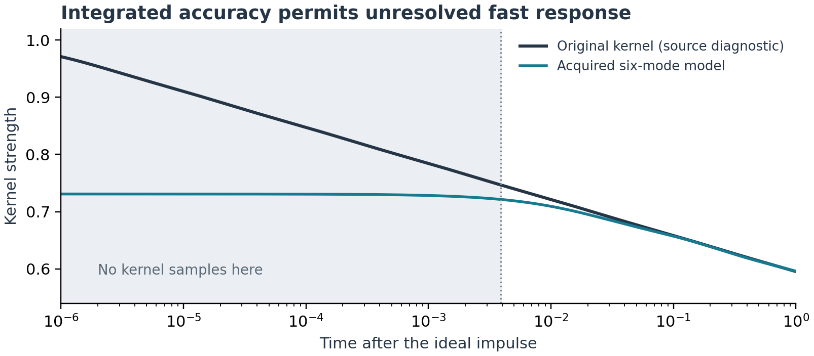
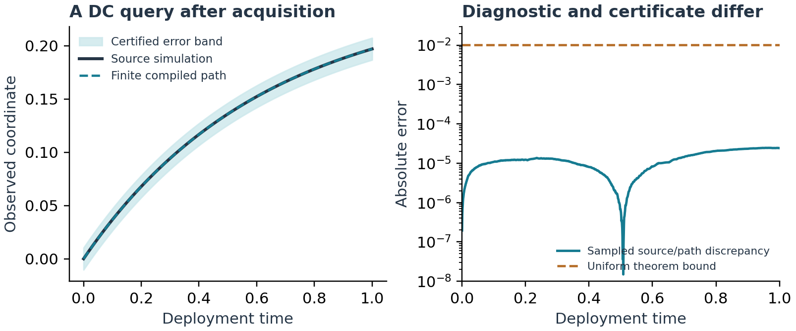

# Result and status

This report constructs a complete measurement-to-prediction operation for an observed coordinate coupled to an unknown passive relaxation environment. The hidden environment can have arbitrarily many modes, arbitrarily slow or fast rates, and a genuinely frozen component. Its physical interaction family, total coupling bound, initial energy bound, and accessible mechanical port are declared resources.

The operation uses a finite moving trap and finite force and position averages. It learns a positive exponential model, measures the old force left in the retained apparatus, and executes a small nonlinear predictor. One confidence event supports every later admissible drive on a chosen finite horizon. The environment is never reset.

The main output is the certificate

$$
\boxed{\quad
\|x-\widetilde q\|_{\infty,[0,T]}
\le
\max\left\{\delta_{\rm in},\,
\frac{\zeta\,\|\dot{\widetilde q}\|_\infty+\gamma+
      \|\rho\|_\infty+\xi_f}{\mu}\right\}.
\quad}                                                    \tag{1}
$$

Here $\zeta$ is the acquired kernel error, $\gamma$ is the measured initial-force error, $\delta_{\rm in}$ includes the finite release from the trap, $\rho$ is the actual residual of the finite numerical trajectory, and $\xi_f$ is the bounded drive-delivery error. Each quantity is earned by an operation below. None is a statement that unknown omitted physical mechanisms have been excluded.

The small positive-model representation and its logarithmic-squared mode count have substantial prior theory. The potentially distinct contribution is the complete physical acquisition and initialization interface, together with an unfiltered nonlinear trajectory guarantee. This report does not establish a civilisation-changing consequence or a practical advantage over every conventional identification method. It does establish a finite, auditable operation for the stated class. Its conservative acquisition costs can be very large.

The proofs are analytic. The package also contains exact rational checks of the emitted model and numerical illustrations of the physical protocol. It does not contain a physical prototype or interval-validated integration of an unknown apparatus.

# 1. How the programme was selected

Independent constructions began with materially different questions.

The backward line started from uniform prediction of equilibrium responses. It obtained a smooth strongly convex family with an exponential acquisition obstruction, and a positive sparse-quadratic reconstruction theorem with an executed finite certificate. The latter substantially overlaps established compressed network reconstruction; its support-search cost also remains exponential in the declared sparsity. It was not promoted as a flagship result.

The forward line began with actual conditional samples and invertible transport maps. It constructed an adaptive race whose accepted phase labels have the exact equilibrium probabilities even while the map changes predictably. When the required conditional sampling operations were completed for a concrete family, ordinary rejection sampling matched or dominated the full configuration cost. Exactness did not earn a metastability breakthrough.

A third construction exposed a related acquisition obstruction: even an analytic, one-direction ridge representation can hide its useful direction at exponential absolute-noise exposure. Low description complexity alone does not make the description observable.

Those results, their programs, and their useful failures are preserved. They motivated a more specific endpoint: acquire a model from a physical class whose positivity and analyticity can actually control the unresolved hidden modes. The accepted Astra passive-memory residual theorem supplies a reusable stability identity. The previously completed N1688 thermal feedback simulator supplies a strong comparison, including no-reset acquisition, but operates through a different matched-pulse interface. Neither supplies the unfiltered nonlinear operation claimed here [1,2].

The two constructive lines were then brought together through explicit contracts:

1. finite actuator and meter operations produce simultaneous intervals for a filtered positive kernel;
2. finite positive fitting turns those intervals into a stored model and an integrated kernel certificate;
3. a new finite hold and readout measures the old force that remains in the same apparatus;
4. a finite numerical compiler supplies a path, its speed, and its residual;
5. the comparison theorem transfers the model path to the physical path.

# 2. Physical class, access, and premises

## 2.1 An explicit mechanical realization

Consider an overdamped observed coordinate $x$, with a calibrated local drag normalized to one, a known restoring potential $V$, and hidden spring-dashpot branches:

$$
\dot x=-V'(x)-\int (x-y_\lambda)\,\nu(d\lambda)+f,
\qquad
\dot y_\lambda=\lambda(x-y_\lambda).                         \tag{2}
$$

A discrete branch has stiffness $b_i$, dashpot coefficient $b_i/\lambda_i$, and force $b_i(y_i-x)$. A zero-rate branch is an elastic spring to a fixed, possibly displaced anchor. A positive measure is the continuum version of the same model.

Assume

$$
\nu\ge0,\qquad \nu([0,\infty))\le B,\qquad
V''\ge\mu>0,                                                \tag{3}
$$

where the derivative inequality can be interpreted through strong monotonicity. A computable local upper Lipschitz bound for $V'$ is also supplied wherever numerical evaluation or metrology needs it. The initial energy satisfies

$$
E_{\rm bath}(0)=\frac12\int |x(0)-y_\lambda(0)|^2\nu(d\lambda)
\le E_0.                                                    \tag{4}
$$

There is no supplied hidden dimension, no positive lower relaxation rate, no largest rate, and no bound on a rate moment. The energy bound may nevertheless grow with the physical volume.

This class is passive for a direct reason:

$$
\frac{d}{dt}\left[
V(x)+\frac12\int (x-y_\lambda)^2\nu(d\lambda)
\right]
=f\dot x-\dot x^2-\int\lambda(x-y_\lambda)^2\nu(d\lambda).
                                                               \tag{5}
$$

Passivity alone is broader than this class. Oscillatory passive environments, active elements, nonlinear hidden branches, unknown local drag, and arbitrary thermal path laws are not included merely because a fitted response looks passive. Conditions (2)--(4) are physical premises, not conclusions of finitely many observations.

## 2.2 Available operations

The apparatus has a calibrated trap attached to $x$:

$$
f=k(q-x).
$$

Its center $q(t)$ can follow a specified finite smooth program with declared position error, speed, acceleration, force, and timing bounds. Fixed stiffness suffices for acquisition. Untrapped deployment additionally requires a finite release operation. Here the stiffness can be ramped to zero with a declared finite slew; any residual force after release belongs in $\xi_f$.

The later additive drive is a separate supplied operation. In this mechanical realization it is implemented by moving the anchor $r(t)$ of the calibrated local viscous support while leaving the hidden branches and $V$ in their laboratory frame. Its force is $\Gamma(\dot r-\dot x)$; with the normalized $\Gamma=1$, the additive input is $f=\dot r$. Thus a bounded, continuous piecewise-Lipschitz force program is physically a bounded support velocity and acceleration program, with a finite travel bill. This selective coupling is not inferred from the existence of a movable trap. Its velocity and drag-calibration errors are converted to the explicit force allowance $\xi_f$.

The meters return finite-bin averages of applied force and observed position. Their calibration and digitization biases are bounded by $\epsilon_f,\epsilon_x$. In the white-readout model, independent time increments have noise densities $v_f,v_x$, so a bin of duration $d$ has mean-noise variance $v_f/d$ or $v_x/d$. Conditional sub-Gaussian versions suffice. Shared and overlapping windows need not be independent.

The model assumes that meter backaction is absent or already represented by a supplied force-error budget. Nonvanishing bandwidth, calibration, or actuator errors create accuracy floors; averaging does not remove them.

Gaussian readout is not an infinite-range, infinite-precision digital primitive. For $Q$ raw bins, mean bound $M_0$, and noise standard deviation at most $s$, a finite ADC range
$M_0+s\sqrt{2\log(2Q/\alpha_{\rm ov})}$ suffices except on an explicitly budgeted overflow event. The quantization step is chosen within the displayed deterministic meter allowance. An overflow produces a failure flag. The joint confidence subtracts this failure budget as well as the acquisition and initialization budgets.

Reliable finite classical arithmetic, force-law evaluation, and stored control programs are computational resources. The representation count below is not a claim that their implementation, error protection, or physical energy consumption is free.

## 2.3 Kernel and old force

Define

$$
K(t)=\int e^{-\lambda t}\nu(d\lambda).
$$

Relative to a reference $x_r$, the exact position-memory form is

$$
\dot x+V'(x)+P_K(x-x_r)=f+g_r(t),\qquad
P_K u=K(0)u-(-K')*u,                                      \tag{6}
$$

where $g_r(t)=\int e^{-\lambda t}(y_\lambda(0)-x_r)\nu(d\lambda)$.
If $x(0)=x_r$, then $P_K(x-x_r)=K*\dot x$.

The old force and the kernel are different unknown objects. Acquiring $K$ does not identify or erase $g_r$.

# 3. Finite physical acquisition

## 3.1 Tracking with a real trap

Let the reference command be $x_r+u(t)$, with $u(0)=0$, $|u|\le A$. A useful programmed trap is

$$
q=x_r+u+\frac{\dot u+V'(x_r)}{k}.                            \tag{7}
$$

The velocity in (7) is the derivative of the known program, not a measurement of the unknown specimen velocity. If $e=x-x_r-u$, then

$$
\dot e+k e+[V'(x_r+u+e)-V'(x_r+u)]+K*\dot e
=-[g_0+K*\dot u+V'(x_r+u)-V'(x_r)].
$$

For a globally bounded command, $\|K*\dot u\|_\infty\le2BA$. If the initial signed-force envelope is $G_z$ and

$$
\Phi(A)=\max_{\pm}|V'(x_r\pm A)-V'(x_r)|,\qquad
D=G_z+2BA+\Phi(A)+\epsilon_{\rm act},
$$

the scalar maximum principle gives

$$
\|e\|_\infty\le
\max\{|e(0)|,D/(k+\mu)\}.                                  \tag{8}
$$

An actual center error $\epsilon_q$ contributes at most $k\epsilon_q$ to $\epsilon_{\rm act}$.

Initial alignment is finite. With an already operating trap center $q_0$, solve the known scalar equation $x_r+V'(x_r)/k=q_0$ to its paid precision. If $d_0$ bounds initial position error, put
$R_0=\max\{d_0,G_z/(k+\mu)\}$ and $G_{\rm prep}=G_z+2BR_0$.
Holding the same center gives the safe bound

$$
|x(t)-x_r|
\le d_0e^{-(k+\mu)t}+\frac{G_{\rm prep}}{k+\mu}.              \tag{9}
$$

Choose stiffness and wait so the right side is below the tracking tolerance. The force bound during this preparation can be as large as $|V'(x_r)|+kR_0$; it must fit the actuator. No hidden rate is used in the waiting formula.

For a ramp $u=A S(t/h)$, use a symmetric smoothstep with nonnegative derivative. The quintic $S(s)=10s^3-15s^4+6s^5$ has

$$
U=\frac{15A}{8h},\quad
U_2=\frac{10\sqrt3 A}{3h^2},\quad U_3\le\frac{60A}{h^3}.
$$

Equation (7) therefore has speed at most $U+U_2/k$, acceleration at most $U_2+U_3/k$, and force at most $|V'(x_r)|+U+k\delta_x$. Its acceleration has finite jumps at quintic splices. If continuous acceleration is required, the septic
$35s^4-84s^5+70s^6-20s^7$ supplies it, with constants $35/16$, $84/(5\sqrt5)$, and $105/2$ for the first three derivative bounds.

These formulas allow a check against actual hardware caps. Reducing amplitude as $A=O(h^2)$ can respect fixed speed and acceleration caps as the pulse shortens, but substantially increases the precision and sampling cost. Fixed stiffness and fixed center resolution still impose a floor.

## 3.2 A finite observable without a velocity meter

On a hold at command value $a$, use a triangular test $\psi$ of height one over $[t,t+2w]$, rising for $w$ and falling for $w$. Two position box averages obey

$$
\frac1w\int\psi(s)\dot x(s)\,ds=\frac{X_R-X_L}{w}.
$$

Split each half into $n$ force boxes. If $F_r$ are their force averages and
$a_r=\psi(\text{midpoint}_r)/n$, then $\sum a_r=1$, and

$$
R=\sum_{r=1}^{2n}a_rF_r-V'(a)-\frac{X_R-X_L}{w}              \tag{10}
$$

measures the normalized triangular average of the resistance force
$\int(x-y_\lambda)d\nu$. The finite force weighting has error at most $F_{\rm hold}/n$. The nonlinear subtraction error is at most
$\Omega_V(\delta_x)$, a computable modulus for $V'$ around the commanded holds.

For one residual, a deterministic meter allowance is

$$
b_{\rm met}=
\Omega_V(\delta_x)+\epsilon_V+\epsilon_f+
\frac{2\epsilon_x}{w}+\frac{F_{\rm hold}}n.
$$

Its white-readout variance is at most

$$
v_{\rm met}=\frac{2v_f}{3w}+\frac{2v_x}{w^3}.                \tag{11}
$$

The $w^{-3}$ position term is real. It is the cost of extracting an integrated derivative from noisy positions.

The windows can start at arbitrary finite rational times. A lattice of uniformly spaced kernel samples is unnecessary. Merging their finite box endpoints gives an executable finite observation schedule. Cumulative meter integrals and per-window accumulators avoid storing the full raw record.

## 3.3 Filtering does not require deconvolution

After the positive ramp, the response in (10) contains

$$
K_*(t)=\int e^{-\lambda t}c_h(\lambda)d_w(\lambda)\nu(d\lambda),
$$

where

$$
c_h(\lambda)=\int_0^h\frac{S'(s/h)}h e^{-\lambda(h-s)}ds,
\qquad
d_w(\lambda)=
\left(\frac{1-e^{-\lambda w}}{\lambda w}\right)^2,
\quad d_w(0)=1.                                             \tag{12}
$$

Both factors are Laplace transforms of positive normalized delays. Thus $K_*$
is another positive mixture of mass at most $B$, including exactly the same zero-rate weight. The mean total delay is $h/2+w$, so

$$
\boxed{\|K-K_*\|_{L^1(0,T)}\le B(h/2+w).}                    \tag{13}
$$

For each rate, integrate the attenuation and use
$(1-e^{-\lambda d})/\lambda\le d$, then average the delay. Equation (13) pays for unresolved fast modes without assuming a maximum rate. It does not give pointwise accuracy at time zero.

## 3.4 Acquiring the signal despite the retained bath

A bounded calibration history also bounds the old force. If $|x-x_r|\le A_{\rm hist}$ throughout,

$$
\int|y_\lambda(t)-x_r|\nu(d\lambda)
\le \sqrt{2BE_0}+BA_{\rm hist}=:G.                          \tag{14}
$$

This follows by solving each hidden relaxation equation. It does not grow with the number of probes. For the old signed force,

$$
g(t)=\int e^{-\lambda t}d_\lambda\nu(d\lambda),\qquad
\int|d_\lambda|d\nu\le G,
\qquad
|g'(t)|\le\frac{G}{et}\quad(t>0).                            \tag{15}
$$

The last inequality is $\lambda e^{-\lambda t}\le1/(et)$.

**Aged-baseline protocol.** Hold near $x_r$ for $H_a>2w$. Measure a baseline with (10) over the final $2w$, perform the finite ramp, and read (10) at all later chosen nodes $t_i\le T$. The estimate is $(R_i-R_{\rm base})/A$.

For clarity, a conservative old-force drift allowance is

$$
D_{\rm age}=\frac{G(h+T+4w)}{e(H_a-2w)}.                    \tag{16}
$$

The sharper mean-separation numerator is $h+T+2w$. At each readout, imperfect tracking contributes at most $2B\delta_x$ to the hidden force; baseline subtraction therefore contributes $4B\delta_x$.

After $R_a$ independently metered repetitions, with all positions restored by a finite reverse ramp and with a quiet hold before each, the simultaneous sample error at $M$ nodes is bounded with probability at least $1-\alpha_a$ by

$$
\eta_a=
\frac{D_{\rm age}+4B\delta_x+2b_{\rm met}}A
+\sqrt{\frac{4v_{\rm met}\log(2M/\alpha_a)}{R_aA^2}}
+\eta_{\rm timing}+\eta_{\rm report}.                       \tag{17}
$$

Repetitions use the uniform envelope (14), not a reset assumption. A single probe is sufficient when its meter accuracy meets (17).

**Random-sign alternative.** Fresh random signs can instead cancel old offsets conditionally on the entire retained past. With no long quiet hold, the error is at most

$$
\frac{2B\delta_x+b_{\rm met}}A+
\sqrt{\frac{2(G_*^2+v_{\rm met})\log(2M/\alpha_a)}{R_aA^2}},
                                                               \tag{18}
$$

apart from timing and reporting errors, where $G_*$ bounds the actual cycle-start resistance force. This is a martingale argument. It is useful when waiting is expensive, but can pay many repetitions. No new claim is made for the random-sign idea itself; N1688 already has a stronger stochastic construction at its own interface [2].

Known finite sensor response can be charged as another bias. For example, a positive force-meter filter with mean delay $\tau_f$ contributes at most $2F_{\rm global}\tau_f/w$ per residual, using the force cap over its relevant history. A hold-only cap requires an independently certified support or clearing property. A position-meter delay $\tau_x$ contributes at most $2D_x\tau_x/w$ when $D_x$ is the certified position speed. Finite bandwidth and front-end linear range are therefore explicit resources, not hidden idealizations.

# 4. From acquired reports to a small positive model

Let $\zeta_f$ be the allocated fitting error, and normalize

$$
\varepsilon_k=\frac{\zeta_f}{BT}\in(0,1),\qquad
k_*(s)=K_*(Ts)/B.
$$

Choose

$$
a=\varepsilon_k/8,\quad
n_c=\lceil\log_2(128/\varepsilon_k)\rceil,\quad
J=\lceil\log_2(1/a)\rceil,\quad M=Jn_c,
$$
$$
L_c=\lceil\sqrt{2n_c-1}\rceil,\qquad
d=\frac{\varepsilon_k}{16L_c}.                              \tag{19}
$$

Use $n_c$ Chebyshev-root nodes in each dyadic interval $[a_j,b_j]$, with
$b_j\le2a_j$. Rationally isolate and round the nodes so their time error is at most $d a_j/2$. The physical acquisition must ensure

$$
|y_i-k_*(\widetilde s_i)|\le d                              \tag{20}
$$

simultaneously. Equation (17) is chosen to meet the physical allowance $Bd$.

For any positive fitted mixture $\widehat k$ of mass at most one, exact interval verification of
$|\widehat k(\widetilde s_i)-y_i|\le r$ yields

$$
\boxed{\|k_*-\widehat k\|_1
\le a+16\,2^{-n_c}+L_c(r+2d).}                              \tag{21}
$$

The proof does not identify the hidden spectrum. Both kernels extend analytically to the right half-plane and are bounded there by one. A parameter-two Bernstein ellipse around every dyadic interval remains in that half-plane. Chebyshev coefficient decay and aliasing give remainder $16\,2^{-n_c}$. Discrete cosine orthogonality gives the elementary interpolation amplification bound $\sqrt{2n_c-1}$. Finite timing is controlled by $|k_*'(s)|\le1/(es)$. On $[0,a]$, both kernels lie in $[0,1]$, so the integrated discrepancy is at most $a$.

## 4.1 A finite feasible fit

Take $\mu_0=d/4$, $H_d=\lceil4/d\rceil$ and the rational rate dictionary

$$
\{0\}\ \cup\
\{\mu_02^j(1+\ell/H_d):0\le j<R_d,\ 0\le\ell<H_d\}
\ \cup\ \{\mu_02^{R_d}\},
                                                               \tag{22}
$$

where $R_d$ is the first integer with
$\mu_02^{R_d}\ge\lceil\log_2(4/d)\rceil/a$.
Every admitted measure has a dictionary witness within $d/4$ at all nodes:
very slow rates round to zero, middle rates round down multiplicatively, and faster rates are discarded after their positive-time contribution is small. This witness proves feasibility; the unknown measure is never used by the learner.

Compute rational exponential coefficients within $d/4$ and solve

$$
w\ge0,\qquad \mathbf1^\top w\le1,\qquad
|\overline A w-y|\le2d.                                    \tag{23}
$$

Conic Caratheodory elimination preserves the fitted moments and mass with at most $M+1$ nonzero weights. Round those weights downward with total loss at most $d/8$. Then $r\le19d/8$, and (21) is less than
$67\varepsilon_k/128<\varepsilon_k$.

Rescaling and adding (13) gives the actual kernel certificate

$$
\|K-\widehat K\|_1\le
\underbrace{B(h/2+w)+BT[a+16\,2^{-n_c}+L_c(r+2d)]}_{\zeta}.
                                                               \tag{24}
$$

## 4.2 What is small, and what is not

With $\ell=\log(BT/\zeta_f)$, the construction has

| Resource | Bound |
|---|---|
| Distinct kernel sample times | $O(\ell^2)$ |
| Retained positive modes | $O(\ell^2)$ |
| Encoded model bits | $O(\ell^3)$, plus scale/input bits |
| Positive dictionary size | $O(\varepsilon_k^{-1}\ell^{3/2})$ |
| Earliest physical sample | $\zeta_f/(8B)$ |
| Largest dictionary rate | $O((B/\zeta_f)\ell)$ |
| Sampling tolerance | Order $\zeta_f/(T\sqrt{\ell})$ |

Acquisition exposure, fitting workspace, and arithmetic are not polylogarithmic. Exact rational LP supplies a polynomial-in-dictionary theoretical solver. The delivered code uses a floating LP only as a proposal and checks the emitted model using exact rational exponential enclosures. It also implements a guaranteed finite support-and-weight enumeration fallback with worst-case $\exp(O(\ell^3))$ candidates. It does not claim that HiGHS is a universally successful exact solver.

The logarithmic-squared positive approximation rate is established mathematics [3,4]. The known metric entropy of bounded Laplace transforms also places the $O(\ell^3)$ model-bit count at the correct worst-case order for representing the entire kernel class in $L^1$ [5]. That is not a lower bound for every possible trajectory-only predictor.

# 5. Initialization on the same retained apparatus

After calibration and its reverse ramp, hold $|x-x_r|\le\delta_x$ for time $H_g$. Let the final force-readout window have support length $b<H_g$, with any positive normalized weighting. The triangular observable above supplies such a window using only finite boxes.

The old signed-force envelope is still bounded by (14). If $c$ estimates the actual bath force $\int(y_\lambda-x)d\nu$ in the final window with error at most $\eta_g$, then

$$
\boxed{
\sup_{0\le t\le T}|g_r(t)-c|
\le
\eta_g+3B\delta_x+
\frac{G(b+T)}{e(H_g-b)}
=:\gamma.}                                                \tag{25}
$$

For the resistance convention in (10), $c$ is the negative of the readout.

To prove the three tracking terms, solve the hidden equation during the hold:

$$
y_\lambda(H_g)-x_r
=e^{-\lambda H_g}(y_\lambda(0)-x_r)
+\lambda\int_0^{H_g}e^{-\lambda(H_g-s)}(x(s)-x_r)\,ds.
$$

The integral contributes at most $B\delta_x$ to the future reference force. The actual force measured during the hold differs from the old signed force by at most $2B\delta_x$. Equation (15) bounds the remaining variation between the readout and the future window. Frozen modes are retained and measured.

The constant-force initialization strategy has a genuine waiting cost. For one mode $g(t)=Ge^{-\lambda t}$, optimizing $\lambda$ shows that the best constant forecast on $[H,H+T]$ can still have error at least

$$
\frac G2\frac{T}{H+T}
\left(\frac H{H+T}\right)^{H/T}
\sim\frac{GT}{2eH}.                                        \tag{26}
$$

Thus its $GT/\gamma$ hold scaling is not merely a loose proof artifact. This is not a lower bound against every initialization strategy.

An independently completed companion uses multiple measurements and analytic continuation of the signed force to trade waiting for precision. With $m+1$ equally spaced positive-age samples, look-ahead ratio $c_*=1+T/W$, total variation $G$, and sample tolerance $\delta_s$, it proves a continuation error at most

$$
2Gc_*e^{-m/(c_*+1)}
+3(3+2\sqrt2)^m\delta_s.
$$

Its full proof and passive energy-constrained fit are included in the package. The amplification of observation error makes it an alternative with a paid precision cost, not a free reset.

## 5.1 Finite release and delivery of the later drive

An instantaneous removal of the trap would leave an unearned physical handoff. Instead ramp its stiffness from $k$ to zero over a finite time $\tau_r$, keeping the center at its last holding value. During this release, bring the movable viscous support smoothly from zero velocity to the selected input's initial value. Subsequent force programs obey their declared speed, acceleration, and travel caps.

Let $F_r$ bound the actual release drive, including delivery error. A running-maximum comparison, using nonnegative trap stiffness, gives

$$
\delta_{\rm in}=
\delta_x+[G+F_r+|V'(x_r)|]\tau_r.                           \tag{25a}
$$

The hidden states are retained throughout this transition. Repeating the hold calculation over the combined hold and release gives

$$
\gamma_{\rm rel}=
\eta_g+2B\delta_x+B\delta_{\rm in}
+\frac{G(b+\tau_r+T)}{e(H_g-b)}.                            \tag{25b}
$$

There are two hold-position terms from the measured force and one from the entire hidden displacement history, whose largest excursion is now $\delta_{\rm in}$. No rate ceiling enters this bound. The untrapped predictor uses $\gamma=\gamma_{\rm rel}$ in (1).

For a quintic release, stiffness slew is at most $15k/(8\tau_r)$. Ramping the support velocity to a force value of magnitude at most $F$ requires acceleration at most $15F/(8\tau_r)$; subsequent acceleration is bounded by the force program's time-Lipschitz constant. Support travel is at most $F(T+\tau_r)$, before adding its calibration allowance. If these caps are too large, increase $\tau_r$ and pay the corresponding initialization errors in (25a)--(25b), or prepare a tighter initial tube. No infinite-speed switch is used.

# 6. Nonlinear deployment and the actual numerical operation

Initialize the learned observed and hidden coordinates at the reference:

$$
\dot q=-V'(q)-\sum_j w_j(q-z_j)+f+c,\qquad
\dot z_j=\lambda_j(q-z_j),\qquad q(0)=z_j(0)=x_r.             \tag{27}
$$

The measured constant changes the potential to $W(q)=V(q)-cq$, preserving strong convexity.

Let $\widetilde q$ be the actual finite numerical path and define

$$
\rho=\dot{\widetilde q}+V'(\widetilde q)
+\widehat K*\dot{\widetilde q}-f-c.                         \tag{28}
$$

Subtract the true position-form equation (6). The error satisfies the following equation, with any drive discrepancy added to its right side:

$$
\dot e+a(t)e+P_Ke
=(\widehat K-K)*\dot{\widetilde q}+g_r-c-\rho,
\qquad a(t)\ge\mu.
$$

The positive Volterra operator has the maximum principle

$$
\|\dot e+a e+P_Ke\|_\infty\le R
\quad\Longrightarrow\quad
\|e\|_\infty\le\max\{|e(0)|,R/\mu\}.                        \tag{29}
$$

For a rigorous comparison, a constant upper barrier $M$ has
$aM+P_KM=[a(t)+K(t)]M\ge R$. The positive part of an excess over that barrier is bounded by a positive Volterra integral and vanishes by Gronwall. Here $-K'\in L^1(0,T)$ with integral at most $B$, even when its point value at zero is infinite. No largest hidden rate is needed. Applying Young's convolution bound proves (1).

The accepted energy argument remains available:

$$
|e(t)|\le
\sqrt{\delta_{\rm in}^2+
\frac{[\zeta\|\dot{\widetilde q}\|_{L^2(0,t)}
+(\gamma+\xi_f)\sqrt t+\|\rho\|_{L^2(0,t)}]^2}{2\mu}}.
                                                               \tag{30}
$$

The uniform maximum principle is the sharper scalar conclusion used here.

## 6.1 Planning the precision before acquisition

For $|f|\le F$, clip the measured $c$ to the known interval
$[-G-2B\delta_x,G+2B\delta_x]$. Projection cannot worsen its error to the actual measured force.

Let $q_*$ minimize $V(q)-cq$, and put

$$
D_0=\frac{|V'(x_r)-c|}{\mu},\qquad
D_s=\max\{D_0,F/\mu\}.
$$

All exact-model coordinates stay within $D_s$ of $q_*$. If $L$ bounds the curvature on that reachable interval, then

$$
\|\dot q\|_\infty\le F+(L+2B)D_s.                           \tag{31}
$$

The clipped range gives an a priori upper bound before observing $c$. For direct residual accounting on the numerical path, use its actually certified maximum slope, or plan (31) with force allowance $F+\rho_*$. Do not silently substitute the exact-model speed for a numerical speed.

For desired path error $\epsilon$, one sufficient allocation is
$\delta_{\rm in}\le\epsilon/4$,
$\zeta D_{\rm num}\le\mu\epsilon/4$,
$\gamma\le\mu\epsilon/4$, and
$\rho_*+\xi_f\le\mu\epsilon/4$.
The physical tracking tolerance may need to be much smaller to meet the nodal measurement requirement.

## 6.2 Finite digital execution

The compiler uses a piecewise-linear observed path. On a step of length $\Delta$ with increment $d_q$, the velocity is $v=d_q/\Delta$. The convolution states update by

$$
r_j^+=e^{-\lambda_j\Delta}r_j
+\psi(\lambda_j\Delta)d_q,\qquad
\psi(s)=\frac{1-e^{-s}}s,\quad\psi(0)=1.                     \tag{32}
$$

A scalar monotone endpoint equation determines $d_q$. Its slope is at least
$1/\Delta+\mu$, so finite rational interval bisection suffices. The two weighted modal sums are prepared once per step: the mode-dependent work is $O(m)$ per step, plus bisection and the declared cost of evaluating $V'$ and the input.

For a supplied force time-Lipschitz bound $L_f$, a certified path slope $U$, a state radius $R_s$, local curvature $L$, and endpoint residual $\tau$, a safe within-step residual estimate is

$$
\|\rho\|_\infty
\le\tau+\Delta\left[(L+B)U+L_f+
2R_s\sum_jw_j\lambda_j\right]                              \tag{33}
$$

plus explicitly accumulated coefficient and state-rounding errors. Known forcing breakpoints are split into separate steps. Rational exponential enclosures and positivity-preserving state updates make the residual verifiable; zero rates use the continuous limit in (32).

The mathematical comparison holds for bounded measurable forces, but finite execution needs a computable force program and its error/modulus budget. It does not grant an oracle for an arbitrary uncomputable input. The compiler proof and executed finite rational fixture are separate package files.

## 6.3 Quantifiers and control consequences

On the single intersection of the calibration, initialization, and numerical-certificate events, (1) holds for every later force in the declared class on the fixed horizon. Inputs and counterfactual queries may be chosen after inspecting the calibration. Additional queries do not consume additional statistical confidence.

This is a prediction statement about a given initialized state. It does not grant a physical reset for repeated trials. After the horizon, the initial-force approximation must be renewed or its longer-window cost paid.

As a mathematical corollary, for separately simulated causal feedback with history sup-norm gain $\kappa<\mu$, the same first-crossing argument replaces $\mu$ by $\mu-\kappa$. Physical feedback additionally needs a compatible startup, finite metering, delay, force-slew, and controller-computation budget; it is not supplied by the open-loop viscous-support program. Arbitrary bounded discontinuous policies do not inherit this deterministic guarantee. N1688 has a different, stronger arbitrary-feedback claim for its encoded stochastic records.

Uniform path control gives immediate robust planning statements. A surrogate constraint with margin greater than its Lipschitz constant times the path bound transfers to the plant. For an objective with path Lipschitz constant $L_J$, a surrogate optimizer with optimization error $\epsilon_{\rm opt}$ is within
$2L_J\epsilon+\epsilon_{\rm opt}$ of the best true objective over the same admissible candidate class. The cost of solving that optimization problem is additional.

The stability proof also extends to a vector observed coordinate with the same scalar kernel multiplying every coordinate and a strongly convex known potential. It does not supply this maximum principle for arbitrary matrix-valued noncommuting kernels.

# 7. Full resource account

Let $\eta=Bd$ be the required physical sample accuracy. The following are sufficient orders, with constants fixed by (8)--(25):

| Resource | Sufficient scaling or explicit charge |
|---|---|
| Pulse and readout widths | $B(h/2+w)\le$ allocated kernel error |
| Tracking tolerance | $\delta_x=O(A\eta/(B+L))$ |
| Stiffness, with (7) | $k+\mu\gtrsim[G+(B+L)A]/\delta_x$ |
| Aged acquisition hold | $H_a=O(w+G(T+h+w)/(A\eta))$ |
| Meter repetitions | $R_a=O(1+(v_f/w+v_x/w^3)\log(M/\alpha_a)/(A^2\eta^2))$ |
| Force boxes | At most $2R_a n(M+1)$ for acquisition |
| Position boxes | At most $2R_a(M+1)$ for acquisition |
| Force quadrature resolution | $n=O(F_{\rm hold}/(A\eta))$ |
| Physical acquisition duration | Initial alignment plus $R_a(H_a+2h+T+2w)$ |
| Deployment initialization | $H_g=O(b+G(T+b)/\gamma)$ after metrology/tracking allocation |
| Physical release | Finite $\tau_r$, stiffness slew $O(k/\tau_r)$, and (25a)--(25b) |
| Later drive | Movable support speed $F$, acceleration from the input modulus, travel $O(FT)$, force error $\xi_f$ |
| Prediction storage | $m$ modal states, observed state, measured bias, and certified bits |
| Prediction arithmetic | $O(m)$ modal work per certified time step plus scalar solve |

Finite sensor response, calibration, clock resolution, and control-program approximation must fit the remaining deterministic budgets. The raw records can be processed as streams; their acquisition and processing counts still remain in the bill.

For fixed amplitude and widths proportional to $\zeta$, the position-noise term alone can make repetitions scale as an inverse fifth power of $\zeta$, apart from horizon and logarithmic factors. Holding and constrained-amplitude choices can worsen the total exponent. There is no claim of an optimal experimental cost.

The actual local-support reaction force is $\Gamma(\dot r-\dot x)$, so counting only commanded support speed would omit a resource. The release proof gives finite bounds $W_{\rm rel},W_{\rm dep}$ on actual specimen speed. It charges support reaction force by $\Gamma(F+\max\{W_{\rm rel},W_{\rm dep}\})$, and absolute support work by this force times the travel. In the displayed fixture, including the $10^{-5}$ drive allowance, those bounds are 5.73956 and 2.29589 in the normalized force and work units. The stiffness-release work bound is $3.16755\times10^{-6}$ and its peak parameter-power bound is 5.93915. Full formulas, including trap-force slew, appear in the finite release proof.

For a full up-and-down feedforward probe, trap travel is at most
$2A+4U/k$, and absolute moving-center work is at most
$F_{\max}(2A+4U/k)$. Initial stiffness programming, when used, adds at most
$\tfrac12 X_{\max}^2\operatorname{TV}(k)$ to the corresponding work bound. Long static holds do not require moving-center mechanical work, but their occupancy, meter activity, control maintenance, and computation power must be paid using the actual apparatus costs. No universal conversion of these dimensioned resources to joules is asserted.

All hidden-dimension independence is conditional on the supplied $B,E_0,\mu$, force-law bounds, and hardware accuracy. These may themselves be difficult or expensive to certify.

# 8. Executed evidence and limits

## 8.1 Joined physical-protocol illustration

The source fixture has 64 modes, including a frozen component and positive rates from $10^{-8}$ to $10^6$. The visible law is
$V'(x)=x+(3/20)x^3$. The fitter sees only 96 rounded reports and the declared mass and horizon bounds; microscopic rates and weights are confined to the source simulator and diagnostics.

| Quantity | Recorded value |
|---|---:|
| Prediction horizon | 1 |
| Probe amplitude | 0.2 |
| Ramp duration / readout half-width | 0.004 / 0.004 |
| Trap stiffness | $3.27116\times10^6$ |
| Certified tracking tolerance | $6.04355\times10^{-7}$ |
| Conservative initial force cap | $6.12587\times10^5$ |
| Probe force cap | 95.7269 |
| Trap speed / acceleration caps | 93.7721 / 72,226.1 |
| Finite release duration | $10^{-6}$ |
| Release stiffness slew cap | $6.13343\times10^{12}$ |
| Initial support-drive acceleration cap | 750,000 |
| Post-release position allowance, before drive-calibration adjustment | $1.39163\times10^{-6}$ |
| Preprobe quiet hold | 14,880.6 |
| Post-acquisition initialization hold | 145.338 |
| Total physical duration, including one deployment | 15,028.0 |
| Counted fine force averages | 79,356,088 |
| Position averages | 196 |
| Positive dictionary entries | 266,242 |
| LP matrix storage in the executed proposal | 411,077,648 bytes |
| Retained positive modes | 6 |
| Encoded pole/weight integer bits | 367 |

The admitted nodal error was $3.90625\times10^{-4}$. The closed analytic acquisition allowance was $1.21581\times10^{-4}$. The measured-data diagnostic discrepancy from the simulated filtered kernel was $2.61798\times10^{-6}$.

For a finite raw-record implementation, force ADC range $\pm4$ with 30 bits and position range $\pm1$ with 38 bits fit the declared quantization and calibration allowances. A union bound assigns an additional $10^{-6}$ overflow probability, giving a conservative joint event probability of at least $0.989999$ for the example's two $0.005$ statistical budgets. Saving every counted raw reading would require about 298 MB; streaming accumulators avoid that retained-record cost. These finite raw records were not materialized in the illustration.

The exact output verifier returned fitting error bound $0.0152418$. Adding the finite-ramp and finite-bin bias gives

$$
\|K-\widehat K\|_1\le0.0212419.
$$

The numerical diagnostic integral was $0.00115004$. The measured positive bath force was $c=0.0494817$, with uniform post-release forecast-error allowance $0.00100840$ before the separately charged drive-delivery error.

{width=95%}

Four numerical deployment queries used DC, sinusoidal, smooth-pulse, and two-tone forces bounded by $0.4$. Each included a finite trap release and a smooth rise to its initial drive. The common analytic bound, before adding their floating solver residual and drive-delivery error, was $0.0357679$. The largest sampled trajectory discrepancy was $9.02720\times10^{-5}$.

The recorded LP proposal took about 62.4 seconds. The final physical-protocol replay, including the finite handoff, took about 2.2 seconds after reusing and exactly reverifying the unchanged fitted model against every unchanged report. The default reproduction command performs the full fit. Physical duration and computational wall time are different quantities.

The acquired six-mode model and measured bias were then passed to the actual finite rational compiler for the DC query $f=7/20$. It emitted 1,024 linear segments after rejecting ten coarser steps, with 21,436 scalar bisection iterations. A fresh verifier reloaded the emitted knots and certified

$$
\|\rho\|_\infty\le0.000786240804<0.001,\qquad
\|\dot{\widetilde q}\|_\infty\le0.398790660436.
$$

Including the bias encoding error and the acquired physical bounds gives the completed numerical-path certificate

$$
\boxed{\|x-\widetilde q\|_\infty\le0.010265685471.}            \tag{34}
$$

Equation (34) is for the nominal delivered force. With an explicitly calibrated force-delivery allowance $\xi_f=10^{-5}$, also increasing the release force budget by $10^{-5}$, the completed bound is $0.010275685481$. This requires the corresponding finite support-motion and drag-calibration accuracy; the source illustration itself uses the nominal motion. The exact rational composition is recorded in bridge/complete_operation_results.json.

The compiler uses rational bisection and outward exponential intervals, with 35 coefficient bits and 33 state fractional bits in its construction; the independent verifier uses 43 and 41 bits. It took about 0.9 seconds to compile and 0.2 seconds to verify in the recorded environment. The full saved path has 1,025 knots and a 151,074-bit integer payload; saving every knot is optional. Streaming execution retains only the small current model state. This fixture adapter explicitly fixes $B=T=\mu=1$ and the displayed polynomial potential.

The recorded compiler used 18,612 mode-loop visits and 66 coefficient pairs over 11 step sizes. Its maximum online modal-interval integer payload was 746 bits; its current coefficient bank used 1,664 bits. These exclude the read-only input model and optional output history, and do not replace the arithmetic-operation counts.

{width=95%}

**Execution limits.** The source ODE and readout quadratures are floating numerical illustrations, not interval-validated physical observations. Fine force-bin errors and counts are charged, but the tens of millions of bins are represented by aggregate statistics rather than materialized individually. The four deployment alternatives replay one saved numerical bath state; physical reset is not supplied. Their sampled errors do not establish the uniform theorem. The finite rational compiler provides the separate executed numerical endpoint and its own residual budget.

## 8.2 Separate checks

The positive fitter was also executed on frozen/ultrafast, thirteen-decade, and nearly colliding-rate fixtures. For a normalized target $1/4$, it retained 4, 5, and 3 modes and emitted exact certificates near 0.122. Sparse elimination preserves moments and mass exactly. A deliberately forced enumeration fallback also completed.

An independent initialization example retains 0.9999997497 of a slow mode after its hold. Its future-force discrepancy was 0.002829 against a 0.019222 bound. This directly illustrates why successful initialization here is measurement of surviving force, not source forgetting.

The forward algebraic checks include frozen modes and rates from $10^{-12}$ to $10^{12}$, the positive filter inequality, finite-box noise variances, and feedforward control constants. These checks support the implementation; the analytic proofs carry the continuous-family statements.

# 9. Strongest comparisons and actual consequence

Positive exponential approximation, efficient auxiliary-variable GLE realization, and data-driven model reduction are established approaches. Braess--Hackbusch and Koyama supply powerful approximation machinery [3,4]. Gao--Li--Wellner describe the finite-information complexity of the full bounded completely monotone class [5]. Bockius and collaborators construct extended Markov models from sampled velocity correlations using Prony methods and positive-real realization [6]. Lang--Lu give quantitative kernel-learning and trajectory-perturbation results, including stochastic settings beyond the deterministic scope here [7,8].

The present result does not improve their basic mode-count scale. It supplies a specific finite-control acquisition contract that does not require unknown microscopic equilibration, exact point values, a known mode count, a spectral gap, or an upper hidden rate. It also handles the retained initial force and propagates its measured uncertainty through a nonlinear numerical prediction.

The accepted N1688 operation already acquires a thermal simulator on a retained device with no hidden reset, unknown constant gains, noisy readout, and a complete future encoded-record guarantee. Its specially matched charge-balanced pulse suppresses slow/DC directions. It supports arbitrary bounded later controllers at that pulse interface [2]. The present operation instead retains the unfiltered continuous kernel and DC force response and allows a known strongly convex nonlinear visible law. Its result is a deterministic path certificate; it is not a replacement for N1688's stochastic total-variation theorem.

Against a full microscopic simulation, the predictor's retained dimension is independent of the number of hidden modes. Against the strongest ordinary exponential-sum approach, the added value is the earned physical report and initialization certificate, rather than a new asymptotic representation rate. The conservative example establishes no practical acquisition-speed advantage.

The scientific understanding is that unknown long memory can be divided operationally without inferring every microscopic time scale. Bounded mass controls the integrated effect of unobserved fast modes. Positivity and analyticity control the finite-horizon kernel from finitely many reports. Very slow and frozen initial forces can persist while becoming sufficiently constant over a chosen future window to measure and retain.

This supports repeated counterfactual simulation and robust planning after one declared preparation, within the supplied passive class. It does not supply autonomous discovery of the physical law, arbitrary hidden-channel coverage, prediction through nonconvex instabilities, or an unlimited-duration simulator at finite one-time cost.

# 10. Preservation and reproducibility

The package preserves the preceding weak-stream archive byte-for-byte, including the earlier finite-error payload-memory theorem, its short-record construction and occupancy bounds, noisy-emission correction, completed companions, exact partial-SWAP acquisition results, and unresolved receiver limits. None is promoted beyond its original physical access, half-diamond convention, or scope. The earlier source-forgetting versus physical-output-acquisition distinction remains intact.

The new archive contains the independent selection constructions, this full report, pinned governing-source references and content receipts, finite acquisition proofs, initialization and extrapolation proofs, positive fitting and compiler code, numerical records, and a checksum manifest.

The main proof modules are in the forward, backward, and independent subdirectories. The joined illustration is in bridge/acquired_passive_bridge.py. The emitted model and physical resource ledger are in bridge/physical_bridge_results.json. The exact compiler records its own execution and residual certificate separately. Requirements and a reproduction guide are included.

\newpage

# References

1. Astra Research, accepted passive-memory certificate and proof, pinned revision 626bf0fb5da1 (full identifier in the source receipt). [Governing proof](https://github.com/harjassand/astra-research-knowledge/blob/626bf0fb5da19c8eb62964f0d7949bb19bc64799/research/returns/2026-11-05-p3-correlated-reliability/package/independent_routes/next3_first_principles/02_PASSIVE_MEMORY_PROOF.md).

2. Astra Research N1688, acquired thermal feedback simulator. [Complete visible source at the same pinned revision](https://github.com/harjassand/astra-research-knowledge/blob/626bf0fb5da19c8eb62964f0d7949bb19bc64799/research/2026-11-04-p2-acquired-thermal-feedback-simulator/source/p2/COMPLETE_VISIBLE_RESPONSE.txt).

3. D. Braess and W. Hackbusch, *On the Efficient Computation of High-Dimensional Integrals and the Approximation by Exponential Sums*, 2009. [Primary preprint](https://webdoc.sub.gwdg.de/ebook/serien/e/MPI_Math_Nat/preprint2009_3.pdf).

4. Y. M. Koyama, *Exponential sum approximations of finite completely monotonic functions*, 2023. [arXiv:2301.08931](https://arxiv.org/abs/2301.08931).

5. F. Gao, W. V. Li, and J. A. Wellner, *How many Laplace transforms of probability measures are there?*, Proceedings of the AMS 138 (2010), 4331--4344. [Primary full text](https://pmc.ncbi.nlm.nih.gov/articles/PMC3093923/).

6. N. Bockius, J. Shea, G. Jung, F. Schmid, and M. Hanke, *Model reduction techniques for the computation of extended Markov parameterizations for generalized Langevin equations*, 2021. [arXiv:2101.02657](https://arxiv.org/abs/2101.02657).

7. Q. Lang and J. Lu, *Learning Memory Kernels in Generalized Langevin Equations*, revised 2025. [arXiv:2402.11705](https://arxiv.org/abs/2402.11705).

8. Q. Lang and J. Lu, *Error Analysis of Generalized Langevin Equations with Approximated Memory Kernels*, 2025. [arXiv:2512.10256](https://arxiv.org/abs/2512.10256).
