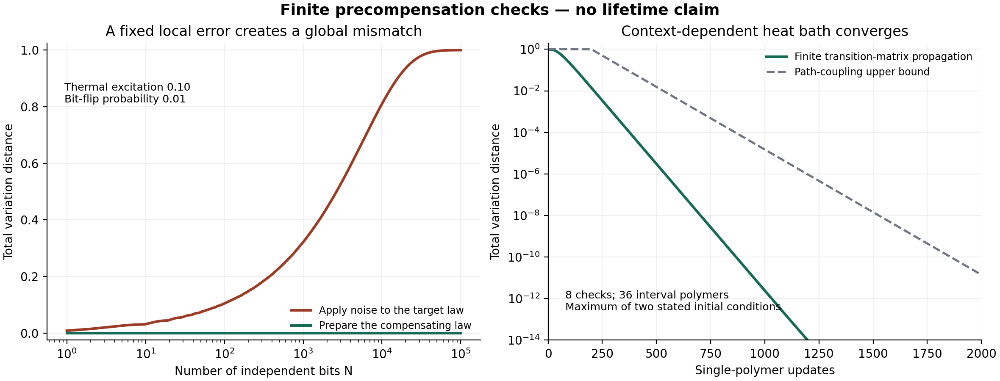

# Finite verification of thermal precompensation

Run `python noisy_interface_work/verify_precompensation.py` to regenerate the JSON, PNG, and PDF. The script uses NumPy, SciPy, Matplotlib, and mpmath and completes in about two seconds in the supplied environment. All calculations are deterministic; no Monte Carlo estimates are used.

These checks test finite algebra, the specified finite heat-bath chain, and a finite reference-entangled quantum example. They do not estimate a BDL lifetime, validate a physical implementation, establish a practical threshold, or demonstrate total-resource superiority. The small endpoint-noise probabilities are chosen to satisfy explicit sufficient inequalities; they are not measured hardware component thresholds.

## Results

| Check | Finite construction | Result |
|---|---|---|
| Constrained syndrome inverse | Seven-spin ring, seven checks, 64 even-parity syndromes, unequal check penalties, bit-flip probability 1e-6 | Strictly positive inverse law; all eight prefix identities checked; final total variation 3.58e-16 |
| Context-dependent sampler | Nine-spin open chain, eight checks, 256 syndromes, 36 interval polymers, penalty 5, bit-flip probability 1e-9 | Detailed-balance residual 2.71e-20; stationarity residual 1.21e-16; influence bound 0.085663 below 0.5 |
| Finite convergence | The exact finite transition matrix, numerically propagated from syndromes 255 and 85 | Both stated starts reach total variation at most 1e-6 after 540 updates; reversible spectral gap 0.0274304 |
| Connected-subset logarithm | Order-four connected-subset Möbius computation, six selected syndromes, 90-digit arithmetic | Largest selected absolute error 6.46e-22 against direct inverse-law logarithm |
| Soft interaction | Birth of check 3 with and without the compatible check-1 polymer | Nonzero log-odds change 2.20235e-14, resolved with high precision |
| Quantum Gibbs output | [[5,1,3]] code, exact syndrome projectors and independent Pauli channels | Half-trace error 2.62e-16, consistent with the exact algebraic identity |
| Unknown quantum input | The same code loaded with half of a Bell pair | Half-trace error 3.04151e-6, below the 5q union bound of 5e-6 |
| Extensive naive mismatch | Independent thermal bits with excitation 0.1, followed by bit-flip noise 0.01 | Naive global total variation is 0.99996596 at N=100000; compensation is algebraically exact for every N |
| Positivity boundary | Excitation 0.1 with noise 0.12 | The unique preimage excitation is negative: -0.0263158 |

## What is being compared

For the ring and open chain, a physical spin flip toggles the adjacent check syndromes. The target is the Gibbs law on the valid syndrome space. The inverse is computed by sequentially applying

\[
K_i^{-1}\nu=
\frac{(1-p)\nu-pT_i\nu}{1-2p}.
\]

The ring retains its global even-parity constraint. Every prefix is compared with the inverse of exactly the channels that remain, so the check tests the claimed prefix identity directly.

For the open chain, every syndrome has a unique decomposition into maximal runs of ones. The update selects one of all 36 possible runs and heat-bath resamples its occupancy conditional on the other runs. Its birth probability uses the full inverse measure and therefore includes context-dependent soft interactions. The transition matrix is explicitly constructed and checked for stationarity and detailed balance. The plotted convergence is the larger of the distances from two stated initial states, not a claim about the actual worst initial state. The theoretical path-coupling bound applies uniformly. Numerical row and distribution normalization remove only accumulated floating-point drift.

The small instances are enumerated to provide an independent reference calculation. The connected-subset logarithm algorithm is checked separately at order four using 90-digit arithmetic. These data are not a scaling benchmark of the general polynomial sampler.

For the five-qubit code, the sixteen weight-at-most-one Pauli representatives provide orthogonal rank-two syndrome projectors. The uniform logical state gives exact thermal compensation, up to matrix arithmetic. Replacing the logical state with half of a Bell pair tests the retained-reference interface. Compensation fixes the syndrome law; the Bell-reference discrepancy is bounded by the probability of any physical endpoint fault. No protection during a subsequent hold is tested.

For the independent-bit comparison, applying noise directly to excitation r=0.1 changes it to 0.108. The compensating input excitation is

\[
\frac{0.1-0.01}{1-0.02}=0.09183673469387756,
\]

which the same channel maps exactly to 0.1. Product-law total variation is evaluated by a binomial likelihood-ratio cutoff rather than summing 2^N configurations. The graph displays how a fixed local mismatch accumulates globally, and how exact precompensation removes that mismatch within the stated model.

