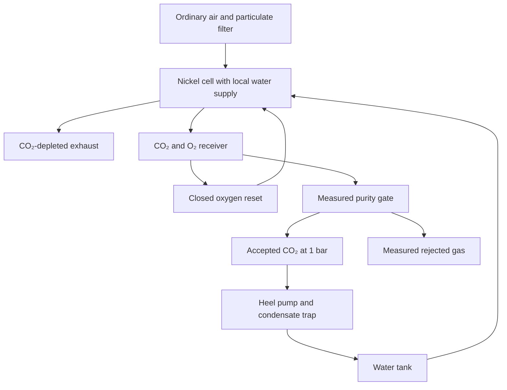

# P1 carbon concentrator: available completed return

Chat: https://chatgpt.com/c/6af4eae7-8470-83ec-bfab-1401d237fac7; latest actual user d83c99f3-808f-40b1-8227-f7b500b8b7f8; final ID prefix ddb8a994. Observation 2026-11-12 01:37 UTC. Prompt/input evidence: P1_FULL_AIR_CARBON_AFTER_WATER_ION_AND_AREA_COUPLING_PRO_20261112.txt.

Native final is truncated at 20,000 characters. The remainder is a transcription of rendered UI, with tables and mathematical formatting reconstructed where visible; this is not full native/database-byte identity. Working activity and helper expansions were not captured in full. Linked artifacts were not collected; their identity and eligibility remain unverified. No linked sources or components were opened.

## Exact native prefix

## Result

**I have not established a concentrator that meets your full contract.** I developed a materially different coupling, specified a construction route, and worked it through carbon, water, charge, gas handling, area and financed cost. It still fails the combined targets—even under several favorable, explicitly unverified assumptions.

The proposed coupling is:

1. **Keep a nickel electrochemical interface locally hydrated behind small water-restricting windows**, rather than humidifying the entire capture airflow.
2. **Collapse and evacuate the gas channels before product collection**, reducing the air inventory that contaminates the product.
3. **Use oxygen generated by parasitic electrochemical reactions during the required electrode reset**, so that battery-state restoration also removes that particular oxygen impurity.

The third coupling is chemically meaningful: it connects a necessary regeneration operation to product purification. But the complete construction does not yet provide sufficiently low water loss, electrical work or cost per unit of useful output.

The executable model, full report, input provenance, cost calculations and proposed experiment are here:

**:chatgpt-content-reference{index="12"}[aircarbon_concentrator.zip](sandbox:/workspace/scratch/6b2ea2175905/aircarbon_concentrator.zip)**

The archive contains an offline HTML report and Python programs requiring only the standard library. No physical experiment was performed.

### What the selected conditional construction predicts

These are **simulation results for an unconstructed combination**, not demonstrated performance.

| Requirement | Selected calculation | Assessment |
|---|---:|---|
| Average delivery over 100 hours | **1.096 kg/day** | Numerically meets the production target |
| Total accepted CO₂ | **4.567 kg** | After modeled collection losses |
| Minimum accepted dry CO₂ purity | **96.46%** | Conditional on unmeasured wet gas permeabilities |
| Delivery pressure | **100,000 Pa absolute** | Included explicitly |
| Single-pass removal | **50%** | Airflow is adjusted to the calculated capture rate |
| Electricity during the 100-hour operating period | **1.464 kWh/kg** | Fails |
| First-campaign electricity including the specified in-house electrode-preparation scenario | **15.70 kWh/kg** | Fails; preparation work is an assumption requiring measurement |
| Charged water, including preparation and initial inventory | **11.23 kg/kg** | Fails |
| Active membrane area | **13.44 m²** | Large for this output |
| Conditional production-scale capture-and-delivery cost | **About $3,250/t** | Fails, despite favorable manufacturing and lifetime assumptions |

The thermodynamic target remains possible in principle. This result does **not** establish a limitation applying to every separator.

---

## 1. Why I selected this opening

The strongest relevant measured starting point I found was the symmetric **Ni(OH)₂/NiOOH electrochemical carbon pump**. It has substantially stronger durability and scale evidence than many molecular electroswing candidates: the published work includes a 5,000-hour small-cell test and a nine-cell pilot stack. The pilot reported approximately **0.83 kWh/kg** and **0.19 mol CO₂/m²/h**; the best aged small-cell result reached **0.46 kWh/kg**. Those are not complete packaged-machine energy figures. :chatgpt-content-reference{index="0"}

A separate experiment supplied a plausible outer interface: an ionic liquid held in porous PTFE reduced water loss from an alkaline liquid while allowing atmospheric CO₂ uptake. Crucially, its carbon-transport and water-loss experiments used different conditions. They do not establish a simultaneous operating point for the proposed nickel interface. :chatgpt-content-reference{index="1"}

That suggested an architecture worth testing:

- Use an established oxygen-compatible electrochemical chemistry.
- Restrict evaporation at the air-facing surface.
- Preserve gas access to a larger internal electrode.
- Integrate impurity removal with electrode-state restoration.

It does **not** justify importing favorable conductivity, dry permeability, oxygen selectivity and water retention from different materials or hydration states. The model labels those transfers as unverified.

## 2. The physical construction

### A cassette with two reversible faces

Each cassette contains the following layers:

1. A shallow external gas channel.
2. An impermeable patterned mask.
3. A supported ionic-liquid covering over the masked face.
4. A connected gas-distribution region within coated nickel foam.
5. An 80 µm anion-exchange membrane.
6. A mirrored electrode, covering, mask and channel.

The inner membrane and electrode films receive water through **separate liquid-filled passages**. Those passages do not occupy the gas pores used for carbon transport.

The air-facing mask has **40% open area on a 0.25 mm pitch**. CO₂ entering a window spreads laterally through the connected gas region to the electrode. The small pitch is essential: a few widely separated openings would demand much longer lateral transport.

This reduces the amount of wet surface exposed to the atmosphere. **It does not improve the covering’s intrinsic CO₂/water-vapor selectivity.**

### Materials and dimensions

| Item | Selected construction |
|---|---|
| Membrane | Commercial PiperION A80, 80 µm |
| Electrodes | Nickel foam carrying electrodeposited nickel hydroxide |
| Covering support | Omnipore PTFE, approximately 65 µm thick, 0.2 µm pores |
| Covering liquid | Trihexyl(tetradecyl)phosphonium bis(trifluoromethylsulfonyl)amide, commonly written \([{\rm ThtdP}][{\rm NTf_2}]\) |
| Active area | 13.44 m² |
| First-build cassette size | 100 × 80 mm active rectangle |
| Cassette count | 1,680 |
| Capture-channel gap | 2 mm |
| Closed product-channel gap | 0.2 mm |
| Total remaining gas void | 5.645 L per complete face, including pores and headers |
| Product buffer | Initially collapsed, approximately 120 L |
| Working water inventory | 2.888 kg |
| Normal current density | 10 A/m², or 1 mA/cm² |
| Selected cyclic charge capacity | 21 Ah/m² |
| Normal capture leg | 2.1 hours |

The many small cassettes are an intentional first-build penalty. A 108 × 88 mm gasket rectangle fits inside a 142 mm catalog PTFE disc; a large rectangular membrane cannot be assumed available merely by multiplying the disc’s price per square metre. The membrane, foam, PTFE and ionic liquid have identifiable procurement routes. :chatgpt-content-reference{index="2"}

One electrical arrangement is **20 parallel strings of 84 cells**, with about 0.08 A per string during normal operation. Water feeds require electrical isolation or droplet air breaks. A common conductive liquid manifold would introduce shunt currents between cells at different potentials.

The gas channels have compliant walls supported by the frame and fine mask. They expand during air capture and collapse before evacuation. Pressure support, seal fatigue and ionic-liquid retention under that pressure cycle are experimental requirements.

### Material inventory

The selected loading gives approximately:

- **1.215 kg** of dry active membrane.
- **9.30 kg** of retained nickel foam.
- **8.92 kg** of electrodeposition mass gain.
- **6.13 kg** of sacrificial nickel consumed during electrode preparation.
- **26.88 m²** of active covering on the two faces.
- **1.36 kg** of ionic liquid over that active area, with additional procurement allowance for seals, cutting and fabrication yield.

The electrodeposition mass gain is not assumed to be a pure-phase assay. Hydration, intercalated ions and residual salts must be measured.

---

## 3. The chemical cycle

For an ideal bicarbonate pathway, the air-facing electrode performs

\[
\mathrm{NiOOH_A+H_2O+CO_{2,air}+e^-
\rightarrow Ni(OH)_{2,A}+HCO_3^-}.
\]

The opposite electrode performs

\[
\mathrm{Ni(OH)_{2,B}+HCO_3^-
\rightarrow NiOOH_B+CO_{2,product}+H_2O+e^-}.
\]

Reversing polarity and gas roles restores the labelled electrodes after a complete pair.

This pathway ideally transfers **one electron per CO₂**. Carbonate transport requires two. Actual useful carbon per electron is lower because hydroxide can carry current, side reactions consume charge, and carbon can leak or remain stored internally.

The model therefore uses **net CO₂ per electron**, rather than assuming a universal two-electron stoichiometry.

### The oxygen/reset coupling

Parasitic oxygen evolution can produce this net loss of charged nickel inventory:

\[
\mathrm{4NiOOH+2H_2O\rightarrow4Ni(OH)_2+O_2}.
\]

The proposed closed reset reverses it:

\[
\boxed{\mathrm{4Ni(OH)_2+O_2\rightarrow4NiOOH+2H_2O}.}
\]

The receiver’s CO₂/O₂ mixture circulates over the depleted cathode while the opposite electrode oxidizes. Both gas returns enter the same receiver.

For bicarbonate conduction, the reset can be written as

\[
\mathrm{O_2+2H_2O+4CO_2+4e^-\rightarrow4HCO_3^-}
\]

and

\[
\mathrm{4Ni(OH)_2+4HCO_3^-
\rightarrow4NiOOH+4CO_2+4H_2O+4e^-}.
\]

Carbon cancels **only if the transient bicarbonate inventory is subsequently released**. Carbon left in the membrane or liquid is not product.

There is also a strict purification limit. Restoring \(D\) moles of NiIII can consume only \(D/4\) moles of O₂. Oxygen entering by neutral crossover or air leakage does not create additional nickel charge deficit. Once that deficit is restored, continued oxygen removal needs another explicitly accounted reaction. Nitrogen and argon remain impurities throughout.

### A serious confounder: consuming the nickel support

The source supplementary information identifies nickel-substrate corrosion as a mechanism increasing active hydroxide capacity during cycling. That makes the following reaction particularly important:

\[
\mathrm{Ni^0+\tfrac12O_2+H_2O\rightarrow Ni(OH)_2}.
\]

It consumes a structural material while removing oxygen. Consequently, oxygen disappearance, increasing capacity and apparently stable coulometry do not by themselves demonstrate regeneration. Metallic nickel, active nickel phases and dissolved nickel need separate before-and-after measurements. :chatgpt-content-reference{index="3"}

---

## 4. The complete operating sequence

The diagram shows functional paths; the valves change their connections during the following sequence.

1. **Startup and inventory measurement.** Leak-test the device, weigh liquids, determine initial inorganic carbon and electrode states, and account for initially trapped air. No pure-CO₂ purge is supplied.

2. **Prepare the product face.** Collapse its channel while venting air, isolate it, then evacuate the remaining wet pores and headers to approximately 0.15 bar. Vacuum electricity and water vapor are charged.

3. **Capture and transfer.** Admit ordinary air to the other face. Adjust airflow to the capture rate required for at least 50% removal. Product pressure builds to 1 bar and then fills the initially collapsed receiver.

4. **Clear the former air face.** Before closed oxygen reset, collapse and evacuate that face separately. This second evacuation is necessary: otherwise its air joins the product loop. CO₂ back-diffusing through the wet membrane during this idle step is counted as a vacuum loss.

5. **Restore electrode state using receiver oxygen.** Close fresh air and circulate the stored mixture. Taper current as oxygen transport becomes limiting. Stop on electrode-potential limits, hydrogen detection, peroxide formation, or completion of the measured charge reset.

6. **Accept or reject the batch.** Measure the dry gas composition. Only qualifying gas enters the delivery holder. Pump both gas heels into that holder with explicit electricity and time; vent the remainder.

7. **Reverse roles and repeat.** End the run after complete polarity pairs. Final electrode state, inorganic-carbon inventory and liquid inventory must match the declared endpoints.

Only **dry-basis purity** is required. The bulk product may therefore remain humid. Its water content is charged as a loss; a full-stream desiccant dryer is not inserted or credited.

The actual water-return path is limited to condensate formed in the heel-pump aftercooler and trap, returned through valved plumbing. The model does not call recirculating vapor “recovered water.”

---

## 5. Transport and the missing joint material property

The model combines carbon-transfer resistances:

\[
\frac{1}{K_{\rm overall}}
=
\frac{1}{K_{\rm gas}}
+\frac{1}{fK_{\rm cover}}
+\frac{1}{K_{\rm access}}
+R_{\rm lateral}.
\]

The useful flux is

\[
J_{\rm CO_2}
=
\min\!\left[
K_{\rm overall}\Delta p_{\rm lm}\,a_T,\;
\eta_{\rm ceiling}\frac{j}{F}
\right].
\]

Here \(a_T\) represents the explicitly assumed temperature dependence. The driving force uses the inlet and outlet concentrations at 50% removal and a **nonzero interfacial CO₂ pressure**.

Water transport is calculated separately:

\[
J_w
=
fK_w
\left[
a_w p_{\rm sat}(T_{\rm interface})
-\phi p_{\rm sat}(T_{\rm air})
\right].
\]

The selected case uses \(a_w=1\). It does not assume that a highly conductive low-water-activity phase already exists.

### Evidence status of the important inputs

| Input | Selected value | Status |
|---|---:|---|
| Apparent covering CO₂ coefficient | \(5\times10^{-6}\) mol m⁻² s⁻¹ Pa⁻¹ | Derived from the alkaline-backed covering experiment; transfer to the nickel interface is unverified |
| Covering water coefficient | \(2.8\times10^{-7}\), same units | Inferred from a separate water-loss experiment |
| Normal CO₂/electron ceiling | 0.282 | Explicit phase-model hypothesis |
| Normal cell voltage | 0.30 V plus modeled lateral penalty | Hypothesis calibrated in magnitude to pilot performance |
| Normal oxygen-evolution charge fraction | 0.08 | Unmeasured phase allocation |
| Reset voltage | Approximately 1 V | Conditional operating assumption |
| Wet membrane O₂/N₂ permeability | 2/1 Barrer | Sensitivity values, not PiperION measurements |
| Idle wet-membrane CO₂ permeability | 5 Barrer | Sensitivity value |
| Long-term degradation | Zero in the base integration | Unverified; not evidence of lifetime |

The covering experiments support a real fabrication route and a real water-retention effect. They do not supply the combined coefficients under forced airflow, electrochemical bias, finite interfacial CO₂ and concentrated product. :chatgpt-content-reference{index="4"}

Papchenko’s dry Fumasep/Sustainion results cannot fill that gap. Those are different polymers measured after drying, not wet carbonated PiperION under operating bias. I have not combined their dry permeability with an independently favorable hydrated conductivity. :chatgpt-content-reference{index="5"}

### Why patterning does not close the water balance

The inferred covering selectivity is insufficiently strong to make the water problem disappear. At the warm, dry corner, the water-vapor pressure difference is thousands of pascals, whereas the useful CO₂ driving pressure is only tens of pascals.

Patterning reduces exposed wet area, but useful carbon must pass through those same openings. Film resistance and finite reaction pressure reduce carbon throughput further.

The selected integration consequently evaporates **about 3.34 kg water per kg delivered CO₂ into capture air alone**. That already exceeds the entire water allowance, before initial inventory, preparation, product humidity or treatment reject.

### Heat and pressure loss

Evaporation cools the interface. The calculation includes finite heat exchange with capture air and a specified **30 W/K external passive heat-transfer path**. That path needs real frame or fin area; it is not supplied by the thin membrane.

Calculated channel friction is relatively small at the selected parallel-channel geometry. The assumed filter and manifolds dominate the roughly **46 Pa maximum air-train pressure drop**, using **45% fan efficiency**. These are design allowances requiring an installed pressure/flow measurement.

---

## 6. Complete-run accounting

The selected simulation processes approximately **12,230 m³ of admitted capture air**, captures **4.676 kg of atmospheric CO₂**, and delivers **4.567 kg** after modeled losses. It completes **36 half-cycles**, restoring the labelled electrode orientation.

### Operating electricity

| Item | kWh/kg delivered |
|---|---:|
| Normal electrochemical legs | 0.670 |
| Closed electrode reset | 0.180 |
| Power-conversion losses | 0.054 |
| Capture-air fan | 0.068 |
| Both air evacuations | 0.036 |
| Recovery of both product gas heels | 0.080 |
| Switching, recirculation and product pumping | 0.006 |
| Water treatment | 0.022 |
| Stack startup and shutdown | 0.299 |
| Controls, sampling, water pump and cooling fan | 0.049 |
| **Total during the operating 100 hours** | **1.464** |

Even removing the entire stack startup/shutdown allowance leaves approximately **1.17 kWh/kg**. The operating failure therefore does not depend on charging a large first-build preparation burden.

### Electrode preparation is also charged

The public preparation route uses electrodeposition followed by electrochemical formation. For the first build I added a separate scenario based on:

- 3 V full-cell deposition voltage.
- 1.5 V full-cell formation charging voltage.
- 0.5 V purchased-work equivalent on reduction legs.
- 90% preparation power-conversion efficiency.
- An explicit preparation auxiliary allowance.

That scenario adds **65.0 kWh**, taking the charged first campaign to **71.7 kWh**, or **15.70 kWh/kg delivered**.

These terminal voltages, formation charge histories and auxiliary loads are **not reported measurements or assured bounds**. They are exposed inputs that must be replaced by wall-power measurements. Preparation occurs before the 100-hour operating clock, but its electricity is charged to the first campaign. If preparation instead occurs inside that clock, productive time must also be reduced.

At production scale, factory preparation is paid through the manufactured core and replacement prices. Charging that same manufacturing electricity again every operating campaign would double-count it.

### Water

| Charged water item over the run | kg |
|---|---:|
| Initial working inventory | 2.888 |
| Preparation and commissioning allowance | 20.160 |
| Evaporation into capture air | 15.260 |
| Product moisture, other gas losses, entrainment, vacuum vapor and bleed | Approximately 0.149 |
| Water-treatment reject | 12.819 |
| **Total** | **51.276** |

The preparation-water allowance is not established by the source paper. A specified bath layout and its stoichiometric demand are included in the report, but rinse conductivity and chemical assays may require additional water.

The final working inventory is retained and charged. Only approximately **0.013 kg** of heel-pump condensate is physically returned. There is no credited air-side water recuperator.

### Ambient inputs

For the operating period, the model separately reports approximately:

- **6.52 kWh** of net ambient heat absorbed.
- **10.34 kWh** of evaporation latent heat.
- **0.76 kWh** as an upper bound on the chemical free energy associated with evaporation into the admitted unsaturated air.

None is subtracted from purchased electricity.

### Uncertainty changes the useful output

With the inherited carbon coefficient retained, constant-corner cases give approximately **1.04–1.10 kg/day**, operating electricity around **1.45–1.54 kWh/kg**, and charged water around **9.3–14.3 kg/kg**.

More consequential tests are:

- *

## Rendered remainder

[Rendered continuation from the end of the native prefix; formatting and mathematical glyphs reconstructed from the visible accessibility view.]

More consequential tests are:
- Half the assumed interface carbon coefficient: substantially lower production, with some cases rejecting all product on purity.
- Five times the assumed neutral-gas permeabilities: off-spec product.
- No product-oxygen return during reset: approximately 90% dry CO₂ in the diagnostic case.
- One percent of carbon retained after each reset: roughly one mole accumulates internally over the run.

The last case is particularly important: reasonable-looking product collection can coexist with an unclosed chemical inventory. The numerical conservation checks close the specified equations. They do not validate the constitutive assumptions.

## 7. Area and financed production cost

At the selected useful throughput, F_delivered ≈ 0.0815 kg m⁻² day⁻¹, so one tonne/day requires approximately A = 1000/F_delivered ≈ 12,262 m². Both faces require covering, giving approximately 24,525 m² of active covering area. The cost model uses:

- 90% annual utilization.
- 328.5 t/year delivered at one tonne/day nameplate.
- 15-year capital life.
- 8% real discount rate.
- Zero salvage.
- Explicit discounted replacement events.

The favorable core allocation is $209/m² from a published future manufacturing model, not an available supplier quotation. New covers, masks, fabrication yield and installation are added. Existing balance-of-plant scope within that allocation is not charged twice. The assumed five-year renewable core life and three-year covering life remain hypotheses. [Visible link: https://media.springernature.com/original/springer-static/esm/art:10.1038%2Fs41560-026-02129-z/MediaObjects/41560_2026_2129_MOESM1_ESM.pdf?utm_source=chatgpt.com]

| Cost category | Approximate US$/t |
|---|---:|
| Financed capital and replacements | 2,634 |
| Maintenance and insurance | 458 |
| Shared labor, site, filters, waste and analysis | 65 |
| Operating electricity | 73 |
| Charged water | 22 |
| Total | 3,254 |

Conditional installed capital is approximately $4.30 million. These are scoping costs with favorable unquoted allowances, not a commercial offer. A separate, more favorable screen retains the uncovered cell’s approximately 0.170 kg/m²/day and assumes 95% collection. Even then, financing the projected $209/m² core over 15 years costs approximately $460/t before covers, replacement or operation.

### What $100/t permits

At the target utility caps:
- Electricity costs $25/t.
- Water costs $4/t.
- Only $71/t remains for everything else.

With $10,000/year of shared service and 3% annual maintenance, the resulting installed-capital allowance is approximately $90,700, before replacement and several other expenses. At 0.1615 kg/m²/day delivered, a five-year renewable cassette assigned $20/t can cost only about $4.24/m². A $100/m² cassette needs approximately 3.81 kg/m²/day to fit that same allowance. That is the required joint improvement: productivity, installed price and actual lifetime must improve together.

### First kilogram/day-class build

The catalog-size research construction is budgeted at approximately $457,000, including materials, fabrication, isolated water feeds, gas handling, power electronics, metrology, labor and 20% contingency. The small-disc construction is expensive. A cheaper large-sheet manufacturing route would require an actual process and quotation; it is not an existing asset in this calculation.

## 8. Comparison with relevant alternatives

The distinctions in this table are essential to a same-output comparison.

| Approach | Relevant result | Remaining boundary |
|---|---|---|
| Nickel hydroxide electrochemical pump | Aged cell 0.46 kWh/kg; pilot 0.83 kWh/kg | Cell figures exclude complete air movement and delivery; do not establish the requested dry-air operating envelope |
| BPT redox carrier with protective gas layer | Oxygen-containing air capture at about 0.675 kWh/kg cell work | Reported cycling releases into a carrier stream; concentrated accepted product and its auxiliaries remain additional |
| Spatially isolated phenazine | Oxygen-compatible DAC at about 0.656 kWh/kg | Does not establish this complete water, equipment and delivery contract |
| MnO₂ surface mineralization | About 1.14 kWh/kg; oxygen-containing air and substantial cyclic testing | Release uses a pure-CO₂ carrier; water and product handling need closure |
| Heat-pump fast thermal swing | A Carbyon study reports 2.5 kWh/kg at the assessed development stage and projects 1.5 | Projection and operating evidence must remain distinct |
| Optimized heat-pump/adsorbent modeling | Published 0.461 kWh/kg annual energy figure and $63.2/t | A model result, not verified here as a demonstration meeting all your humidity, removal, purity and inventory conditions |
| Climeworks Generation 3 | Company capture-cost target of $250–350/t by 2030 | Company target, not achieved $100/t under this contract |

The BPT, phenazine and MnO₂ results are meaningful advances, but their reported operating boundaries do not supply the missing complete device. [Visible link: https://doi.org/10.1038%2Fs41467-026-70444-w?utm_source=chatgpt.com] For BPT specifically, the reported 4 mL/min feed over 4 cm² imposes a feed-carbon ceiling of only about 0.011 kg/m²/day, even at complete capture. That illustrates why capacity and instantaneous current cannot substitute for useful delivered flux. [Same visible link.]

The heat-pump comparison must remain open. The favorable modeled result deserves a complete independent audit; its headline numbers cannot be treated as proof of a packaged humid-air device. The Carbyon assessment and Climeworks figures carry different demonstration and projection boundaries. [Visible link: https://www.sciencedirect.com/science/article/pii/S0306261925003964?utm_source=chatgpt.com]

For the best aged nickel figure, even the favorable calculation 0.46/0.95 + 0.0606 = 0.545 kWh/kg exceeds the cap before further auxiliaries and product losses. This conclusion depends on that cell figure and the illustrative fan condition. It does not rule out a different electrochemical cycle or substantially improved contactor. I also examined porous solid nickel hydroxide as a possible route avoiding a continuously wet interface. Its humidity-dependent adsorption evidence does not establish an electrochemically regenerated, low-water cycle against concentrated product. It therefore cannot supply a replacement working capacity for this design. [Visible link: https://pmc.ncbi.nlm.nih.gov/articles/PMC12042040/?utm_source=chatgpt.com]

## 9. The smaller decisive prototype

### Build

Construct two independent 100 cm² circular coupons, each with a 112.8 mm active diameter:
- One patterned, locally hydrated test coupon.
- One uncovered or sham-covered control from the same electrode and membrane batches.

Use the commercial constituents above, supported masks, adjustable channel gaps, small latching valves, a closed gas receiver, a gas-rated diaphragm pump and an ambient condensate trap. At approximately 0.1 A per coupon, the selected model scales to only about 3.4 g of CO₂ per coupon over 100 hours. That is enough for a decisive balance experiment, but ordinary continuous analyzer flows could consume the product. Use recirculating analysis and small GC aliquots. Feed approximately 2 L/min of measured ordinary air, adjusted from measured carbon removal. If a climatic fixture imposes the temperature/RH envelope, meter and report all its electricity and water. Its consumption cannot be erased to claim a packaged-device energy pass.

### Measurements and numerical decisions

| Measurement | Decision criterion |
|---|---|
| Admitted-air removal | At least 50%, including measurement uncertainty |
| Accepted product | Every accepted batch at least 95% dry CO₂; resolve O₂, N₂, Ar and H₂ |
| Carbon balance | 95–105% closure across feed, exhaust, accepted/rejected gas and internal DIC |
| Water balance | 98–102% closure across all stocks, air losses, product, samples and discharge |
| Electricity | Integrate complete terminal power in both directions and wall power; target uncertainty ≤2% |
| Repeated regeneration | At least ten complete polarity pairs; product exceeds five times initially extractable DIC |
| Electrode endpoints | Matched labelled-electrode states within 2% |
| Alkalinity and ions | Initial/final titration and ion analysis within 2%, after measured impurity uptake/discharge |
| Oxygen-reset stoichiometry | O₂ consumed agrees with restored NiIII/4 within 5% |
| Nickel-consumption confounder | Metallic-Ni conversion accounts for less than 1% of integrated reset charge, or is explicitly classified as consumed feedstock |
| Promising joint operating gate | At the same worst-corner state: net carbon flux ≥0.16 mol/m²/h, ongoing water loss ≤1 kg/kg, and full-cycle cell work ≤0.38 kWh/kg |

The final row is a discriminating target, not a predicted result. Measure peroxide, nickel in liquids, ionic-liquid retention, TOC and relevant anions. Quantify metallic nickel separately from total nickel; simple mass gain can reflect hydroxide formation, hydration or salt uptake. The experiment should distinguish:
- Initial alkalinity consumption.
- Battery-inventory discharge.
- Carbon accumulation.
- Nickel-support oxidation.
- Air leakage and neutral-gas crossover.
- Genuine repeated carbon transfer with restored material states.

### Budget

| Prototype category | US$ |
|---|---:|
| Purchased membrane, foam, PTFE and ionic liquid | 1,307 |
| Fixtures, deposition consumables and closed gas circuit | 2,000 |
| Electrochemical, flow, gas and electrical instrumentation | 9,800 |
| Independent analytical access | 4,100 |
| Climatic-fixture access | 1,800 |
| Build, monitoring and endpoint labor | 3,000 |
| 15% contingency | 3,301 |
| Total | 25,308 |

An optional Pt/C comparison adds approximately $173 under the stated research procurement allowance and receives no assumed performance credit. Success would establish a local regenerated coupling under measured conditions. It would not establish a kilogram/day package, low-power production instrumentation, large manifolds, multi-year sealing, manufacturing yield or $100/t economics.

## What remains unresolved

The indispensable missing result is one actual stack, at the same hydration, carbonation, bias and product pressure, delivering the required carbon flux with low water loss and restored carbon, ion and nickel inventories. For this construction, that material result would still need to be accompanied by much lower complete-cycle work and a major improvement in delivered output per purchased square metre. The work here produces an auditable construction, a conditional model and an experiment capable of deciding whether the proposed coupling is real. It does not complete the target-meeting invention, and it does not justify a sequestration or negative-emissions claim. Compression beyond 1 bar, transport, permanent storage and lifecycle burdens remain additional operations.
