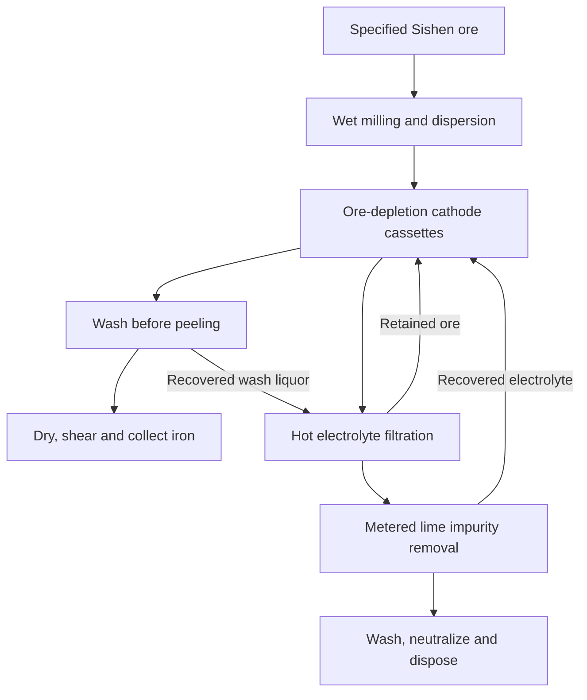

# P1 DEC9C2C6 available return — 12 November 2026

Chat: https://chatgpt.com/c/6af51fe2-b75c-83ec-917e-28235e2143c3 ; user 72a59af6-28bd-48ec-94fd-f380e324a509; final dec9c2c6-a4fd-5a2d-9fcd-e8c6801f21d0; UI model Pro. Exact already-held prompt: P1_FULL_ELECTRIC_ORE_TO_IRON_WITH_REAGENT_CLOSURE_PRO_20261112.txt (source 6432 ASCII bytes, d3c2226f; posted source minus terminal LF). Native read supplied only the first 20,000 characters of the final. The visible continuation is separately labelled and transcribed with rendered table and equation formatting; this is not complete native/database-byte identity. The visible ZIP iron_ore_process_model.zip has unverified identity and eligibility and was not collected; no producer artifact or code was opened or executed. Top-level activity is included; nested command, web, file, Library and subagent details were not captured.

## Native final prefix

## Verdict

**I developed a concrete process and an executable model, but I cannot honestly claim an invention that meets your complete target.** The process below can conditionally produce the required quantity and core product quality in its 100-hour model. Its industrial case fails both the energy and cost requirements.

The candidate is **alkaline iron electrowinning with ore-depletion cassettes, washing before cathode peeling, and a separately metered impurity-removal circuit**. Its intended advantage is to preserve iron recovery while removing gangue and returning caustic. The unresolved physical issue is whether those operations can sustain useful electrochemical performance on the selected ore.

| Requirement | Reference design result | Assessment |
|---|---:|---|
| Actual hematite-bearing ore, 55–65% Fe | Sishen ore, **59.66% Fe** | Measured feed qualifies |
| At least 5% silica + alumina | **12.60%** | Measured feed qualifies |
| Metallic iron over the complete 100 hours | **4.334 kg credited** | Conditional model result |
| Feed-iron recovery into product | **93.29% total Fe; 92.61% credited metallic Fe** | Conditional |
| Product total Fe / metallization | **99.17% / 99.5%** | Assumed separation and oxidation behavior |
| Product P / S | **0.0238% / 0.0356%** | Conditional impurity partition |
| Industrial purchased electricity at the site | **5.17 MWh/t metallic Fe** | Fails |
| Industrial energy including declared upstream preparation | **5.59 MWh-equivalent/t** | Fails |
| Complete cost at $40/MWh | **Approximately $684/t** | Fails |
| Complete cost at $80/MWh | **Approximately $905/t** | Reported sensitivity |

**These are engineering calculations, not experimental results or vendor quotations.** In particular, the model does not establish the assumed impurity-removal chemistry, sheet morphology, product assays or component lifetimes.

The complete deliverable is here:

[**:chatgpt-content-reference{index="13"}**](https://chatgpt.com/library?file_id=libfile_ccadd7e7cf4481919f1f7e247a881e94&account_id=personal)

It contains the runnable Python model, measured feed information, 100-hour trace, material and energy ledgers, financing and replacement calculations, comparison cases, construction budgets and the smaller decisive experiment. It uses the Python standard library:

```bash
python3 iron_process_model.py --out results --samples 160
python3 verify_accounting.py
```

---

## 1. What existing work already supplies

Replacing chlorine evolution with oxygen evolution is established alkaline ironmaking chemistry. It is not the invention here.

The supplied Noble–Moutarlier–Kempler paper explicitly compares its chlorine-producing cell with earlier alkaline iron/oxygen cells operating around 1.7 V. Its four-hour point near 3.2 V and 84% iron current efficiency gives, by Faraday’s law,

\[
E_{\mathrm{cell}}
=\frac{1.43978\times3.2}{0.84}
=5.485\ \mathrm{kWh/kg\ Fe}.
\]

The same paper shows that impurities can reduce iron selectivity substantially without a correspondingly obvious voltage increase. That matters because a cell can continue drawing power while increasingly producing hydrogen. :chatgpt-content-reference{index="0"}

A stronger contemporary comparator is Volteron. ArcelorMittal’s public presentation reports 50% NaOH, 110°C, 85% Faradaic yield, maximum current density of 800 A/m², and **3.739 MWh/t iron plate** across its listed operations. It also reports **92 kg fresh NaOH/t plate** and identifies substantial capital charges. Those figures provide a much more demanding benchmark than chlor-iron alone. :chatgpt-content-reference{index="1"}

Laboratory alkaline studies also report approximately 85–93% current efficiency and 1.7–2.3 V under favorable conditions with prepared hematite. Particle size, operating conditions and morphology matter; those results cannot simply be assigned to an untreated natural ore. :chatgpt-content-reference{index="2"}

Therefore the useful invention would have to improve **the coupled ore preparation, impurity control, iron collection and equipment productivity**.

---

## 2. One actual feed, with its limitations preserved

I selected **AMIS0597**, a commercially obtainable reference material made from natural Sishen jig-plant ore supplied by Kumba.

| Dry-basis constituent | Selected assay |
|---|---:|
| Total Fe | **59.66 wt%** |
| SiO₂ | **9.74 wt%** |
| Al₂O₃ | **2.86 wt%** |
| Phosphorus | **0.0667 wt%** |
| Sulfur | **0.020 wt%**, measured but uncertified |
| Loss on ignition | **1.08 wt%** |

The certificate provides the measured composition; the supplier identifies the natural ore provenance and offers laboratory packs. :chatgpt-content-reference{index="3"}

For industrial procurement, the assumption is **a contracted Sishen jig-fines stream matching this assay envelope**. I have not established a bulk supply agreement, and I do not treat the reference sample as proof that every current Sishen shipment has this composition.

### Preparation is charged

The industrial calculation uses:

- **$90 per dry tonne delivered ore**, including mine supply, initial crushing, jigging, classification, dewatering and transport.
- **75 kWh/t dry ore** for additional wet milling, classification and dispersion.
- Separate upstream energy allowances for mine preparation and delivery.
- No high-purity purchased oxide.
- No assumed high-recovery flotation upgrade.
- No industrial feed dryer: ore moisture enters the slurry and water balance.

The reference material is already finely prepared. The industrial route must reproduce that preparation rather than inherit it for free. The package distinguishes its measured particle-size distribution from the assumed industrial milling duty.

### The phosphorus requirement is consequential

At 90% iron recovery and a 97%-Fe product, one tonne of this ore would produce approximately

\[
m_{\mathrm{product}}
=\frac{596.6(0.90)}{0.97}
=553.5\ \mathrm{kg}.
\]

That product may contain at most 0.277 kg phosphorus, against 0.667 kg entering in the ore. Thus **at least approximately 58.5% of feed phosphorus must be excluded from the product**.

The reference design assumes 80% phosphorus rejection. That is a hypothesis requiring a complete phosphorus balance.

Sulfur has more margin: the selected 0.020% feed sulfur would give approximately 0.036% in the product even if all of it followed the iron. Incoming sulfur nevertheless requires confirmation because its reported value is not certified.

---

## 3. The proposed operation

The design uses staggered batches rather than continuously bleeding a suspension and repeatedly losing a fraction of its remaining iron.



### 3.1 Retain each ore charge until it is substantially depleted

Each cassette receives a known mass of ore. Its solids remain in the reduction circuit while current is tapered as the reactive iron inventory decreases.

The electrochemistry is:

\[
\begin{aligned}
\text{Cathode:}\quad&
\mathrm{Fe_2O_3+3H_2O+6e^-\rightarrow2Fe+6OH^-},\\
\text{Anode:}\quad&
\mathrm{6OH^-\rightarrow1.5O_2+3H_2O+6e^-},\\
\text{Overall:}\quad&
\mathrm{Fe_2O_3\rightarrow2Fe+1.5O_2}.
\end{aligned}
\]

The intended benefit is straightforward: **impurity removal does not require repeatedly rejecting an iron-bearing mineral fraction from the whole slurry**.

That distinction matters. A separator retaining 98% of the iron on each of ten equivalent passes retains only

\[
0.98^{10}=81.7\%.
\]

The model instead charges one residual-ore discharge per batch, together with explicitly accumulated iron leakage into the impurity circuit.

### 3.2 Separate growth from final collection

During deposition, ore particles must reach the cathode. During collection, those particles must be removed.

The proposed sequence is:

1. Reduce the ore while maintaining slurry circulation.
2. Stop admitting ore to the cathode face.
3. Sweep the deposit with clarified hot electrolyte.
4. Return dislodged particles to the residual-ore circuit.
5. Peel the deposit.
6. Wash countercurrently to remove soluble caustic.
7. Dry under nitrogen, then shear and fold the sheet.

This sequence is intended to obtain clean iron pieces without exporting the entire mineral slurry into the product.

**Its success is not established by the existence of an iron deposit.** The deposit must survive peeling, release embedded or adhering particles, and remain sufficiently metallic during washing and drying. If it instead forms fragile dendrites, the process needs additional fines recovery and densification.

### 3.3 Remove dissolved impurities outside the deposition zone

A heated filter retains ore particles while a clarified electrolyte stream enters a lime-treatment vessel.

Ideal bookkeeping reactions include:

\[
\mathrm{Na_2SiO_3+Ca(OH)_2\rightarrow CaSiO_3+2NaOH},
\]

\[
\mathrm{2NaAl(OH)_4+3Ca(OH)_2
\rightarrow Ca_3Al_2(OH)_{12}+2NaOH},
\]

\[
\mathrm{3Na_3PO_4+5Ca(OH)_2
\rightarrow Ca_5(PO_4)_3OH+9NaOH}.
\]

Lime-assisted impurity removal from alkaline iron-bearing-material circuits is already described in prior art. It cannot be claimed as a newly discovered reaction. :chatgpt-content-reference{index="4"}

The difficult part is whether suitable phases form **fast enough, with sufficiently low residual dissolved impurities and sufficiently little sodium retention, in this concentrated electrolyte**.

There is a second problem: dissolved-impurity removal may not remove silica-rich material already coating ore particles. The primary impurity literature identifies particle-surface contamination as a cause of poor reduction behavior. A clean liquid therefore does not automatically make the particles behave like reagent hematite. :chatgpt-content-reference{index="5"}

This is the central unresolved coupling in the proposed invention.

---

## 4. Physical construction and transport

### Nominal laboratory construction

| Item | Design basis |
|---|---|
| Cathodes | Two removable titanium faces, each 250 × 250 mm |
| Total active cathode area | **0.125 m²** |
| Anodes | Nickel oxygen-evolution electrodes |
| Electrolyte | **50 wt% free NaOH** |
| Temperature | **110°C** |
| Pressure | Approximately **1.05 bar absolute** |
| Circulating liquid | Approximately **5.2 L** |
| Initial free NaOH | **4.0 kg** |
| Peak current | Approximately **200 A** |
| Peak current density | **1,600 A/m²**, tapered during depletion |
| Electrode spacing | Approximately 6–8 mm including separator |
| Impurity-loop flow | **15 L/h** |
| Vacuum | None |

The construction uses separate anode and cathode gas collection, demisters, an insulated liquid loop, a hot filter, a stirred impurity-removal vessel and a second solids filter.

Titanium cathodes and a ceramic diaphragm are proposed materials, not lifetime guarantees. Titanium adhesion and hydrogen uptake, nickel corrosion, diaphragm resistance and hot-caustic filter integrity must all be measured.

### Current distribution

The model uses an effective area resistance of

\[
R_A=1.6\times10^{-4}\ \Omega\,\mathrm{m^2},
\]

representing electrolyte, separator and bubble contributions. At the peak current density, this contributes approximately 0.26 V.

Segmented electrical feeds, edge masks and segment-current measurements are included in the construction concept. They address the practical possibility that edges carry much more current than the nominal area average.

A tangential manifold provides adjustable circulation along each cathode. The suggested local liquid velocity is approximately 0.2–0.5 m/s. **That is a design setting to investigate, not a demonstrated mass-transfer correlation.**

### Fine-particle filtration is a real unit operation

At an assumed hot-filter flux of 20 L/m²/h, the 15 L/h side stream requires at least **0.75 m² of filter area**.

The model charges **0.010 g Fe/L of permeate leakage**, giving 13.5 g iron lost into the impurity circuit over the batch campaign. Higher leakage consumes the recovery margin.

A simple settler is not substituted for this filter. Nor is an ordinary magnet assumed to recover essentially all ultrafine hematite.

### Actual product form

The intended product is **dry, sheared and folded cathode iron**, approximately 25–100 mm across, supplied in covered bins. The nominal deposited mass corresponds to roughly 0.4–0.5 mm of dense iron per batch.

The proposed purchaser specification is:

| Property | Proposed release limit |
|---|---:|
| Total Fe | ≥97.0 wt% |
| Metallization | ≥95.0% |
| P | ≤0.05 wt% |
| S | ≤0.05 wt% |
| Free moisture | ≤0.10 wt% |
| SiO₂ + Al₂O₃ | ≤1.0 wt% |
| Na + K | ≤0.10 wt% |
| Chloride | ≤0.02 wt% |
| Carbon | ≤0.20 wt% |
| Cu | ≤0.05 wt% |
| Ni + Cr | ≤0.15 wt%, subject to purchaser agreement |
| Loose fines below 1 mm | ≤1 wt% |

These are proposed contractual limits, not a universal EAF specification. The executable acceptance flag evaluates the four requested Fe/metallization/P/S criteria. The additional handling and trace-element limits remain release tests; they are not established by the model.

---

## 5. Reagent and gas closure without coproduct sales

### Lime is consumed

The reference industrial case consumes approximately **201 kg CaO/t metallic Fe**.

Its manufacture, delivery and resulting residue are paid. Limestone calcination alone contributes approximately

\[
0.201\frac{44.009}{56.077}
\approx0.158\ \mathrm{t\ CO_2/t\ Fe}.
\]

Thus the design is not automatically zero-carbon even with zero-carbon electricity.

### Caustic losses are replaced

The reference case requires approximately **38 kg fresh NaOH/t metallic Fe**, covering sodium retained in discarded material and losses in washing.

To avoid concealing dependence on a chlorine buyer upstream, the modeled makeup supply uses a chlorine-free route:

\[
\mathrm{Na_2CO_3+CaO+H_2O\rightarrow2NaOH+CaCO_3}.
\]

Per tonne NaOH, the ideal material requirements are approximately:

| Stream | Tonnes |
|---|---:|
| Soda ash input | 1.325 |
| CaO input | 0.701 |
| Net water input | 0.225 |
| NaOH output | 1.000 |
| Calcium carbonate for paid disposal | 1.251 |

Chemical caustic manufacture from soda ash and lime is an established operation. Natural soda ash itself has an obtainable mineral-production route. :chatgpt-content-reference{index="6"}

The supply allowance is **$750/t NaOH delivered and 2.5 MWh/t NaOH**, including raw-material preparation, clarification, concentration, waste, transport and capital. This is an optimistic engineering allowance, not a commissioned supplier quotation. A more conservative supply-energy case is included in the comparisons.

### Waste neutralization is paid

Free caustic lost with washing enters a separate cooled neutralization tank. Purchased sulfuric acid converts it into a sodium-sulfate waste stream.

The model includes the acid, its production allowance, generated water and disposal. Acid-treated liquid does not return to the iron cell.

### Hydrogen receives no sale credit

Competing hydrogen evolution is explicitly included in the electrical charge.

Hydrogen is collected separately and recombined with a metered portion of the anode oxygen. Condensed water returns to the process. Remaining oxygen is demisted and vented.

For the 100-hour reference run:

- Hydrogen generated: **0.115 kg**.
- Oxygen generated before recombination: **2.800 kg**.
- Net oxygen after recombination and modeled product oxidation: **approximately 1.876 kg**.

At industrial scale, this requires substantial gas-handling and heat-recovery equipment. It is included in the equipment allowance.

**No oxygen, hydrogen, silicate, carbonate or residue revenue is used.** I have not established a qualified buyer, so I have not added a speculative sale scenario.

---

## 6. Complete 100-hour operation

### Schedule

| Period | Operation |
|---|---|
| Hours 0–6 | Feed preparation, solution charging, conditioning and cold startup |
| Hours 6–96 | Nine ten-hour ore batches, including reduction, washing and harvesting |
| Hours 96–100 | Final washing, drying, inventory recovery and shutdown |

Each batch admits **0.52 kg of ore iron**. Electrolysis can occupy at most 9.5 hours of its ten-hour slot, leaving time for washing and harvesting.

The model does not force every batch to reach its conversion target. In the inhibited and failed-guard cases, the available charge and time are insufficient.

### Iron ledger

| Iron stream | kg Fe |
|---|---:|
| Iron entering in dry ore | **4.6800** |
| Total iron in collected product | **4.3661** |
| Iron remaining in discharged ore residue | 0.2784 |
| Iron lost into impurity-removal solids | 0.0135 |
| Iron lost during collection | 0.0219 |
| **Total accounted iron** | **4.6800** |

The physical modeled product contains approximately **4.3443 kg metallic Fe**. I then exclude a **10 g allowance for initially present metallic iron in the apparatus**, giving **4.3343 kg credited metallic Fe**.

In a real experiment, every wetted component and reagent must be assayed, and any additional non-ore iron must also be excluded. “Titanium cathode” or “nickel anode” does not establish zero iron contamination.

### Other principal quantities

| Quantity | 100-hour reference case |
|---|---:|
| Dry ore | **7.844 kg** |
| Gross dry product | **4.403 kg** |
| CaO consumed | **0.875 kg** |
| Fresh NaOH makeup | **0.165 kg** |
| Sulfuric acid, pure-acid equivalent | **0.107 kg** |
| Residue on the model’s analytical equivalent basis | **2.673 kg** |
| Initial solution water | 4.000 kg |
| Additional fresh process water | 8.669 kg |
| Free water entering with ore | 0.682 kg |
| Free water in filter cake | 1.439 kg |
| Treated liquid purge | 6.679 kg |

The final free-caustic inventory is retained separately. Final dissolved silica, alumina and phosphate are also retained inventories, not simultaneously counted as discarded residue.

**An important limit remains:** the exact guard mineral phases and their hydration are unknown. The model therefore reports analytical oxide/NaOH-equivalent residue quantities and a separate hydration allowance. It closes the declared component partitions, but it does not establish an experimentally verified, atom-resolved mineral-phase balance.

### Laboratory energy

The laboratory model explicitly recovers some cell/recombiner heat and calculates heater demand over time. It does not charge the full heat loss again when the cell already supplies it.

| Electrical load | Predicted kWh |
|---|---:|
| Cell and rectifier | 19.48 |
| Heater after heat recovery | 1.95 |
| Dry-cooler fans | 1.31 |
| Circulation and filtration | 4.50 |
| Ventilation and gas handling | 10.00 |
| Controls | 1.50 |
| Ore preparation and milling | 1.09 |
| Washing, drying and peeling | 1.40 |
| Water recovery, nitrogen and shutdown | 1.65 |
| **Site total** | **42.88** |

That is approximately **9.89 kWh/kg credited metallic Fe**.

Including declared upstream preparation and manufacture of the initial and replacement chemicals gives **54.71 kWh**, or approximately **12.62 kWh/kg** for this first run.

These are predicted consumption figures. No apparatus was physically operated.

### First-build budget

For construction in an existing suitable laboratory:

- Hardware and fabrication allowance: **$34,000**.
- Design, commissioning and technical labor: **$12,000**.
- **First construction: approximately $46,000**, with a planning range of $32,000–70,000.
- First 100-hour campaign, including ore, labor, assays, consumables and facility allocation: **approximately $8,100**.
- **First construction plus first campaign: approx

# Rendered continuation, transcribed from the visible response

The native prefix ends at “First construction plus first campaign: approx”. The following begins with the overlapping complete visible sentence. Tables are transcribed from the accessibility tree; line breaks and mathematical formatting are rendered rather than native bytes. URLs are producer-visible links and were not opened.

First construction plus first campaign: approximately $54,100. These are budget allowances rather than actual incurred costs. Constructing an entirely new laboratory building is outside that estimate.

## 7. Industrial plant at the same operating point

The industrial model uses the same cyclic production, material losses, reagent consumption and product assumptions. It adds an explicit aging penalty. Its reference operating point is approximately:

- Charge-weighted cell voltage: 2.05 V.
- Charge-weighted iron current efficiency: 66%.
- Active cathode area: 29,600 m².
- Installed capital: $84.6 million.
- Nameplate metallic-iron production: 100,000 t/year.
- Output at 90% utilization: 90,000 t/year.
- Site electrical load at nameplate rate: approximately 59 MW.

The 66% efficiency is a screening assumption for the actual-ore circuit. It is not a measured Sishen result.

### Industrial energy ledger

| Operation | MWh/t metallic Fe |
|---|---:|
| Electrolysis and rectification | 4.709 |
| Wet grinding and classification | 0.135 |
| Pumps, filters, impurity circuit, gas handling and controls | 0.125 |
| Washing and water recovery | 0.065 |
| Drying, peeling and cutting | 0.075 |
| Dry cooling | 0.045 |
| Startup and shutdown allocation | 0.015 |
| Site electricity | 5.169 |
| Upstream mine preparation and delivery | 0.072 |
| Lime manufacture | 0.252 |
| NaOH manufacture | 0.095 |
| Acid manufacture and initial reagent allocation | 0.004 |
| Total declared supply energy | 5.592 |

Transport and upstream preparation are reported as energy equivalents where appropriate; their cash costs are already included in delivered materials and are not charged twice. The design specifies dry cooling. A fully evaporative cooling tower rejecting the modeled heat could not be reconciled with the same small freshwater allowance.

### Complete production cost

At $40/MWh:

| Cost component | US$/t metallic Fe |
|---|---:|
| Delivered specified ore | 162.5 |
| Site electricity | 206.8 |
| Lime | 32.2 |
| Caustic makeup | 28.5 |
| Waste-neutralization acid | 3.9 |
| Residue disposal, water, treatment and miscellaneous consumables | 45.8 |
| Labor and administration | 52.5 |
| Routine maintenance | 23.5 |
| Initial capital recovery | 95.8 |
| Scheduled major replacements | 26.5 |
| Decommissioning and working-capital carry | 6.0 |
| Total | 684 |

At $80/MWh, the result is approximately:

- $891/t if purchased reagent prices remain fixed.
- $905/t with electricity-cost pass-through for the modeled lime and caustic supply.

### Material life is separate from financing life

The financial calculation uses CRF = 0.08 / [1 − (1.08)^−20] = 0.101852. Major replacements are separately discounted:

| Component | Assumed replacement interval |
|---|---|
| Electrodes | 3 years |
| Diaphragms | 2 years |
| Filter elements | 2 years |
| Mill and pump overhaul | 5 years |
| Power electronics | 10 years |

These are paid assumptions, not demonstrated service lives. Decommissioning is also charged. At 90,000 t/year, every $1 million of initial capital adds approximately $1.13/t in capital recovery before maintenance and replacements.

## 8. What the coupled sensitivity analysis shows

I did not combine the lowest voltage, highest efficiency, smallest area and longest lifetime from unrelated conditions.

| Scenario | Declared industrial energy | Cost at $40/MWh | Other consequence |
|---|---|---|---|
| Reference conditional circuit | 5.59 MWh/t | $684/t | Core quality and recovery conditional |
| Favorable ore reactivity and cleanup | 4.69 MWh/t | $630/t | Still unvalidated |
| Very low current density with favorable chemistry | 4.01 MWh/t | $1,015/t | Much larger electrode area |
| Strong particle-surface inhibition | 8.64 MWh/t | $877/t | Recovery falls to about 78% |
| Poor impurity removal | 8.61 MWh/t | $940/t | Recovery falls to about 80% |
| Faster aging | 6.51 MWh/t | $721/t | Higher voltage and lower efficiency |
| Poor washing | — | — | Zero accepted output |

The low-current case illustrates the relevant tradeoff: lowering polarization can reduce electricity consumption while increasing electrode area, capital, inventory and replacement cost. The sodium-return idea also has a limited economic margin. Relative to approximately 93 kg NaOH/t metallic Fe after normalizing the published plate benchmark, reducing makeup to about 38 kg/t saves roughly $41/t at the assumed caustic price. But the proposed circuit consumes about $32/t of lime, before additional residue handling and equipment. Successful caustic recovery alone would therefore not establish a large whole-plant cost advantage.

### Verification performed

The supplied verification script checks:

- Iron conservation.
- Charge versus iron production.
- Oxygen versus reduction and hydrogen recombination.
- Sodium inventory.
- Disjoint Si, Al, P and S partitions.
- Water bookkeeping.
- Chlorine-free caustic-supply stoichiometry.
- Energy and cost sums.
- Zero accepted output for failed core product quality.

Halving the integration timestep changes reference DC energy by approximately 0.06%. These checks verify the calculations; they do not validate the physical hypotheses.

## 9. Comparison with strong alternatives

### Matching product quality changes the comparison

Ordinary DRI is not automatically a 97%-Fe product. An actual commercial DRI specification from Qatar Steel, for example, lists 90.5% minimum total Fe and 92.5% minimum metallization. MIDREX explains that solid-state reduction leaves gangue in the product rather than refining it away. [Visible source: https://www.qatarsteel.com.qa/qatar-steel-main-products/product-specifications/?utm_source=chatgpt.com]

For hematite-derived DRI with 98% metallization, retained gangue and residual iron as FeO, approximately 68.73% Fe in the concentrate is needed to obtain a 97%-Fe product before binder or other contamination. Consequently, the hydrogen comparator must pay for unusually good upgrading. Assuming that upgrading also recovers 95% of this ore’s iron is a significant unresolved condition.

### Constructed comparisons on the requested boundary

The following are illustrative engineering scenarios, not supplier quotations or validated plant results. They use the same selected feed basis, $90/t delivered ore, 100,000 t/year nameplate, 90% utilization, 20 years, 8% real discounting and zero coproduct revenue.

| Route | Total declared supply energy | Cost at $40/MWh | Cost at $80/MWh |
|---|---|---|---|
| Proposed cassette/cleanup process | 5.59 MWh-equivalent/t | $684 | $905 |
| Electrically heated H₂ reduction with upgraded concentrate | 4.20 MWh-equivalent/t | $620 | $785 |
| Existing alkaline-electrolysis architecture, adjusted supply/disposal case | 4.41 MWh-equivalent/t | $744 | $918 |
| Molten oxide electrolysis, with preparation, casting and impurity allowances | 4.73 MWh-equivalent/t | $681 | $867 |
| Natural-gas DRI with upgraded ore and low-carbon product control | 3.88 MWh-equivalent/t | $474 | $490 |
| Small blast furnace with paid refining and casting | 6.22 MWh-equivalent/t | $668 | $690 |

For the fossil routes, those totals include chemical energy. The natural-gas case uses about 12.3 GJ/t fossil supply energy in addition to its electricity; the blast-furnace case uses approximately 20.1 GJ/t. These central estimates should not be interpreted as a precise ranking between technologies. Their capital, upgrading and impurity-control assumptions differ in uncertainty.

### Hydrogen deserves a strong comparator

The hydrogen route uses electric process heating rather than unnecessarily burning additional electricity-derived hydrogen. The DOE’s published alkaline-electrolyzer status table provides a complete-system electricity benchmark of 55 kWh/kg H₂, with lower future targets explicitly distinguished from demonstrated status. [Visible source: https://www.energy.gov/cmei/fuels/technical-targets-liquid-alkaline-electrolysis?utm_source=chatgpt.com]

At roughly 55–58 kg H₂/t metallic Fe, hydrogen manufacture alone is around 3 MWh/t. Ore upgrading, reduction heat, recycle gas, water treatment and product handling then determine whether the full process stays near or exceeds 4 MWh/t. Hydrogen reduction also has materially stronger sustained-operation evidence than a short electrochemical test: HYBRIT reports more than 5,000 tonnes of pilot sponge iron and 98–99% metallization. That does not validate our selected ore, but it deserves substantial weight. [Visible source: https://innovation-centre-for-industrial-transformation.ec.europa.eu/innovative-techniques/hydrogen-breakthrough-ironmaking-technology-hybrit?utm_source=chatgpt.com]

### Molten oxide electrolysis remains a serious alternative

Its physical advantage is direct production of liquid metal beneath an oxide bath, providing a natural route to dense product collection and gangue separation. Boston Metal describes approximately 1600°C operation with oxygen evolution and bottom tapping. [Visible source: https://www.bostonmetal.com/moe-steel/?utm_source=chatgpt.com]

That shifts the principal difficulties toward bath chemistry, impurity partition, anode and refractory life, thermal management and capital. The comparison charges those interfaces; it does not assume their elimination.

### Carbon accounting

No carbon price or carbon credit is used in any base cost. For perspective, applying IPCC fuel factors to the central fossil-input assumptions gives gross complete-oxidation potentials of approximately 0.65 t CO₂/t Fe from the natural-gas input and 1.74 t CO₂/t Fe from the blast-furnace coke and injected coal. These are fuel-carbon components, not complete lifecycle results. [Visible source: https://www.ipcc-nggip.iges.or.jp/public/2006gl/pdf/2_Volume2/V2_2_Ch2_Stationary_Combustion.pdf?utm_source=chatgpt.com]

The proposed electrical process still has its approximately 0.158 t CO₂/t Fe from main-circuit lime calcination, plus caustic-supply, transport and electricity-related emissions. Clean electricity does not remove the carbonate chemistry.

## 10. The smaller decisive experiment

The most informative smaller test is two matched 100 cm² cells, operated through eight actual-ore batches per arm, plus no-ore hardware blanks. One arm receives the lime impurity-removal circuit. The other receives an equal-flow hydraulic sham. Each batch contains approximately 0.04 kg ore iron, giving 0.64 kg total ore iron across both arms. Successful conversion would yield about 0.6 kg metal—large enough to distinguish production from gram-scale initial hardware inventories.

### Measurements that decide the mechanism

The experiment must establish four things together:

1. Origin of the iron. Assay and weigh the ore, electrodes, collectors, filters and all other wetted materials before and after. Measure metallic Fe independently of total Fe. Subtract every possible non-ore contribution.
2. Sustained ore reduction. Compare early and late cycles at the same conditions. Record charge, electrode potentials, segment currents, cell voltage, gas production and metallic-iron yield.
3. Actual reagent return. Close Na, Ca, Si, Al, P and S across product, residues, washes and retained electrolyte. A stable voltage is not evidence of stable selectivity or closed caustic inventory.
4. Usable collection. Measure washing losses, entrained gangue, oxidation, phosphorus, sulfur, sodium, morphology and fines. Product mass alone is insufficient.

The smaller experiment budget is approximately $14,200, including apparatus, materials, initial analyses, labor and facility allocation in an existing suitable laboratory. The package gives the itemized allowance and a $10,000–22,000 planning range. A useful positive result would be sustained ore-derived metallic-iron production, acceptable product assays, bounded impurity inventories and measured reagent replacement over repeated cycles. If the guard removes dissolved silica while current efficiency continues deteriorating because of particle-surface contamination, the proposed coupling has failed.

## What this work establishes

The developed candidate identifies a specific useful operation to investigate: retain ore through depletion, separate slurry contact from final product collection, and measure impurity removal and caustic return independently. It also exposes why the accounting does not presently support an economical invention:

- The ore’s electrochemical reactivity is not supplied by its total-Fe assay.
- Dissolved-impurity removal does not necessarily repair particle surfaces.
- Lime consumption and residue disposal absorb much of the possible caustic saving.
- Lower current density exchanges electricity savings for substantial equipment cost.
- Product purity, sustained recovery and equipment life remain unproven at the same operating point.

I would not label this a successful solution to your $450/t, 4 MWh/t challenge. The result is a developed and executable candidate with a negative economic outcome under its stated assumptions. That negative result applies to this investigated process; the broader primary-ironmaking invention question remains open.


# Visible activity

Expanded “Worked for 33m 13s”. The following captures the available top-level visible activity. Nested command, web, file, Library and subagent details were not expanded or captured; linked artifacts were not collected. Activity statements are producer statements, not independent verification.

“I’ll build the process around a specific ore and keep recovery, product quality, energy and cost tied to the same operating point. I’ll also test the proposed mechanism against the strongest existing routes and make clear which parts are measured, extrapolated or still unproven.”

Prepared technical surveys and compared reduction routes; subagents Ore feed, Route mechanism and Benchmarks economics started. Searched 14 websites; selected candidate ore feed; assessed membrane separation; built the coupled model.

“The literature points to alkaline iron electrolysis as the strongest starting route, but that chemistry already exists. The main opening is keeping a real ore’s dissolved silica and alumina from degrading the electrolyte, while recovering the caustic and harvesting clean iron. Published pilot figures also show that reagent replacement and equipment cost can erase an attractive cell-energy result.”

Ran a command, searched the web; tested candidate route feasibility; planned lime desilication; assessed ore feed options; developed a mass-flow model; route and ore subagents updated; reviewed report guidance; drafted elemental ledger; read files and searched the web; refined the BMED loop and estimated evaporation energy; assessed membrane recovery feasibility; set up depletion model.

“I found a suitable measured feed: Sishen jig-plant ore sold as AMIS0597, with 59.66% Fe and 12.60% combined silica and alumina. Its phosphorus content requires real rejection during processing. The difficult finding is that ‘add lime and recycle the caustic’ is not yet a demonstrated solution in the concentrated electrolyte; I’m treating that separation and its effect on sustained iron production as explicit uncertainties, rather than assuming them away.”

Benchmarks economics finished; defined bounded model inputs; designed cathode washing process; Ore feed finished; refined design case and sized nominal design; sized nine iron-feed batches; refined iron-balance and iron-credit models; Route mechanism finished; estimated guard filtration; modeled batch voltage; Benchmarks economics and Ore feed updated; searching five websites; built and refined product batch mass model; prepared elemental ledgers and estimated plant capital; Ore feed finished; edited a file; checked mass-balance errors and selected nominal phases; ran a command; checked zirconia separator limits; Route mechanism updated; ran a command; revised guard-flow cost model with startup conditioning; checked recombiner heat balance and briquette press load; allocated trace fractions and checked Fe phosphate accounting; built mass ledger and calculated freshwater demand; balanced NaOH purge; refined final-salt constraints and fixed duplicate acceptance; built oxide-equivalent ledger and flagged uncertain LOI water; checked residue mass ledger and calculated bound water.

“The coupled model now produces about 4.33 kg of credited metallic iron over the full 100 hours, conditional on the proposed separation and collection behavior. It fails the industrial targets: roughly 5.6 MWh/t including purchased-reagent preparation and $670/t at $40/MWh electricity. I’m checking the balances and the lower-current alternative, where reduced cell energy requires more electrode area and capital.”

Benchmarks economics finished; edited a file; estimated chlorine-free NaOH costs and assessed trona soda ash; added caustic supplier inputs; refined uncertain cost inputs and checked energy threshold; integrated hourly heat analysis and applied pump-heat offset; Route mechanism finished; reviewed thermal accounting setup and assumptions; edited a file; prepared upload metadata; read files and searched the web; Benchmarks economics updated; added emissions factors; verified silica comparison basis and clarified ore preparation accounting; defined lab milling preparation and set gap resistance; evaluated low-current case; Benchmarks economics finished; edited a file; polished artifact notes and updated final iron ledger; added and repositioned external iron credit allowance; built cost model and updated chemical costs; edited files; checked net cost advantage; ran a command and searched the web; packaged model inputs and read model script; set native-iron assay gate and prepared results summary; prepared results package.

“The accounting checks are complete. I corrected the laboratory heat ledger so recovered cell heat reduces heater demand, and the model assigns zero accepted output when the product fails specification. The main result remains unchanged: this proposed process does not establish the requested cost and energy targets. I’m using the Library skill to package the runnable model, assumptions, comparison cases and smaller experiment design.”

Used Library integration and ran commands; reported $80 electricity cost; clarified cost assumptions and checked conditional iron yield; refined taper heuristic and checked control assumptions; assessed oxygen sale viability; consolidated cost tables.
