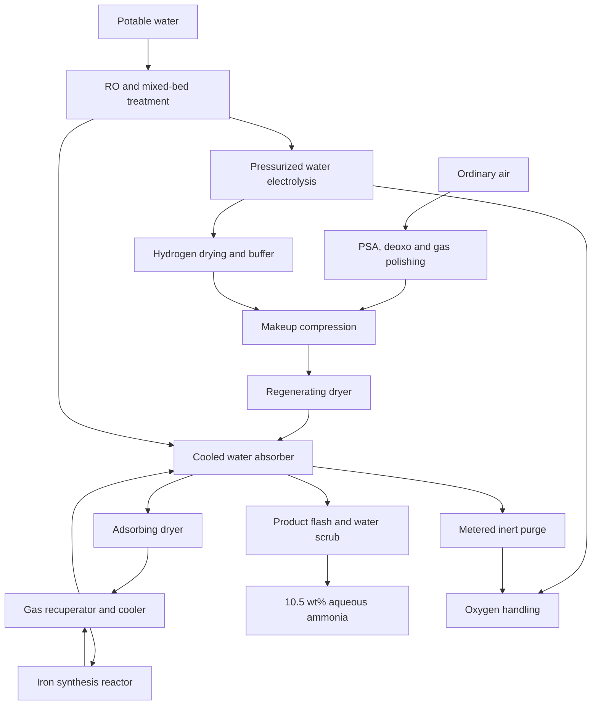

# P3 economical ammonia: available completed return

Chat: https://chatgpt.com/c/6af4eb36-d13c-83ec-811c-00db062459b3; actual user 992814bf-0076-48e9-9d50-addf62cf7e6c; final c9306717-aac0-56ce-8bde-07e69b50bb55. Observed 2026-11-12 01:57 UTC. Exact prompt source: P3_FULL_ECONOMICAL_AMMONIA_WITH_PHYSICAL_OPERATING_FREEDOM_PRO_20261112.txt.

Native final truncated at 20,000 characters; rendered continuation is transcribed with reconstructed table/math formatting. Commands in rendered continuation were not exposed in accessibility output. This is not full native/database-byte identity. Working activity and helper expansions were not captured in full. Linked artifacts remain uncollected with identity/eligibility unverified; no linked sources or components opened.

## Exact native prefix

## Result

**This attempt did not establish a genuinely new process that meets all your targets.** It did produce a substantially more practical, fully accounted engineering construction than the earlier low-temperature candidate, together with an executable model and decisive experimental designs. The remaining gap is consequential: the construction is largely established ammonia technology, its critical integration steps remain unqualified, and its estimated production cost is about **$1.50/kg NH₃**, even with favorable service-life assumptions.

Giving temperature and pressure their proper freedom changes the result. A **100 bar, approximately 400°C promoted-iron loop**, supplied by its own water electrolyzer, can plausibly produce useful quantities without palladium hydrogen-transfer membranes, hydride inventories, or salt-ammoniate product capture. The difficulty moves to affordable hydrogen equipment, reliable recovery and drying, service life, and utilization.

All plant-performance figures below are **conditional calculations, not experimental demonstrations**.

| Complete nominal-module result | Calculated value | Assessment |
|---|---:|---|
| Warm synthesis capacity | 1.50 kg NH₃/day | Deliberately exceeds 1 kg/day to cover commissioning |
| Useful NH₃ during the complete cold 100-hour interval | **5.060 kg** | Exceeds 4.167 kg |
| Aqueous product | **48.193 kg at 10.5 wt% NH₃-equivalent** | Meets concentration target if assays pass |
| Site electricity, including startup and shutdown | **56.629 kWh; 11.191 kWh/kg NH₃** | Conditional pass |
| Site electricity plus first-stock material preparation | **11.792 kWh/kg** | Conditional pass; this is not the full lifecycle metric |
| Cold operation plus allocated manufacture and preparation | **12.409 kWh/kg** | Fails the chosen evidence-limited lifetime case |
| Production cost at 1 tonne/day, 90% utilization | **$1.503/kg NH₃** | Fails $1/kg |
| Similarly costed condensation-based alternative | **$1.439/kg NH₃** | Direct aqueous recovery has no established cost advantage |

The complete deliverable is here: **:chatgpt-content-reference{index="13"}[ammonia_open_window.zip](sandbox:/workspace/scratch/1f6dcf494ae0/output/ammonia_open_window.zip)**. It contains the executable models, numerical results, component specifications, preparation and replacement ledgers, source notes, cost model, and experimental protocol. No physical experiment was executed.

---

## 1. The physical construction

### Why this operating window

The selected chemistry is conventional:

\[
\mathrm{N_2+3H_2\rightleftharpoons2NH_3},
\qquad
\mathrm{3H_2O\rightarrow3H_2+\tfrac32O_2}.
\]

Consequently, the sustainable net reaction is

\[
\boxed{\mathrm{N_2+3H_2O\rightarrow2NH_3+\tfrac32O_2}}.
\]

The proposed reactor operates around **100 bar absolute and 400°C**, allowing an approximately **8 mol% NH₃ outlet**. This substantially reduces the gas flow needed to transport each kilogram of product.

At the selected flow, gross sensible heating of the circulating gas is approximately **2.29 kWh/kg NH₃**, versus the 33.64 kWh/kg in the previous candidate supplied in your question. A 95% recuperator leaves approximately **0.115 kWh/kg**, rather than requiring exceptionally high recuperation to rescue an intrinsically large circulation duty. That improvement comes from the operating window and established catalytic chemistry; it is not a newly discovered mechanism.

For the rate anchor, I used Cholewa and colleagues’ measurements on crushed commercial promoted-iron catalyst, including reversible kinetics and product-loaded operation. Their experiments covered 350–450°C and 10–80 bar gauge, with an explicit activation and stabilization procedure. The proposed 100 bar cartridge is therefore a modest pressure extrapolation and a different assembly, not a measured replication. :chatgpt-content-reference{index="0"}

### Process arrangement

The two dryer beds exchange duties. Gas leaving the regenerating bed returns **upstream of the absorber**, so released ammonia and water remain inside the recovery operation. The diagram omits instrumentation and isolation valves, which are included in the specifications and budget.

### Actual components and dimensions

| Subsystem | Proposed construction and duty |
|---|---|
| Water treatment | 5 µm filtration, carbon dechlorination, RO at 70% recovery, mixed-bed polishing, final 0.2 µm filtration |
| Electrolyzer | Five series alkaline cells, each 200 cm²; 6 M KOH; 80°C; balanced nominal 30 bar |
| Electrolyzer electrical point | Approximately 60.68 A/cell, 0.303 A/cm², **9.50 V full-stack terminal voltage**, 96% rectifier efficiency |
| Hydrogen conditioning | Gas–liquid separator, demister, trace-oxygen recombination, regenerative drying and particulate guard |
| Hydrogen inventory | 0.5 L nominal buffer/associated gas volume at 30 bar; startup fill and shutdown venting counted |
| Nitrogen train | Oil-free compressor, aftercooler, CMS pressure-swing adsorption, supported-metal deoxo catalyst using plant H₂, final drying and polishing |
| Makeup compressor | Oil-free diaphragm booster; charges compression from actual delivery pressures, including the already pressurized hydrogen |
| Synthesis cartridge | Four 6 mm-ID channels, **0.804 m packed length each**; approximately 174 g promoted Fe and 6.82 g SiC |
| Recuperator | 95% thermal effectiveness as an exposed qualification requirement |
| Absorber | 60 cooled capillaries, 1 mm ID × 0.25 m; fresh water enters the polishing end |
| Recycle dryers | Two 0.25 kg commercial 3A molecular-sieve beds; each approximately 30 mm ID × 0.544 m |
| Dryer cycle | 24 h adsorption; partner bed receives 12 h regeneration at 300°C, then 12 h cooling |
| Product finishing | Pressure letdown to approximately 1.3 bar, dissolved-gas separation, water scrubbing of flash NH₃, closed storage and transfer |

The hot pressure tubes, headers, dryer vessels, seals and valves require qualified fabrication for their actual hydrogen/ammonia service. Illustrative tube dimensions are not a pressure-code certification. Inspection, controls, relief arrangements, containment and installation are charged in the budget.

### Catalyst procurement and preparation

The selected material is **commercial pre-reduced, stabilized promoted wüstite-derived iron, AmoMax 10RS**. Its commercial identity and granule form are established; a small-lot price, minimum order and activation guarantee for this assembly were not obtained. :chatgpt-content-reference{index="1"}

The proposed preparation is:

1. Purchase approximately **204.5 g** for the small module.
2. Crush and sieve under dry inert handling to **250–500 µm**, charging an **85% usable yield**.
3. Load approximately **173.8 g** into the four channels with the specified SiC distribution.
4. Activate in a **closed circulating H₂/N₂ loop**, collecting reduction water in a separate guard.
5. Measure the catalyst’s initial and final oxygen, nitrogen and hydrogen inventories.

The accounting assigns approximately **6.13 g factory H₂** to preparation of the purchased catalyst. Residual oxide reduction in the module consumes another approximately **0.438 g H₂** and produces **3.915 g water**.

Closed activation is essential. Scaling the source experiment’s **once-through** activation gas directly to this charge would consume approximately **1.14 kg H₂**, destroying the energy budget before useful production. The paper does not establish the proposed closed activation procedure; that is one of the required physical tests.

### Electrolyzer evidence and its limit

A relevant measured anchor is Kuleshov and colleagues’ five-cell, approximately 0.5 kW pressurized alkaline stack using nickel-based electrodes, 6 M KOH and a porous polymer/inorganic diaphragm. That supports the general scale and architecture, but does not supply this exact stack, coating process, price or lifetime. :chatgpt-content-reference{index="2"}

The construction specifies expanded nickel current collectors, nickel-based electrode coatings, nickel-clad plates, alkaline-resistant separator material and PTFE perimeter seals. **The simultaneous 1.90 V/cell, pressure, crossover and durability requirements remain qualification gates.** Naming a NiMo coating or a separator chemistry does not establish them.

For context, DOE’s alkaline-electrolysis status values distinguish approximately 51 kWh/kg H₂ stack energy from 55 kWh/kg system energy, and distinguish status from future targets and high-volume uninstalled cost assumptions. I have not treated the latter as a quotation for this module. :chatgpt-content-reference{index="3"}

---

## 2. Product, feeds and closed inventories

### Concrete fertilizer service

The product is **unacidified aqueous ammonia**, nominally **10.5 wt% NH₃-equivalent**, or approximately **8.64 wt% elemental nitrogen**. The intended use is closed transfer to **subsurface soil injection for corn or cereal fertilization**. Subsurface placement is established practice for avoiding ammonia volatilization from aqua ammonia. :chatgpt-content-reference{index="4"}

Proposed release specifications, per kilogram of solution, are:

| Property | Release limit |
|---|---:|
| NH₃-equivalent | 10.0–11.0 wt% |
| Insoluble solids | <10 mg |
| Fe, Ni, Cr | Each <1 mg |
| Pb, As, Cd | Each <0.1 mg |
| Total organic carbon | <10 mg |
| Chloride | <50 mg |
| Sodium + potassium | <100 mg |
| Nitrate + nitrite, as N | <2 mg |
| Non-ammoniacal nitrogen | <0.1% of ammoniacal nitrogen |

These are proposed purchasing and experimental acceptance criteria, not a claim of regulatory certification. No mineral acid is consumed to turn the product into an ammonium salt. Analytical and emergency acid traps are separately charged consumables and are excluded from useful product.

### Water and gas specifications

Feed water is ordinary potable water meeting declared limits: conductivity ≤500 µS/cm, hardness ≤150 mg/L as CaCO₃, TOC ≤2 mg/L, total fixed nitrogen ≤5 mg/L and no oil. After treatment, the targets are conductivity ≤1 µS/cm, TOC ≤0.1 mg/L, chloride ≤0.1 mg/L and **fixed nitrogen ≤0.01 mg/L**. Conductivity alone cannot certify the nitrogen blank.

The PSA product before deoxo is specified as:

- 98.799 mol% N₂;
- 1.2 mol% Ar;
- 10 ppm O₂.

Deoxo consumes the module’s own hydrogen. Regenerative adsorption removes air-derived water and CO₂ to the reject stream; the design does not assume an indefinitely effective disposable carbon bed.

At the nominal reactor inlet, the dry composition is approximately:

\[
y_{\mathrm{H_2}}=0.674925,\quad
y_{\mathrm{N_2}}=0.224975,\quad
y_{\mathrm{Ar}}=0.100000,\quad
y_{\mathrm{NH_3}}=0.000100.
\]

Required contaminant limits include CO+CO₂ ≤0.05 ppm, O₂ ≤0.1 ppm, and the more demanding recycle-water limits discussed below. These are acceptance requirements, not demonstrated outputs of an unspecified purifier.

### Complete 100-hour material ledger

| Quantity | Calculated amount |
|---|---:|
| NH₃ formed | 5.07709 kg |
| Useful recovered NH₃ | **5.06028 kg** |
| NH₃ retained inside equipment | 6.564 g |
| NH₃ handling/flash loss | 10.247 g |
| Hydrogen generated on site | 0.93090 kg |
| Hydrogen in disposal/tail streams | 23.10 g |
| Hydrogen retained at shutdown | 5.907 g |
| Nitrogen retained at shutdown | 24.628 g |
| Argon retained at shutdown | 15.435 g |
| PSA nitrogen/argon product | 3.53394 Nm³ |
| Dry ordinary-air intake | 8.94337 Nm³ |
| Actual humid intake at 35°C, 60% RH | 10.5796 m³ |
| Raw water purchased | 73.9428 kg |
| RO reject water | 22.1828 kg |
| Net electrolyzer water consumption | 8.31917 kg |
| Water in useful product | 43.1329 kg |
| Oxygen discharged after tail-H₂ oxidation | 7.20495 kg |

Here, Nm³ means 0°C and 1.01325 bar.

The retained NH₃ includes approximately **1.057 g in dryer solids** and **5.5 g in liquid hold-up**. The dryer also retains approximately **9.49 g water**. None is counted as delivered product.

Argon starts near **0.30%** in the newly filled loop and reaches approximately **9.90%** by shutdown. The model includes its fresh-feed input, metered purge, dissolution in product and final inventory. It does not start with a free argon bottle or omit inert accumulation.

Unused air nitrogen and original air oxygen leave through the PSA reject. Hydrogen-bearing purge and flash gas are handled separately; their hydrogen is oxidized with plant oxygen without an energy credit. No oxygen sales revenue is assumed.

The numerical bulk N/H/O/Ar balances close to floating-point precision. **That verifies accounting consistency for the represented species; it does not validate the assumed material properties or prove that every trace contaminant has been modeled.**

---

## 3. Finite kinetics, transport and the principal failure modes

The model does not assign a conversion or a recovery efficiency and then size equipment around it.

### Reactor calculation

The reactor integrates a reversible, product-inhibited iron-catalyst rate using gas fugacities:

\[
r \propto
\frac{
\sqrt{a_{\mathrm{N_2}}}\,K_{1/2}
\sqrt{a_{\mathrm{H_2}}^{1.5}/a_{\mathrm{NH_3}}}
-
\sqrt{a_{\mathrm{NH_3}}/a_{\mathrm{H_2}}^{1.5}}
}{
1+K_{\mathrm{ads}}a_{\mathrm{NH_3}}^{0.261}
}.
\]

The source’s rate normalization admits an interpretation issue. Rather than depend on its favorable interpretation, the integrated design installs enough catalyst for a **50% rate allowance**, in addition to an exposed 0.8 activity factor.

The calculation includes:

- SRK fugacities and reverse reaction;
- finite external film transfer;
- a finite mean-pore resistance with \(D_{\mathrm{eff}}=2\times10^{-7}\ \mathrm{m^2/s}\) as an unmeasured input;
- intraparticle temperature rise;
- axial gas heating and finite wall heat transfer;
- Ergun pressure loss;
- channel-flow and fixed-hardware deterioration cases.

Calculated nominal results are **1.112 Nm³/h circulation**, **411.5°C maximum bulk temperature**, **0.071 bar packed-bed pressure drop**, and approximately **0.321 bar total modeled loop pressure drop**.

The reactor releases approximately **53.4 W**. After imperfect recuperation and an assumed 12 W insulation loss, approximately **34 W** remains potentially available at useful temperature. The dryer requires roughly 13 W average high-temperature duty. A real thermal coupling must establish that transfer; low-temperature absorber heat is not credited as 300°C regeneration heat.

On the same installed hardware, halving catalyst activity reduces warm output from approximately 1.50 to **1.02 kg/day**. Returning 2% NH₃ instead of 100 ppm reduces it to approximately **1.17 kg/day**. The larger cartridge therefore provides margin, not immunity to inhibition or contamination.

### Absorption and drying are the most uncertain interface

A rich, well-mixed 10.5% ammonia bath cannot provide an arbitrarily low ammonia return pressure. The absorber therefore uses fresh-water polishing at one end and rich product withdrawal at the other.

Its assumed finite properties are a **65 µm liquid film**, **85% wetting**, and **1 mm/s overall transfer coefficient**. Those require approximately 6.9 transfer units; the proposed geometry supplies approximately 9.6 under those assumptions. Maldistribution or poor wetting can remove that margin.

The dryer uses competitive adsorption:

\[
\frac{dq_i}{dt}=k_i(q_i^*-q_i),\qquad
q_i^*=\frac{q_s b_i p_i}{1+\sum_jb_jp_j}.
\]

The high-pressure binary NH₃/H₂O parameters for the selected 3A material are **not measured inputs**. The model permits stored ammonia to be displaced during water uptake. In a higher-NH₃ challenge, it predicts outlet roll-up rather than pretending every bed is a perfect sink.

Required catalyst-inlet water performance is:

- sustained mean **≤0.05 ppm**;
- switching peaks **≤1 ppm**;
- independently demonstrated catalyst-rate retention.

These strict requirements are a major practical disadvantage of direct water absorption.

Dissolved H₂/N₂/Ar and product flashing are included using exposed Henry-law approximations. Actual high-pressure 10.5% ammonia-solution data are needed; pure-water solubilities are not treated as exact mixture measurements.

### Electrical distribution and crossover

A separate model resolves parallel electrical paths with contact-resistance and bubble-blockage variations. Nominal geometric current density is about 0.30 A/cm², but locally wetted regions can carry substantially higher current.

The main ledger assumes **99.5% net H₂ Faradaic yield**. The crossover model shows why this becomes harder at low load. Under its stated assumptions, preserving that yield at the half-load conditioning point requires hydrogen permeance no greater than approximately

\[
7.0\times10^{-11}\ \mathrm{mol\,cm^{-2}\,s^{-1}\,bar^{-1}}.
\]

That is a qualification limit, not a membrane achievement.

After current stops, the electrolyzer gas spaces must be depressurized and isolated promptly. The reactor’s two-hour cooldown does not authorize leaving stagnant pressurized H₂/O₂ compartments together for two hours.

---

## 4. Cold startup, shutdown and energy

### The complete clock

| Time | Operation | Treatment of output |
|---|---|---|
| 0–1.5 h | Water/air startup, purge, heating and pressure establishment | No useful production credited |
| 1.5–13.5 h | Closed-gas catalyst activation; collect reduction water | No useful production credited |
| 13.5–25.5 h | Synthesis stability check | Product quarantined |
| 25.5–26 h | Assay and release decision; synthesis continues | Counted only if acceptable |
| 26–98 h | Qualified collection | Useful production |
| 98–100 h | Stop feed, cool, recover liquids, isolate inventories | Retained stocks excluded |

The first twelve synthesis hours are assigned an **assumed average 75% rate**. The source measured a steady stability hold, not this startup transient.

This assumption matters. If all conditioning product is rejected, useful output remains approximately **4.468 kg**, but site energy rises to **12.674 kWh/kg**. The mass target survives; the energy target fails. Starting the clock after conditioning would hide that failure.

### Purchased-electricity ledger

| Item | kWh during 100 h |
|---|---:|
| Actual electrolyzer DC terminal \(VI\) integral | 47.267 |
| AC–DC conversion loss | 1.969 |
| Electrolyzer pumps, cooling and controls | 1.158 |
| Hydrogen purification and drying | 0.205 |
| Air compression, PSA and drying | 1.590 |
| Makeup compression and drive | 1.613 |
| Recycle circulation | 0.676 |
| Aqueous separation pumping and cooling | 0.665 |
| Water treatment | 0.148 |
| Plant controls and ventilation | 0.400 |
| Cold heating, activation hold and initial dryer heating | 0.890 |
| Shutdown cooling and controls | 0.048 |
| **Total** | **56.629** |

Dividing by **5.06028 kg actual recovered NH₃** gives **11.1908 kWh/kg**.

The first dedicated material-preparation allowance adds:

- 0.542 kWh for catalyst factory reduction and preparation;
- 0.500 kWh for initial sieve activation;
- 2.000 kWh for initial electrode/separator preparation.

These are exposed engineering allowances, not measured supplier declarations.

### Lifecycle preparation is a separate ledger

The embodied-energy assumptions are:

| Item | Assigned preparation/manufacturing energy | Allocation life |
|---|---:|---:|
| 

## Rendered remainder

[Rendered continuation of the partial table at the native prefix boundary; formatting reconstructed from the visible accessibility view.]

### Lifecycle preparation is a separate ledger

The embodied-energy assumptions are:

| Item | Assigned preparation/manufacturing energy | Allocation life |
|---|---:|---|
| Pressure equipment and heat exchangers | 1,000 kWh | 15 years at 90% utilization |
| Reused electrolyzer frame and power electronics | 400 kWh | Same |
| Active nickel electrodes and separator set | 48 kWh/set | 1,000 operating h |
| Dryer media | 5 kWh/charge | 16,000 h |
| Catalyst preparation | 0.542 kWh/charge | 40,000 h |
| KOH, CMS, resin, carbon and polishing stocks | 12 kWh | 8,000 h |

This adds 1.219 kWh/kg, giving 12.409 kWh/kg for the cold interval plus allocated manufacture/preparation. The 1,000-hour electrode allocation is a conservative qualification policy tied to relevant experimental duration, not an observed failure lifetime. Extending it to 2,000 hours lowers the calculated total to roughly 11.94 kWh/kg, but that cannot be claimed until the same assembly maintains its voltage, crossover and serviceability. Full first-stock preparation and amortized preparation are not added twice. Equally, charging the entire first equipment build to the first five kilograms would produce a much larger number than any of these operating metrics.

### Operating limits

The initial qualification range is 20–35°C ambient and 75–100% continuous load. At 35°C ambient the absorber operates at approximately 40°C; there is no free cold-water utility. Higher temperatures require derating or paid refrigeration. Deep turndown is not assumed: crossover fractions and fixed auxiliary power rise. Repeated cold cycling requires measured reheat, purge, seal-fatigue and catalyst-state ledgers. The economics assume grid-supported operation and continuous product use, not free batteries or direct solar-only utilization. Important sensitivities are:

| Change | Useful NH₃ in 100 h | Site kWh/kg |
|---|---:|---:|
| Nominal | 5.060 kg | 11.191 |
| Reject conditioning product | 4.468 kg | 12.674 |
| Cell voltage rises to 2.10 V | 5.060 kg | 12.215 |
| Rectifier efficiency falls to 90% | 5.060 kg | 11.839 |
| Air-train energy rises to 0.80 kWh/Nm³ | 5.060 kg | 11.435 |
| Continuous 1 ppm water exposure under the assumed poisoning model | 4.593 kg | 11.273 |
| Product handling loss rises to 5% | 4.817 kg | 11.757 |

The water case illustrates a limitation of energy ratios: reduced output can also reduce hydrogen demand, leaving a superficially acceptable kWh/kg while undermining capacity and long-term catalyst service.

## 5. Production scale and full cost

A tonne/day plant should not be one thousand copies of a laboratory module. The production construction uses a shared approximately 450 kW hydrogen package, shared air treatment and compression, and three conventional intercooled iron beds. The conservative sizing gives approximately:

- 141.5 kg installed Fe, rounded to 170 kg purchased after yield and useful-output allowance;
- three 250 mm-ID beds, approximately 0.250, 0.470 and 0.784 m packed length;
- 375°C inlet to each bed and approximately 421°C peak temperature;
- approximately 364 kg of cylindrical pressure-vessel metal before heads and nozzles;
- two approximately 11.9 kW intercoolers;
- an absorber with about 40 m² wetted surface;
- two approximately 167 kg operating dryer beds, with additional media charged for service and spares.

These dimensions support a fabrication estimate; they are not certified drawings or purchased assets.

### Installed capital

| Complete installed scope | Allowance |
|---|---:|
| Hydrogen system: treatment, rectification, gas handling, cooling and installation | $787,500 |
| Air/N₂ preparation and purification | $45,000 |
| Makeup compression | $60,000 |
| Reactor, recuperator and first catalyst | $75,000 |
| Recycle circulator | $18,000 |
| High-pressure absorber and cooling | $95,000 |
| Duplex dryers, heaters, valves and first media | $90,000 |
| Flash separation and low-pressure scrub | $15,000 |
| Product storage, containment and transfer | $22,000 |
| Additional warm-loop cooling | $12,000 |
| Controls and detection | $28,000 |
| Piping, valves and insulation | $25,000 |
| Site connections, installation and certification | $40,000 |
| Manufacturing engineering, QA and warranty allocation | $25,000 |
| Ammonia-subsystem contingency | $82,500 |
| Total | $1,420,000 |

These are engineering allowances, not supplier quotations. Custom fabrication is charged at 90% yield; catalyst crushing is charged at 85%. The hydrogen-package allowance includes its installation scope rather than taking an uninstalled stack price as a complete plant. That distinction is material. IEA’s 2026 analysis reports substantial geography-dependent installed electrolyzer costs and large engineering, procurement, construction and balance-of-plant contributions. Those market ranges do not provide a guaranteed 450 kW offer at their lowest endpoint. [Visible link: https://www.iea.org/commentaries/what-explains-the-cost-advantage-of-chinese-electrolysers?utm_source=chatgpt.com]

### Annualized cost

Assumptions are 90% utilization, 328,500 kg/year, 15-year capital life, 8% real financing, $0.05/kWh, and 11.5 kWh/kg annual complete-energy input. The latter is an exposed production-scale economic assumption, not a substitution for the small module’s cold-run result.

| Cost component | $/kg actual NH₃ |
|---|---:|
| Electricity | 0.575 |
| Initial capital recovery | 0.505 |
| Major replacements | 0.117 |
| Routine maintenance | 0.086 |
| Paid labor, site, insurance and assays | 0.146 |
| Water, filters, electrolyte and waste | 0.065 |
| Working capital and decommissioning | 0.008 |
| Total | 1.503 |

Major replacement assumptions include a $236,250 hydrogen-stack service every 60,000 hours, $24,000 catalyst service every 40,000 hours, $14,000 dryer-media service every 16,000 hours, and separately charged compressor, valve, heater, control and purifier services. Those long lives are not established for this assembly. They are favorable economic assumptions, and the plant still misses the target. Sensitivity is consequential:

- 60% utilization: $1.871/kg.
- 75% utilization: $1.657/kg.
- 20,000-hour hydrogen-stack life: $1.699/kg.
- Ten-year capital life: $1.650/kg.
- 12% real financing: $1.629/kg.
- Reducing energy from 11.5 to 10.0 kWh/kg saves only $0.075/kg.

Thus, improving an isolated catalyst or shaving a few tenths of a volt does not by itself close the full cost gap. The separately budgeted first 1.5-kg/day demonstrator is $173,750, with an indicative range of $130,000–240,000 pending bids. It includes custom hardware, inspection, paid laboratory access, labor, analysis and contingency. It is not a repeat-production selling price.

## 6. Comparison with competent alternatives

### Electrolysis plus condensation-based Haber–Bosch

I gave the incumbent the same freedom to choose pressure, temperature and recycle composition. The comparator solves finite condensation approach, gas fugacities, fresh-gas dilution, inert purge, product inhibition, compression, refrigeration and aqueous finishing. Representative results at the same warm gross synthesis capacity are:

| Recovery arrangement | Reactor inlet NH₃ | Installed Fe | Circulation, Nm³/h | Common steady energy, kWh/kg |
|---|---:|---:|---:|---:|
| Direct aqueous; 100 bar, 400°C reactor | 0.010% | 174 g | 1.112 | 10.515 |
| Condensation at −20°C; 100 bar, 400°C reactor | 2.960% | 240 g | 1.763 | 10.848 |
| Condensation at 20°C; 200 bar, 400°C reactor | 7.484% | 296 g | 1.120 | 10.721 |
| Condensation at 35°C; 200 bar, 420°C reactor | 10.020% | 490 g | 0.686 | 10.644 |

These are matched steady-boundary comparisons, not cold 100-hour demonstrations. The condenser’s complete startup, receiver inventory, letdown flash and shutdown recovery still require integrated qualification. Comparing its 10.64 steady result directly with the aqueous module’s 11.19 cold result would be misleading. Nevertheless, the result is sufficient to reject a claimed decisive energy advantage for direct aqueous recovery. The approximately 0.13–0.33 kWh/kg difference is small relative to uncertainties and additional dryer costs. The complete economic comparator costs $1.439/kg at the same annual energy assumption, financing and utilization. Under a favorable scenario—$500/kW installed hydrogen equipment, $12,000/year operator labor and 9.5 kWh/kg complete energy—it reaches approximately $0.996/kg. That is not an obtained offer, but it demonstrates why this work is not an impossibility argument. A current commercial electrolyzer datasheet provides a useful reality check: Enapter lists 51.3 kWh/kg H₂ within stated battery limits at beginning of life and 15°C, with additional dryer power. Ambient conditions, drying and battery limits therefore matter even for commercially described systems. [Visible link: https://www.enapter.com/wp-content/uploads/2025/05/Datasheet_AEM-Nexus-500_15.06.2026.pdf?utm_source=chatgpt.com]

### Purchased fertilizer

I used posted agricultural prices rather than expensive laboratory ammonia. Examples retrieved were $785.70/US short ton at one cooperative and $870/short ton at another; USDA’s Illinois report gave a higher comparison point. These are dated posted prices, not present delivery contracts. [Visible link: https://s3.amazonaws.com/media.agricharts.com/sites/1041/2026-8-4.pdf?utm_source=chatgpt.com] The service calculation additionally charges:

- truck and driver for a declared local delivery scenario;
- receiving, storage and dilution equipment;
- financing and maintenance;
- operator time, water, waste and 0.5% losses.

It produces approximately $1.08–1.29/kg actual NH₃ delivered into the same aqueous service. Only the starting fertilizer prices are observed offers; the delivery and receiving additions are explicitly costed scenarios. No site-specific delivered quotation was obtained. The supplier’s manufacturing energy and provenance are also unknown, so purchased fertilizer is not assigned zero lifecycle energy.

## 7. What was actually investigated as the new operation?

The cost-changing proposal was a replaceable active-electrode/separator cassette: retain pressure-rated frames, plates and manifolds, and replace a low-cost active leaf rather than assuming a research coating survives for decades. The underlying catalyst-coated-diaphragm mechanism is already prior art. Xu and colleagues report a specific catalyst/binder preparation and measured operation, including approximately 300-hour tests and a longer switched-load test. Those durations cannot be moved to a different current density, pressure and cheap catalyst formulation without evidence. [Visible link: https://www.nature.com/articles/s44172-025-00344-2?utm_source=chatgpt.com]

I charged the actual reported high binder loading, separator area, preparation, rejects and replacement work. The resulting screen was unfavorable:

| Cassette case | Active area at 1 t/day | Replacement set allowance | Complete cost in the favorable screening plant |
|---|---:|---:|---:|
| 0.5 A/cm², 1.72 V, 300-hour replacement policy | 40.97 m² | $16,105 | $2.36/kg |
| Switched-load mean 0.6 A/cm², assumed 1.78 V, 1,000-hour policy | 34.14 m² | $13,788 | $1.37/kg |
| Optimistic 1 A/cm², 1.8 V, 1,000-hour policy | 20.48 m² | $9,153 | $1.25/kg |

These screening costs use a more favorable balance of plant than the final audited aqueous construction; they are not alternative validated factory prices. Even with an artificially low $400,000 fixed plant cost, the switched-load case would need a complete 1,000-hour replacement set costing roughly $3,150, versus the $13,788 allowance, or several thousand hours of qualified life at that set price. The proposal therefore fails its simultaneous area, preparation, life and service-cost test. It should not be presented as an economical invention. Other credit is also due:

- Promoted iron and multibed synthesis are established Haber–Bosch practice.
- Water absorption followed by regenerable drying of synthesis recycle appears in patent literature with 1977 priority. [Visible link: https://patents.google.com/patent/EP0001324B1/en?utm_source=chatgpt.com]
- Capillary-fed electrolysis has already demonstrated exceptionally low cell voltage; that physical mechanism belongs to its inventors, and a cell result does not supply this plant’s installed price and lifetime. [Visible link: https://www.nature.com/articles/s41467-022-28953-x?utm_source=chatgpt.com]

The unestablished operation in the selected construction is reliable, economical integration of water absorption, competitive drying, closed activation and catalyst protection. It is a useful experimental target, but I have not established that it is novel or economically superior.

## 8. A decisive physical prototype—designed, not executed

### Stage A: test the largest integration risk first

A $25,000 paid-access experiment tests whether the dryer operation can actually protect iron while closing ammonia and water inventories. Use:

- two 5 g 3A beds in qualified pressure tubes;
- 100 bar adsorption at 40°C;
- approximately 20 NL/h carrier flow;
- initially 100 ppm NH₃ and approximately 850 ppm water;
- a subsequent 1,000 ppm NH₃ challenge;
- 300°C regeneration with approximately 3 NL/h makeup gas;
- twelve-hour regeneration, twelve-hour cooling and at least five cycles.

Start with nitrogen carrier, then test the actual H₂/N₂ mixture. Meter and analyze everything entering, leaving and remaining in each bed. The expected daily ammonia throughput is approximately 36.5 mg, versus a required integrated blank below 0.1 mg. Water loading is approximately 327 mg/day. Pass criteria are:

- mean catalyst-feed water ≤0.05 ppm and switching peaks ≤1 ppm;
- NH₃ roll-up ≤1,000 ppm;
- ≥99% ammonia cycle closure;
- water balance within ±3%;
- adsorbate-inventory drift <1% per cycle;
- measured regeneration heat compatible with the scaled duty.

Failure here rejects the proposed direct aqueous integration before an expensive complete build. Passing establishes a component operation, not catalyst lifetime or factory economics.

### Stage B: complete 0.15-kg/day apparatus

The smaller complete apparatus has a $99,000 budget, including pressure hardware, fabrication and inspection, on-site air separation and electrolysis, sensors, paid laboratory space, labor, consumables, isotopes and analytical access. Stages A and B together are $124,000 without equipment-reuse credit. Its synthesis section uses approximately 20–25 g Fe in a 6 mm-ID heated tube, with scaled absorption and duplex drying. It follows the same cold-start-inclusive schedule. The conditional target is:

- approximately 0.509 kg gross NH₃ during 100 hours;
- at least 0.48 kg accepted NH₃;
- product concentration at least 10 wt%.

The whole-process energy gate is independent: E_100h ≤ 12(0.48) = 5.76 kWh. That allows only 57.6 W average over the entire interval. The miniature apparatus may fail because instrumentation and auxiliary losses do not scale down well. A chemical-integration success must not be relabeled an energy success.

### Measurements and source attribution

Measure:
- wall AC power and every cell’s terminal voltage/current;
- calibrated feed, recycle, purge and flash flows;
- reactor and dryer temperature profiles and pressure loss;
- H₂/N₂/Ar/O₂ gas composition;
- online NH₃ and trace water;
- gravimetric product output;
- independent ammonia titration and ion chromatography;
- water content and metal contamination;
- initial/final electrolyte, catalyst, sorbent, gas and liquid inventories.

Controls include catalyst-free SiC, no-H₂, no-current, N₂-to-Ar substitution, water and sampling blanks, and assays of all starting materials. Calibrate with matrix-matched standards, standard additions and dilution series; use a second analytical method. Require an initial non-atmospheric fixed-nitrogen bound of ≤20 mg N. That reservoir cannot explain a 480 g NH₃ product, but its contribution must still be subtracted and checked. After ordinary-air baseline operation, conduct a separately accounted isotope pulse:

- approximately 0.82 NL of 98 atom% ¹⁵N₂;
- substitute it for 10% of nitrogen feed over two hours;
- expected maximum excess labeled signal approximately 1.225 g NH₃-equivalent;
- measure actual loop-gas enrichment, product enrichment, washout and retained adsorbed label.

The experiment must quantitatively match label appearance to the measured gas pool, rather than merely display a labeled peak. Cylinder gas itself must be checked for ammonia and nitrogen-oxide contamination. This follows the logic of rigorous quantitative isotope protocols, not an assumption that enriched gas is automatically clean. [Visible link: https://www.nature.com/articles/s41586-019-1260-x?utm_source=chatgpt.com]

The isotope cylinder is a paid diagnostic input and is excluded from the ordinary-air production baseline. Require N/H/O/water closure within ±3%, with propagated analytical uncertainty, and ≤5% corrected catalytic-rate decay through the switching sequence. Initial and final hydrogen-containing inventories must be measured; no initial hydride, membrane charge or disappearing electrolyte water is credited as renewable hydrogen.

## What the executable package establishes

Run: [command not exposed in accessibility rendering]. For the additional pressure/temperature condensation sweep: [command not exposed in accessibility rendering]. The package uses the Python standard library. It reproduces the complete cold ledger, finite reactor and separation calculations, crossover/current-distribution screens, replacement economics and comparator scenarios. The accounting checks passed for modeled time, electricity, recovered/retained product and bulk atom balances.

The useful result is a concrete, falsifiable construction and a quantified rejection of its claimed breakthrough—not a successful invention disguised by optimistic bookkeeping. Higher-pressure iron synthesis resolves much of the previous circulation and catalyst problem. It does not establish cheap complete equipment, durable electrolysis, or a superior recovery operation. Those coupled requirements remain unresolved, and the stronger condensation alternative must remain the benchmark against which any next invention is judged.
