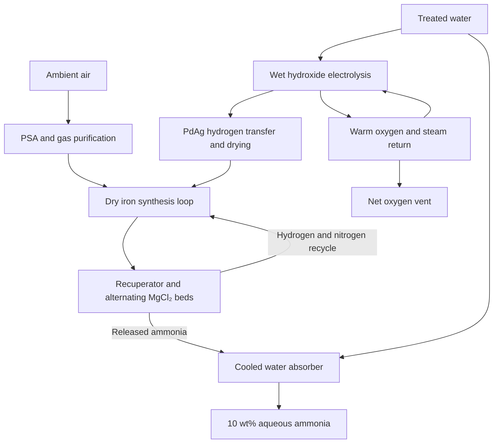

# P3 air/water ammonia: available completed return

Chat: https://chatgpt.com/c/6af4eb36-d13c-83ec-811c-00db062459b3
Question: P3_FULL_MODULAR_AIR_WATER_AMMONIA_INVENTION_PRO_20261112.txt, user cda7244d-9f78-4d60-8fd4-45e1a48c9a38. Final: fefa0c2f-36da-55fb-a8c4-a00cc486c43d. Observed 2026-11-11 23:57 UTC; UI Pro, completed, empty composer.

The native response is truncated at 20,000 characters. The remainder is transcribed from rendered UI, with table and mathematical formatting reconstructed where visible; it is not full native/database-byte identity. Activity text is excerpted below, not a full expansion of nested activity or helpers. Producer-linked ammonia_complete_cycle.zip has unverified identity/eligibility and was not collected; no linked sources or components were opened.

## Available visible activity excerpts

“I’ll work this as a complete process design: close the energy and material balances, compare credible routes, and develop the strongest candidate into a reactor, cost model and decisive prototype. I’ll use parallel reviews for the chemistry, plant economics and failure modes, with measured performance kept separate from proposed performance.”

“A useful experimental lead has emerged: a published 250°C membrane reactor combines water splitting, hydrogen transfer and ammonia synthesis, and reports roughly 90% ammonia current efficiency at 1.75–1.85 V with gas recycling. Those numbers leave a plausible energy margin. The gaps are substantial, though: the experiment uses cryogenic ammonia separation, a thick palladium–silver membrane and laboratory gas handling. I’m examining whether replacing those parts can preserve the performance at a viable cost.”

“The cost model is now separating the promising chemistry from the factory claim. Scaling the published reactor preserves a plausible energy budget, but requires expensive membrane area and ruthenium. I’m developing a cheaper iron-catalyst variant with a dry, regenerable ammonia trap. Its key test is whether it can keep ammonia and water low enough to sustain the iron catalyst’s rate while using the hot cell’s waste heat for regeneration.”

“The complete-cycle checks exposed two penalties that change the design: a small vacuum pump can consume more power than the ideal compression calculation suggests, and charging the ammonia sorbent at startup consumes real product and electricity. I’ve removed vacuum regeneration from the main design and am including startup inventory explicitly. A newer iron catalyst may also reduce material cost, but I’m checking its actual low-temperature rate and stability before using it.”

“The first complete model misses the targets: about 11.5 kWh/kg during steady operation rises above 13 kWh/kg when startup and sorbent charging are included, and the optimistic production cost is above $2/kg. I’m checking whether those gaps come from avoidable design choices or weak assumptions. The design package will show the balances, uncertainty and failure thresholds; I won’t present the steady-state number as a complete-process pass.”

“The complete balance exposes two decisive costs: establishing the ammonia inventory in the recovery beds, and replacing the catalyst, sorbent and membrane. The current design projects about 11.9 kWh/kg during steady operation, but 14.1 kWh/kg when startup is charged to the first 100-hour run, and about $2.59/kg at one tonne per day. I’m packaging the executable model and a prototype that tests the uncertain operations directly; these are projections, not demonstrated performance.”

“The proposed operation is a specific integration: a thin hydrogen-transfer membrane feeds a separately dried iron synthesis loop, while alternating salt beds recover ammonia without refrigeration. The membrane, salt capture and iron catalysis each have precedents. Their performance together is untested—especially the iron catalyst at realistic ammonia concentrations and the thin membrane in hot wet caustic. The prototype therefore measures those failures directly and checks whether any output comes from the catalyst’s initial hydrogen inventory.”

“The cost audit raised the estimate to about $3.38/kg. I replaced the lumped heat-exchanger allowance with a cost tied to its required area, and added explicit water, waste, site, quality-control, spare-parts and decommissioning costs. The energy result is unchanged. The design now misses both targets even with favorable material-life assumptions; the model also shows which improvements would matter and which would barely move the result.”

## Exact native prefix

## Result: a complete candidate, but not a successful solution of both targets

I developed a concrete reactor architecture, closed its operating material and energy balances, and built an executable model. **The resulting design does not meet your full specification.** Its projected steady operation approaches the energy target, but startup and material preparation push it over; its production cost is substantially above $1/kg.

The candidate combines **warm-water electrolysis through a supported palladium–silver membrane, a separately dried iron synthesis loop, and regenerative magnesium-chloride ammonia recovery**. It uses neither supplied hydrogen nor a sacrificial reagent as its intended energy source. However, several properties necessary for that statement to remain true—particularly conservation of the catalyst’s hydride inventory—still require experimental proof.

| Requirement | Final calculated result | Status |
|---|---:|---|
| Actual ammonia production | 1 kg/day | Conditional reactor calculation |
| Useful product | 10 kg/day of 10 wt% aqueous NH₃ | Recovery and purity require qualification |
| Continuous production interval | 100 h after conditioning; 4.167 kg NH₃ collected | Proposed experiment, not demonstrated |
| Installed operating conditions | 245°C, 18 bar | Within the specified operating envelope |
| Steady purchased electricity | **11.90 kWh/kg NH₃** | Conditional |
| Startup charged to the 100 h production interval | **14.09 kWh/kg NH₃** | **Fails 12 kWh/kg** |
| Including assumed lifetime-allocated material preparation | **14.84 kWh/kg NH₃** | **Fails 12 kWh/kg** |
| Production cost at 1 tonne/day and $0.05/kWh | **$3.38/kg NH₃** | **Fails $1/kg** |
| Installed production plant budget | **$3.60 million** | Engineering allowances, not quotations |

These are final model results after charging heat-exchanger area, manufacturing rejects, material replacement, water and waste, site costs, quality control, financing and decommissioning. They are not measurements.

**Executable deliverable:** :chatgpt-content-reference{index="11"}[ammonia_complete_cycle.zip](sandbox:/workspace/scratch/1f6dcf494ae0/output/ammonia_complete_cycle.zip)

The package contains four Python programs, numerical results, sensitivity tables, construction notes, source provenance and the proposed experiment. It uses only the Python standard library. I executed the calculations and balance checks; **I did not execute a physical experiment**.

---

## 1. The architecture and what would actually be new

The design separates three operations that impose conflicting chemical requirements:

1. **Water oxidation and hydrogen production** occur in a wet, conductive hydroxide electrolyte.
2. **Nitrogen activation and hydrogenation** occur in a dry gas loop.
3. **Ammonia recovery** occurs through a regenerable solid, followed by absorption into water outside that dry loop.

The proposed architectural change is a **thin, supported hydrogen-transfer cassette feeding a protected hydrogen makeup stream**, combined with a warm oxygen return and alternating ammonia sorbent beds. Its purpose is to retain the favorable electrolysis temperature while preventing water from poisoning the synthesis catalyst and avoiding refrigerated ammonia condensation.

This is **not** a claim that palladium hydrogen transfer, low-pressure Haber–Bosch chemistry or salt-assisted ammonia separation is new.

A particularly relevant predecessor is Sagara, Watanabe and Kubota’s 2025 experiment: a Pd-alloy membrane, molten hydroxide, nickel anode and ruthenium catalyst operated at 250°C and 10 bar, with ammonia separation and gas recycle. It reported roughly 1.75–1.85 V at 100 mA/cm², but used a −75°C separator. Those measured cell results are a useful starting point, not a complete plant energy figure. :chatgpt-content-reference{index="0"}

Absorption-enhanced synthesis using air separation, water electrolysis and ammonia-binding salts also has substantial prior art. Micrometre-scale supported PdAg membrane fabrication predates this proposal. :chatgpt-content-reference{index="1"}

**The untested operation here is their particular integration:** a supported 2 µm PdAg film must survive wet hot caustic, supply dry hydrogen at useful current density, and share heat with an inhibited iron catalyst and a low-partial-pressure sorbent cycle. I have not established patent novelty, and the calculation does not establish a consequential economic advantage.

The supplied lithium/Pd paper is an important interface demonstration, but its approximately 36% Faradaic efficiency and multi-volt full-cell operation do not provide this energy budget. At 7 V and 36%, the charge term alone is about 92 kWh/kg. Likewise, the dissociative metal-mediated thermodynamic analysis constrains its specified deposition–nitridation–protonation cycle; it does not rule out every architecture. :chatgpt-content-reference{index="2"}

---

## 2. A specific 1 kg/day module

### Feed preparation and complete chemistry

The intended sustainable reaction is

\[
\mathrm{N_2+3H_2O\rightarrow2NH_3+\tfrac32O_2}.
\]

Hydrogen is an internal intermediate. Its production, purification, drying, losses and electrical demand are included.

Ordinary air enters at 1 bar and 20–35°C. The front end comprises an inlet filter, oil-free compressor, condensate separator, twin-bed pressure-swing adsorption system, deoxygenation catalyst, regenerable dryer and CO₂/VOC guard. The model includes argon in the nitrogen product; it does not treat PSA gas as pure nitrogen.

The specified water supply is attainable potable water, initially **TDS ≤500 mg/L**, followed by RO and mixed-bed deionization. Acceptance targets after polishing are conductivity ≤1 µS/cm, chloride ≤0.1 mg/L and TOC ≤0.5 mg/L. These are proposed feed specifications, not assumed field measurements.

### Hardware and operating point

| Subsystem | Proposed construction and operating condition |
|---|---|
| Electrolyzer | 34 electrically isolated cells in series; approximately 98 cm² projected membrane area per cell; 3 mm electrolyte gap; Ni200 anodes |
| Electrolyte | Equimolar NaOH/KOH; initial total charge 0.8 kg dry hydroxides plus 0.8 kg water; actual hot water content must be measured |
| Hydrogen-transfer membrane | Pd₇₅Ag₂₅ atomic composition, 2.0 ± 0.2 µm thick, on porous nickel support |
| Membrane area | 0.3325 m² fabricated area; 0.2660 m² active area after support obstruction |
| Electrical operation | 6.26 A through the series stack; approximately 64.7 V stack voltage; equivalent single-cell current 212.8 A |
| Hydrogen guard | Separate makeup-H₂ plenum, cooled deoxo stage and two 100 g regenerable 3A molecular-sieve beds |
| Synthesis reactor | 7.07 kg shaped iron catalyst in six 50 mm-ID tubes, each approximately 0.923 m active length |
| Synthesis conditions | 245°C, 18 bar; H₂:N₂ = 3:1 among reactive gases; 10% argon in the loop |
| Gas circulation | 20 Nm³/h; approximately 0.077 bar modeled loop pressure drop |
| Gas recuperator | Welded counterflow 316L core, approximately 1.76 m² heat-transfer area; required effectiveness 98% |
| Ammonia sorbent | Two beds, each containing 1.204 kg of 40 wt% MgCl₂/silica |
| Sorbent cycle | Capture at 50°C and 18 bar; release at 220°C against approximately 1 bar NH₃ |
| Product recovery | Cooled packed water absorber; 9 kg water added per kg recovered NH₃ |

The hydrogen guard sees **fresh hydrogen only**. Sending the ammonia-bearing recycle through a molecular-sieve dryer would introduce another ammonia inventory and separation problem.

The cells also need electrically isolated wet compartments. A shared conductive hydroxide manifold could create shunt currents and corrosion that are absent from the nominal voltage calculation.

### Membrane preparation and required properties

A concrete starting fabrication route is magnetron sputtering from a prealloyed PdAg target onto polished silicon, followed by framed release and transfer to a porous nickel support. Proposed initial conditions are 0.3–0.7 Pa argon, cooled substrate below 100°C and approximately 0.04 µm/min deposition for 50 minutes.

The support is 200–500 µm thick, with ≤2 µm face pores and 35–45% porosity. Composition, thickness, pinholes, adhesion and pressure-cycle integrity require inspection. This recipe is a development starting point based on established thin-film methods; **durability in the proposed caustic environment is unmeasured**.

Required hydrogen flux is approximately

\[
J_{\mathrm{H_2}}=\frac{j}{2F}
=0.00415\ \mathrm{mol\,m^{-2}\,s^{-1}}
\]

at an active-area current density of 80 mA/cm².

A deliberately demanding acceptance condition is that the membrane and downstream guard together hold water ingress into the catalyst below **0.1 mg/day per 1 kg/day capacity**. Oxygen crossover is monitored independently. Pressure balancing reduces mechanical load; it does not eliminate diffusive crossover.

### Catalyst choice, preparation and its hidden inventories

The main catalyst is the published **BaH₂–BaO/Fe/CaH₂** material. Its evidence includes approximately 0.72 mmol NH₃ g⁻¹ h⁻¹ at 200°C and 9 bar, measured product inhibition and a 100-hour stability experiment. These are dilute-product measurements, not measurements of this reactor. :chatgpt-content-reference{index="3"}

The preparation uses iron oxide, barium nitrate and calcium hydride, with hydrogen activation at 300°C. The source also conditions the catalyst in synthesis gas at 300°C before low-temperature measurements. Those operations must be purchased and charged; they cannot be silently omitted.

For the module, I propose inert dry pressing and sieving to 0.5 mm granules. The model assumes:

- Bulk density: 650 kg/m³.
- Packed void fraction: 0.40.
- Retained activity after shaping: 80%.
- Effective pore diffusivity: \(5\times10^{-7}\ \mathrm{m^2/s}\).

All four are qualification targets.

There is an especially important inventory problem. The installed catalyst could initially contain **0.261 kg H₂-equivalent**, enough hydrogen for approximately **1.47 kg NH₃**, or **35% of the intended 100-hour output**. Its barium-nitrate precursor also represents an upper bound of about **44 g NH₃-equivalent nitrogen before conditioning**.

Therefore:

> A large ammonia yield is insufficient. The experiment must demonstrate conserved hydride functionality, negligible net use of initial hydrogen, and fixation of newly supplied nitrogen.

If calcium hydride is progressively converted into amide or another depleted phase, this architecture fails its intended renewable cycle. I do not count such consumption as a useful alternative operating mode.

The higher-temperature catalyst preparation is outside the installed production module. **If your 250°C ceiling also prohibits initial manufacture and activation of replaceable materials above that temperature, this catalyst choice fails that interpretation too.**

---

## 3. Material balance and useful fertilizer product

The following is the conditional steady balance per **1 kg actual recovered NH₃**.

| Stream | Quantity |
|---|---:|
| Ordinary dry-air equivalent entering PSA | 1.935 Nm³ |
| Fresh nitrogen reaching synthesis system | 0.8498 kg |
| Fresh argon entering synthesis system | 0.01472 kg |
| Hydrogen generated on site | 0.1921 kg |
| Gross ammonia formed | 1.0050 kg |
| Recovered ammonia | **1.0000 kg** |
| Ammonia assigned to contained loss/waste | 0.0050 kg |
| Nitrogen leaving synthesis purge | 0.02322 kg |
| Hydrogen oxidized in waste-gas treatment | 0.01362 kg |
| Net oxygen generated after internal consumption | 1.4163 kg |
| Net reaction water consumed | 1.5947 kg |
| Product dilution water | 9.000 kg |
| Raw water, including treatment losses | 14.4596 kg |
| RO reject | 3.6149 kg |
| Additional water-train rinse/vent loss | 0.250 kg |

Approximately another 1.04 kg nitrogen is rejected at the air-separation front end. It leaves with separated air oxygen and argon. The process-generated oxygen is distinct from that ordinary air oxygen.

Unreturned hydrogen is treated in a cooled catalytic recombiner using the plant’s own oxygen. Its water is collected and polished. No oxygen-sale revenue or high-temperature heat credit is assigned to this treatment.

The 0.25 kg water allowance is **not** an unpriced concentrated hydroxide purge. Hydroxide losses, service replacement and disposal are separately charged.

### Product specification

The intended use is **subsurface soil injection of aqueous ammonia in irrigated row-crop production**. This is a concrete fertilizer service, although local product approval and agronomic application rates remain separate matters.

Proposed release specifications are:

| Property | Acceptance target |
|---|---:|
| NH₃ concentration | ≥10.0 wt% |
| Nitrogen content at 10 wt% NH₃ | Approximately 8.22 wt% N |
| Chloride | <100 mg/kg solution |
| Sodium plus potassium | <50 mg/kg solution |
| Barium and nickel | Each <0.1 mg/kg solution |
| Palladium plus silver | <0.01 mg/kg solution |
| Nitrate plus nitrite | <1 mg N/kg solution |
| Insoluble material | <10 mg/kg solution |

These are engineering acceptance targets, **not a claim of regulatory certification**. NH₃ concentration is determined by titration and an independent analytical method; metals require ICP analysis. Failed batches remain contained.

The product is recovered into water. Acid used in analytical traps or emergency waste treatment does not create additional credited ammonia product.

---

## 4. Reactor, transport and recovery model

### Catalytic rate and product inhibition

I fitted a reduced-order plug-flow model to the reported dilute-gas iron result, using an integrated laboratory reactor calculation rather than treating the published average rate as a local outlet rate.

The working rate law is

\[
r =
k_0
\exp\!\left[
\frac{40\,000}{R}
\left(\frac{1}{473.15}-\frac{1}{T}\right)
\right]
\left(\frac{p_{\mathrm H_2}}{6.75}\right)^{1.5}
\left(\frac{p_{\mathrm N_2}}{2.25}\right)
\left(1+\frac{p_{\mathrm{NH_3}}}{p_*}\right)^{-1.1}.
\]

Pressures are in bar. The calibration gives \(k_0=2.659\ \mathrm{mol\,kg^{-1}\,h^{-1}}\), with \(p_*=0.001\) bar.

The regularization \(p_*\), extension to 245°C and 18 bar, and behavior at the designed product concentration are **assumptions**. The model predicts ammonia partial pressure increasing from 0.0152 to 0.0650 bar across the reactor. Its required average rate is approximately 0.365 mmol g⁻¹ h⁻¹ before the installed catalyst reserve.

Finite transport is included through:

- Gas-film transfer using \(Sh=2+1.1Re^{0.6}Sc^{1/3}\).
- Reactant depletion and ammonia buildup inside pellets.
- A mean spherical-pellet concentration rise proportional to \(r_vR_p^2/(15D_{\rm eff})\).
- Stoichiometric gas contraction.
- Ergun pressure drop and actual circulation power.

This is a transparent engineering model, not a validated spatial simulation. It is restricted to the dilute-ammonia operating regime; arbitrary high-conversion extrapolation would require a reversible kinetic law.

### Contaminant accumulation and activity loss

New contaminant atoms are counted when they enter, rather than being counted again on every recycle pass. Their possible effects are bounded against both bulk hydride and available iron surface sites.

The nominal model assumes only **1% of incoming impurity oxygen reaches the counted active iron sites**. That assumption is consequential: assigning all impurity oxygen to those sites reduces predicted capacity to approximately **0.76 kg/day**, despite the installed reserve.

The model also includes 1% activity decline over the initial 100 hours. If that decline continues, the 5% reserve is exhausted in roughly 500 hours. Consequently, **the 20,000-hour catalyst life used in economics is an independent unproven requirement**, not an extrapolation justified by the short experiment.

### Salt recovery and inventory restoration

The recovery cycle uses the MgCl₂ hexammine–diammine transition. The imported equilibrium fit is

\[
\ln[p_{\mathrm{NH_3}}(\mathrm{Pa})]
=
\frac{231}{R}
-\frac{55\,660}{RT}.
\]

It gives approximately 0.0117 bar equilibrium ammonia pressure at 50°C and 14.8 bar at 220°C. Supported MgCl₂ has relevant experimental precedent, but published cycling at substantially higher ammonia partial pressure does not establish the proposed low-pressure uptake rate. :chatgpt-content-reference{index="4"}

The model specifies:

- Usable cyclic capacity: **0.08 kg NH₃/kg composite**.
- Linear-driving-force coefficients: \(2\times10^{-4}\ \mathrm{s^{-1}}\).
- Gas transfer requirement: 4.5 transfer units.
- Two-hour capture, followed by warming, 90-minute desorption and cooling.

These are finite rates and capacities, but they remain experimental gates.

The beds together require up to **0.535 kg ammonia inventory** to establish periodic operation. The module must synthesize that ammonia before the counted production interval. Replacement beds require reconditioning, and ammonia retained in spent beds is counted.

A thermal store—5 kg aluminum plus 3 kg closed-loop thermal fluid—bridges the asynchronous bed heating and cooling. The model credits 45% sensible-heat recovery, rather than assuming that a bed can simultaneously remain cold for capture and provide unrestricted regeneration heat.

### Electrical distribution

At the nominal hydrogen-loss budget, gross ammonia charge efficiency is 92.91% and **recovered-product charge efficiency is 92.44%**:

\[
I_{\mathrm{equiv}}
=
\frac{3F\dot n_{\mathrm{NH_3,recovered}}}
{\eta_{\mathrm{recovered}}}
\approx212.8\ \mathrm A.
\]

A 40-sector resistance model with ±20% resistance variation gives a maximum local current density of approximately 98 mA/cm² at an 80 mA/cm² mean. It is a distribution surrogate, not evidence that actual fabricated cells avoid hot spots or shunts.

---

## 5. Energy, startup and operation

### Complete steady electricity balance

| Purchased-electricity term | kWh/kg recovered NH₃ |
|---|---:|
| Electrolysis, actual terminal DC power | 9.716 |
| AC conversion loss | 0.352 |
| Air separation and nitrogen purification | 0.344 |
| Fresh-gas pressure boost | 0.051 |
| Synthesis-loop circulation | 0.340 |
| Salt-bed gas recovery/recompression | 0.100 |
| Additional electrical heating | 0.545 |
| Oxygen circulation, controls, fans and pumps | 0.432 |
| Water treatment | 0.015 |
| **Total** | **11.896** |

The approximately 1.90 V cell voltage is a **complete anode-to-cathode terminal voltage**. It is not an iR-corrected potential.

Heat is evaluated on a liquid-water input boundary. Electrolysis provides approximately 2.15 kWh/kg gross heat above the hydrogen HHV requirement. After finite heat recovery, electrolysis and synthesis supply 2.35 kWh/kg usable heat against 2.90 kWh/kg demand; the additional heater supplies the difference.

Two demanding thermal operations dominate:

**The synthesis recycle carries 33.64 kWh/kg of gross sensible heat.** At 98% recuperation, the residual is 0.673 kWh/kg. At 95%, it becomes 1.682 kWh/kg. The exchanger therefore needs both large area and low pressure drop.

**The oxygen loop must retain its steam.** It returns at 160°C rather than cooling all circulating vapor to liquid. Cooling and reboiling the retained water adds approximately **1.90 kWh/kg**. The required oxygen-compatible warm circulator is itself an unqualified component, not a free ideal pump.

### Star

## Rendered remainder

[Rendered continuation from the partial heading at the end of the native prefix. Formatting and mathematical glyphs are transcribed from the visible accessibility view.]

### Startup and preparation

Establishing the salt inventory requires approximately 12.84 hours of equivalent production. Initial heating and conditioning add a total of 9.12 kWh to commissioning. Thus:

E_startup+100h = (49.57 + 9.12)/4.167 = 14.09 kWh/kg.

The 100-hour production interval begins after conditioning. A 100-hour calendar window beginning with a cold, uncharged plant would collect less product. The assumed preparation energies are 50 kWh/kg catalyst, 1,000 kWh/m² fabricated membrane and 20 kWh/kg sorbent. Allocated over the stated service lives, preparation and replacement conditioning add approximately 0.75 kWh/kg. Those preparation assumptions are not supplier-audited. In particular, literal once-through use of the published catalyst activation and conditioning gas flows would consume roughly 53 kg hydrogen per kilogram catalyst. Producing that hydrogen entails approximately 2,900 kWh/kg catalyst before other preparation. A low-energy preparation process therefore needs a paid, qualified factory gas-recycle operation. The executable sensitivity using 3,000 kWh/kg catalyst preparation gives approximately 39.9 kWh/kg for startup, the 100-hour run and allocated preparation. Charging all assumed first-fabrication energy wholly to the first 4.167 kg product gives approximately 190 kWh/kg. That is a commissioning allocation, not a claimed perpetual operating demand.

### Startup, shutdown and cycling

Startup uses the included nitrogen system to dry and purge the loop, establishes pressure balance, heats gradually, starts hydrogen generation, establishes synthesis-gas composition and charges the sorbent. Every preliminary current and inventory change is logged. Shutdown removes electrolysis current, isolates oxygen, maintains cooling, recovers ammonia, purges with nitrogen generated by the plant and leaves catalyst and sorbent sealed dry. Emergency venting or quenching creates charged waste and a new conditioning requirement. The initial qualification envelope is:

- Ambient 20–35°C; nonfreezing water.
- Capture bed 50 ± 2°C; product ≤40°C.
- Normal operation near steady load.
- Proposed initial turndown range 50–100%, with current ramp ≤1% rated current/minute.
- Temperature and pressure trips before 248°C and 19 bar.
- Ten startup/shutdown cycles after the uninterrupted 100-hour test.

Daily cold cycling or direct following of intermittent solar power is not established.

## 6. Production cost at 1 tonne/day

The production layout is twenty nominal 50 kg/day skids with shared utilities. Total active inventories are approximately:

- 333 m² fabricated PdAg membrane, containing 7.78 kg alloy.
- 7.07 tonnes catalyst.
- 2.41 tonnes sorbent.
- 1,761 m² gas-recuperator surface.

The last number is economically important. The final model charges exchanger area at $500/m² plus installed circulators, rather than assigning an unrealistically small lump sum.

### Explicit assumptions

The financial basis is 90% utilization, 328,500 kg/year production, 15-year capital life and 8% financing. Manufacturing yield is 90%; rejected fabrication is charged. Assumed component lives are:

| Component | Assumed service life |
|---|---:|
| PdAg membrane | 40,000 h |
| Iron catalyst | 20,000 h |
| MgCl₂ composite | 10,000 h |
| Electrolyte service interval | 10,000 h |
| Cell structures | 60,000 h |

None of the long service lives has been demonstrated for this assembled process.

Prepared-material budget assumptions are $1,500/m² membrane, $50/kg catalyst and $40/kg sorbent. Replacement installation is additional. No precious-metal salvage credit is taken. Installed capital includes pressure equipment, rectification, air and water treatment, hydrogen guards, thermal equipment, controls, product recovery, containment, incoming electricity service, engineering, permitting, manufacturing rejects, spares, working capital and a 15% construction contingency. Recurring costs include shared operator labor, external quality-control assays, insurance, site lease, filters, water, liquid waste and spent catalyst/sorbent disposal. The model treats $0.05/kWh as an all-in electricity tariff; additional demand charges are an explicit sensitivity.

### Calculated full production cost

| Cost term | US$/kg actual NH₃ |
|---|---:|
| Electricity at assumed lifetime-average voltage | 0.621 |
| Capital recovery and financing | 1.279 |
| Routine maintenance | 0.219 |
| Labor, insurance, site and quality control | 0.213 |
| Water, guards, materials and waste | 0.157 |
| Membrane replacement | 0.235 |
| Catalyst replacement | 0.381 |
| Sorbent replacement | 0.232 |
| Cell-structure replacement | 0.025 |
| Decommissioning | 0.017 |
| Total | 3.379 |

These are explicit engineering allowances, not verified purchase offers. Several remain favorable: inexpensive prepared catalyst, high membrane yield and long material life. The 90% utilization also requires year-round demand or paid distribution. Three-day product storage is included; seasonal storage is not. A seasonal farm cannot obtain year-round utilization merely by producing dilute ammonia continuously.

### Sensitivities that destroy the advantage

| Change | Consequence |
|---|---|
| Recuperator effectiveness falls from 98% to 95% | Startup-inclusive site energy rises to 15.22 kWh/kg; smaller exchanger lowers cost to about $3.16/kg |
| Oxygen return is cooled to condensate | Startup-inclusive site energy rises to 16.23 kWh/kg |
| Sorbent working capacity halves | More inventory, heating and replacement; approximately $3.70/kg |
| Membrane life is 10,000 h | Approximately $4.47/kg |
| Catalyst life is 5,000 h | Approximately $5.03/kg |
| Utilization is 50% | Approximately $4.69/kg |
| The initial catalyst decline continues | A roughly 500-hour replacement case exceeds $24/kg |
| All incoming impurity oxygen poisons counted sites | Predicted capacity falls to 0.76 kg/day |
| Intrinsic catalyst rate doubles | Cost still approximately $3.06/kg; startup-inclusive energy remains approximately 13.99 kWh/kg |

This last result matters: a better catalyst alone does not rescue the specified plant. I also evaluated the stronger 2025 inverse AlH–K/Fe material as an alternative. Its attractive results warrant further investigation, but transferring kinetic orders measured at higher temperature to 245°C changes predicted catalyst requirements dramatically. The separate executable model exposes that uncertainty rather than importing favorable activity without its conditions. [Visible link: https://advanced.onlinelibrary.wiley.com/doi/10.1002/advs.202410313?utm_source=chatgpt.com]

## 7. Comparison with existing ways to supply the same service

The comparison uses 1 tonne actual NH₃/day, 90% utilization, the same financing basis and delivery of 10 wt% aqueous ammonia at the user’s site.

### Water electrolysis plus conventional Haber–Bosch

DOE’s alkaline-electrolyzer status gives 55 kWh/kg H₂ at system level, rather than cathode-only energy. With 97% eventual hydrogen utilization:

E_H2 = 55(0.17755)/0.97 ≈ 10.07 kWh/kg NH₃.

Adding an explicit 0.7–2.0 kWh/kg allowance for nitrogen supply, compression, purification, synthesis circulation and recovery gives approximately 10.8–12.1 kWh/kg steady site energy. [Visible link: https://www.energy.gov/cmei/fuels/technical-targets-liquid-alkaline-electrolysis?utm_source=chatgpt.com]

A matched financial scenario with $1.2–2.5 million complete installed capital and explicit operating/replacement allowances gives approximately $1.36–2.12/kg. This is an engineering comparator, not a verified quotation for a particular 1-tonne/day vendor plant. Its exact startup and manufacturing-energy audit are unavailable, so it cannot be declared to pass your complete 100-hour test. Conventional synthesis exceeds the 250°C/20 bar operating envelope. Nevertheless, it shows why low temperature alone is not an energy or economic advantage. The published reaction–absorption cost study often used as a small-scale benchmark modeled 20,000 tonnes/year, not 1 tonne/day. Its favorable figures cannot simply be assigned to the module requested here. [Visible link: https://ureaknowhow.com/wp-content/uploads/2022/01/2020-Lin-Performance-of-a-Small-Scale-Haber-Process-A-Techno-Economic-Analysis.pdf?utm_source=chatgpt.com]

### Purchased ammonia and other fertilizer

The USDA October 30, 2026 Illinois report lists anhydrous ammonia at $981.11 per US short ton FOB, equivalent to $1.081/kg actual NH₃. That is not a delivered local quotation. [Visible link: https://www.ams.usda.gov/mnreports/ams_3195.pdf?utm_source=chatgpt.com]

Adding explicitly assumed freight of $0.10–0.30/kg and approximately $0.195/kg for receiving, dilution, storage, labor and associated costs yields an illustrative $1.38–1.58/kg of NH₃ in 10 wt% solution. The sensible logistics are to transport concentrated ammonia and add water locally. The same USDA report implies approximately $1.52/kg NH₃-equivalent nitrogen for urea and UAN28 before freight. These are nutrient-service comparisons; neither is actual recovered ammonia. Purchased ammonia’s upstream manufacturing energy is not zero. Without a supplier-specific production and transport inventory, I cannot give it a falsely precise matched energy figure.

The proposed architecture has not established an economic advantage over either conventional electrolysis–Haber–Bosch or ordinary fertilizer supply. A remote-site niche would require a genuine delivered quotation and verified operating costs, not a selected expensive benchmark.

## 8. The smaller decisive prototype

### Apparatus and expected signal

Build three electrically isolated cells, each with 25 cm² projected membrane area. With 80% active area, each carries 1.6 A at 80 mA/cm² active current density. The associated process uses:

- Approximately 159 g catalyst.
- Two 27 g sorbent cartridges.
- Approximately 0.45 Nm³/h synthesis recycle.
- The same warm oxygen return, separate hydrogen guard and water absorber.
- A 100 µm PdAg foil reference operated with the same downstream train.

Projected output is 22.56 g NH₃/day, or approximately 94 g over 100 h, collected as approximately 0.94 kg of 10 wt% solution. Against a measured blank of 1 mg/day, that is a signal above blank by more than 22,000-fold. The experiment is therefore capable of testing useful chemistry rather than a tiny analytical signal. All wall electricity is metered. Small laboratory heaters, pumps and instruments are not assumed to scale favorably; this prototype is not predicted to meet 12 kWh/kg.

### What it must test

The experiment jointly tests the two most dangerous failure mechanisms:

1. Thin-film failure: water or gas crossover, caustic attack, metal loss, shunts or degradation at the required current density.
2. Catalyst failure under realistic recycle: product inhibition, poisoning or irreversible use of hydride inventory.

Salt uptake and regeneration are measured at the actual low ammonia partial pressures. A favorable isolated membrane test or fresh-gas catalyst rate does not pass the integrated experiment.

### Measurements and controls

Required measurements include full-cell voltage/current, wall energy, gas flows and compositions, water and condensate masses, ammonia production, salt loading, catalyst hydrogen/nitrogen inventory and metal loss. Controls are:

- Zero-current operation.
- Nitrogen replaced by argon.
- Catalyst-free hardware.
- Feed-water, electrolyte and sorbent blanks.
- Upstream nitrogen assays for ammonia and nitrogen oxides.
- Conditioned-catalyst nitrogen-only release blanks.
- Thick-foil membrane reference.

Ammonia released after switching off current is assigned to existing inventory unless demonstrated otherwise. For calibration, use standards spanning the diluted analytical ranges, matrix spikes, independent titration and ion chromatography, and before/after gas-meter and balance calibration. Target uncertainties are ≤2% for NH₃ assay, ≤0.5% for charge and ≤1% for gas moles.

### Isotopic nitrogen and hydrogen provenance

After the ordinary-air 100-hour run, perform a separate approximately four-hour ¹⁵N₂ segment. Purchase and purify the isotope gas; measure its ammonia/NOₓ contamination before it reaches the reactor. Sample ammonia upstream of the sorbent beds, because their retained ammonia otherwise creates a long isotope delay. Measure the isotope fraction of the actual nitrogen entering the catalyst, and compare product labeling against the measured gas and sorbent inventories. Use calibrated NMR with authentic ¹⁴NH₄/¹⁵NH₄ standards plus independent total-ammonia analysis. The small prototype initially contains up to approximately 5.88 g H₂-equivalent hydride hydrogen, enough for roughly 33 g NH₃. Pre/post quantitative hydrogen and phase analysis must exclude that reservoir as the explanation. D₂O is only supplementary evidence. Hydrogen exchanges in aqueous ammonia, and hydride assays must correct for hydrogen introduced by their own analytical hydrolysis reagents. Charge, oxygen, hydrogen, water, electrolyte and solid inventories must close together.

### Numerical pass/fail criteria

| Measurement | Prototype pass threshold |
|---|---|
| Useful collected ammonia | ≥90 g over 100 h after conditioning |
| Product concentration | ≥10 wt% NH₃ |
| Recovered charge efficiency | ≥90% |
| Full-cell voltage | Mean ≤1.95 V at 80 mA/cm² active area |
| Production stability | Last 24 h within 5% of first steady 24 h |
| Background | Product ≥1,000 times measured blank, with positive 95% lower confidence bound after corrections |
| Initial hydrogen contribution | <1% of product at 95% confidence; no irreversible hydride-depletion mechanism |
| Nitrogen closure | 95–105% |
| Hydrogen/oxygen closure | 98–102% |
| Shaped catalyst rate | ≥0.35 mmol NH₃ g⁻¹ h⁻¹ under actual recycle conditions |
| Sorbent capacity | ≥0.08 kg NH₃/kg composite at actual partial pressures |
| Regeneration | ≤90 minutes at 220°C against approximately 1 bar NH₃ |
| Salt-cycle inventory closure | ±2% |
| PdAg loss | ≤0.01% of initial inventory over 100 h |
| Operating envelope | No excursion above 250°C or 20 bar |

The moisture requirement scales to approximately 2.3 µg/day after the hydrogen guard. Independent gas-crossing alarms and pressure/temperature trips are part of the apparatus, not inferred from successful ammonia production.

### Paid prototype and demonstrator budgets

| Smaller prototype item | Planning allowance |
|---|---:|
| Films, supports, cells, thermal hardware, catalyst preparation, air/water equipment | $30,000 |
| Valves, flow/power instrumentation, containment and interlocks | $20,000 |
| ¹⁵N₂, purification and standards | $16,500 |
| External analytical work | $12,000 |
| Engineering and technician time | $26,000 |
| Facility use and waste disposal | $7,000 |
| 20% contingency | $22,300 |
| Total | $133,800 |

The isotope allowance uses an explicit unquoted planning price. Analytical access is paid: for context, UC Davis lists $503/hour for external, center-performed quadrupole ICP-MS service. [Visible link: https://icpms.ucdavis.edu/rates-policies?utm_source=chatgpt.com] The separate first 1 kg/day demonstrator budget is approximately $270,000, including engineering, manufacturing qualification, instrumentation, commissioning and contingency. Neither research budget is presented as a repetitive-production component price.

## What this work establishes

The executable model closes nitrogen, hydrogen, argon, oxygen and reaction-water balances; charges full terminal power and auxiliaries; restores the cyclic ammonia inventory; and exposes the dependence on preparation and replacement. It provides a specific apparatus and a large-signal experiment that can reject the central proposed operation. It does not establish a practical $1/kg invention. Even doubling catalyst activity leaves the model near $3/kg. Reaching your target would require a substantial additional advance: much less inhibited synthesis at higher ammonia concentration, far cheaper durable hydrogen isolation, or a different separation cycle that removes both the large circulation burden and recurring sorbent cost. A successful 100-hour prototype would justify investigating those advances and longer service life. It would not establish the claimed economics of a one-tonne/day factory.
